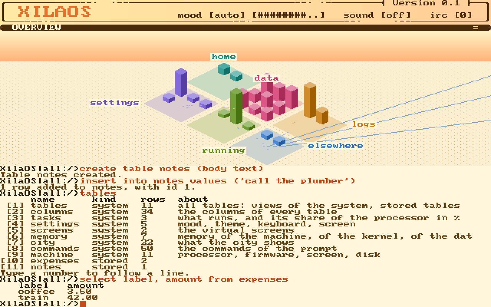
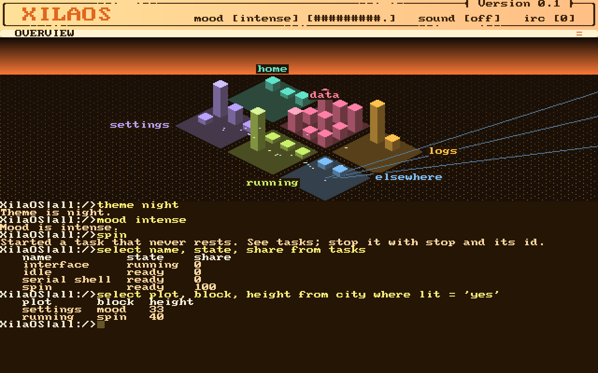
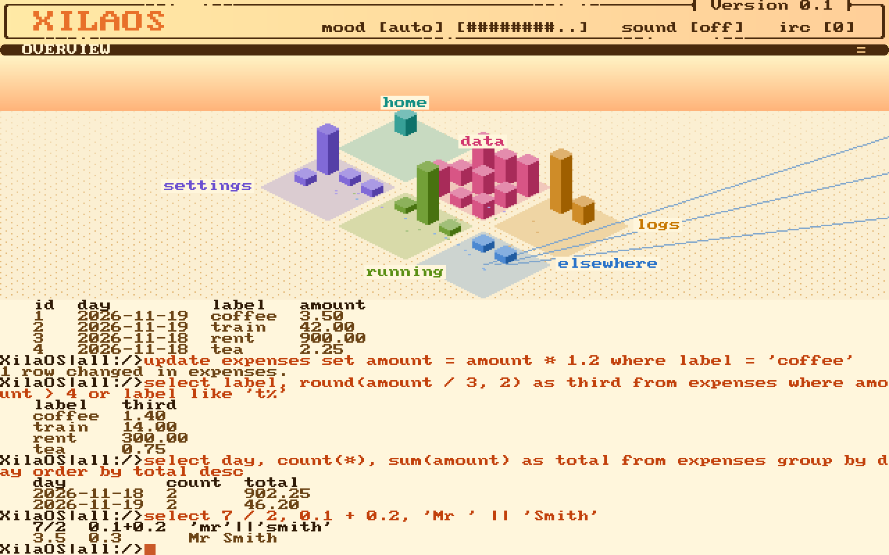
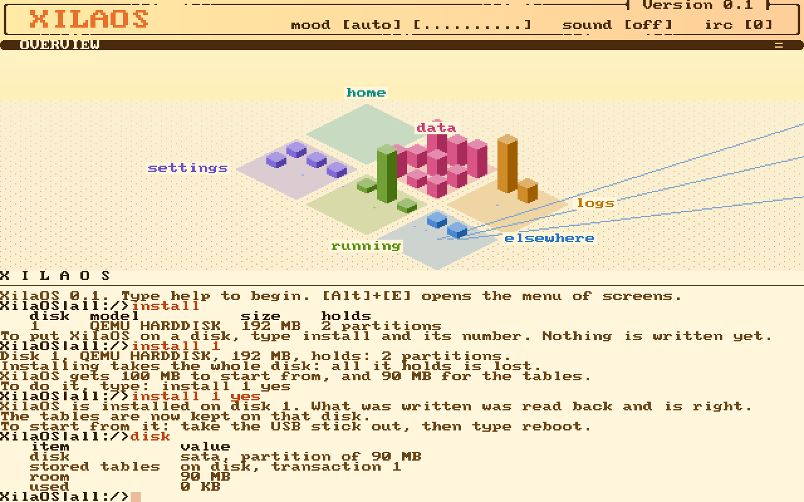
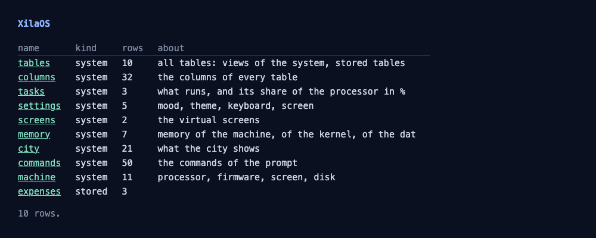

# XilaOS

A hobby operating system for x86-64 PCs, written from scratch in Rust,
that is not a Unix: **a database sits at the core of the system, there
are no files, and SQL is typed straight at the command prompt.**



It boots as a UEFI application in QEMU and on a real laptop (a Lenovo
ThinkPad T430), installs itself on the disk, keeps its tables through
a power cut, and talks TCP on a cable. The city at the top of the
screen is not decoration: every block is something real, one tower per
task, as tall as its share of the processor.

> **Status: in development, as a hobby.** The first version was built
> over two days in November 2026 and published as XilaOS 0.1; work
> resumed on 23 November 2026, with no schedule and no promise. Do not
> run it on a machine whose data matters: `install` erases a whole
> disk, and what it opens to the network is not encrypted.

**Full documentation:** [docs/](docs/README.md), or as one file,
[docs/xilaos.pdf](docs/xilaos.pdf).

## What it does

```sql
create table expenses (day text, label text, amount decimal)
insert into expenses values (today, 'coffee', 3.5), (today, 'train', 42)
select label, round(amount / 3, 2) as third from expenses where amount > 4
select name, share from tasks order by share desc
```

```
on insert into expenses
    if new.amount > 50
        notify alerts, 'big expense: ' + new.label
    end
end
```

- **A storage engine instead of a file system.** Copy-on-write B-trees
  on 4 KB pages, a checksum in every page, commits that are a single
  write. Tested with the power cut at every write.
- **SQL at the prompt**: `SELECT` with expressions, `GROUP BY` and
  aggregates; `CREATE TABLE`, `INSERT`, `UPDATE`, `DELETE`; exact
  decimals; `LISTEN` / `NOTIFY`.
- **The system as tables**: `tasks`, `memory`, `machine`, `settings`,
  `city`... are views of live state.
- **XilaScript**, the language of the prompt: variables, conditions,
  loops, programs stored in the database, and programs that run by
  themselves when a table changes or on a schedule.
- **A character interface**, 80 by 50, drawn by the system with the
  font of V2_OS, driven by the keyboard only, with day and night
  themes.
- **A preemptive kernel** in stable Rust: tasks, memory, its own page
  tables, drivers for SATA, virtio, Intel Ethernet and the Intel HD
  Graphics of 2011-2012.
- **A network stack of its own**: ARP, IPv4, ICMP, UDP, DHCP, DNS, TCP,
  and TLS 1.3 for what it asks of the Internet; a prompt over the
  network; the tables as read-only web pages.
- **A companion**, Xila: `ask how many tasks are running?`. A model of
  the Internet answers, reads the tables of the machine to do so, and
  changes them when asked; what it does is written in a table, and
  `companion off` stops it.
- **Self-installation**: `install` partitions a disk, writes a FAT32
  start-up partition and reads it all back.

| | |
|---|---|
|  |  |
|  |  |

## Try it

You need QEMU (`brew install qemu`) and either Rust from rustup with
the target `x86_64-unknown-uefi`, or Docker (the build script then
compiles in a container).

```sh
tools/run.sh              # builds, then opens XilaOS in a QEMU window
```

The terminal you ran it from becomes the serial port, with the same
prompt as the screen. `Ctrl+A` then `X` quits. Type `help` to begin;
[Getting started](docs/02-getting-started.md) has a first session and
the steps for a real machine.

```sh
cargo test -p xila-core -p xila-db -p xila-tls   # about 300 unit tests, on the host
tools/build.sh && python3 tools/check.py    # more than 300 checks of the whole system, in QEMU
```

## Architecture

About 36,000 lines of Rust in four crates. The fourth, `tls/`, is TLS
1.3 for the pages XilaOS asks for; it is the only one that rests on
libraries from elsewhere, for the arithmetic and for the checking of
certificates.

```text
 ┌──────────────────────────────────────────────────────────────────┐
 │ kernel/   xila-kernel    the machine                             │
 │ UEFI boot, interrupts, tasks, memory, page tables, the screen,   │
 │ drivers: PS/2, serial, PCI, virtio, AHCI, e1000, Intel graphics  │
 └───────────────┬──────────────────────────────────┬───────────────┘
                 │ scancodes, bytes, frames, ticks  │ a disk
                 ▼                                  │
 ┌────────────────────────────────────────────┐     │
 │ core/   xila-core    all the logic         │     │
 │ interface, shell, SQL, XilaScript, events, │     │
 │ city, network stack, TCP, GPT, FAT, QR...  │     │
 │ no hardware, no heap, tested on the host   │     │
 └───────────────┬────────────────────────────┘     │
                 │ tables, rows, transactions       │
                 ▼                                  ▼
 ┌──────────────────────────────────────────────────────────────────┐
 │ db/   xila-db    the storage engine                              │
 │ copy-on-write B-trees on the pages of a volume; knows no SQL     │
 └──────────────────────────────────────────────────────────────────┘
```

- **`db/`** keeps tables of typed records and changes them in
  transactions. Pages are never overwritten while something points at
  them; a commit is the write of one header page, so a power cut leaves
  the old state or the new one. Free pages are found again at start by
  walking the trees. See [The storage engine](docs/08-storage.md).
- **`core/`** is everything that can be decided without touching the
  machine, which by design is most of the system. It uses fixed-size
  buffers only and runs under `cargo test` on the development machine:
  the SQL engine, the language, the interface, TCP against a simulated
  peer, the partition tables. See [Architecture](docs/06-architecture.md).
- **`kernel/`** is a UEFI application with no boot loader. It takes the
  machine from the firmware, runs up to eight preemptive tasks switched
  100 times per second, polls its devices, and copies the character
  grid that `core` produces to the screen. See
  [The kernel](docs/07-kernel.md).
- **`tools/`** builds, runs and checks. The same shell runs on the
  serial port in a format a program can read, and `tools/xq.py` drives
  QEMU through it: commands, keys, the characters on the screen,
  screenshots. See [Development and testing](docs/12-development.md).

## What it is not

There are no programs outside the kernel, no memory protection, one
processor core, no USB, no sound, no Wi-Fi, no encryption of what it
serves to the network, no indexes in SQL. The plan is larger: a virtual machine for programs,
applications as isolated zones with access lists, a mirrored disk, an
encrypted protocol between machines.
[Status and roadmap](docs/13-status-and-roadmap.md) says what is built,
what is not, what is designed on paper, and holds the work plan.

## How it was made

XilaOS is written by its author together with Claude, Anthropic's AI
model, through Claude Code. Most of the code and of the documentation
is written by the model; the author sets the direction, makes the
decisions and tries each step on the real machine. The system was
shaped for that from the first day: a serial shell that a program can
read, and a check for every behavior. [`CLAUDE.md`](CLAUDE.md) is the
briefing the model works from.

## Licence

XilaOS is free software under the GNU Affero General Public License,
version 3 or later. The full text is in [`LICENSE`](LICENSE).

What the repository holds from other authors keeps its own licence:

- The font (`core/src/font.rs`) comes from V2_OS, published under the
  GNU GPL version 2 or later.
- The mock-up (`docs/mockup/`) bundles three.js (MIT) and the
  Silkscreen and VT323 fonts (SIL Open Font License). Their licences
  are in `docs/mockup/trame-0.3/licences/`.
