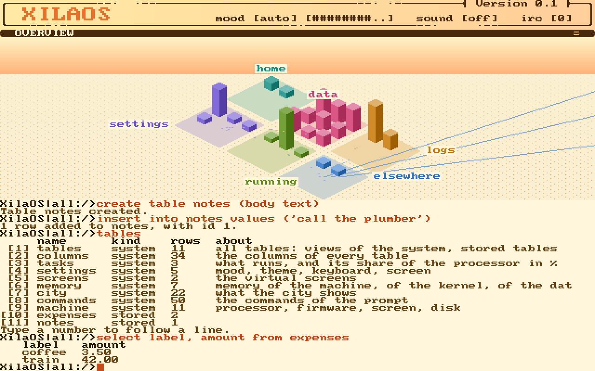

# Overview

XilaOS is a hobby operating system for x86-64 PCs, written from scratch
in Rust. It is not a Unix. Its model is the AS/400: a database sits at
the core of the system, there are no files, and SQL is typed straight
at the command prompt.

It starts on a real machine (a Lenovo ThinkPad T430), installs itself
on the disk, keeps its tables through a power cut, talks TCP on a
cable, and draws a small city that shows what the system is doing.

The first version was built over two days in November 2026 and
published as XilaOS 0.1. Development resumed on 23 November 2026, as a
hobby, with no schedule. This documentation describes what exists, how
it works inside, and what is planned and not built yet.

## The idea

Three decisions set XilaOS apart from the usual hobby kernel:

1. **The database is the file system.** The disk belongs to a storage
   engine with transactions. Everything that lasts is a row of a table:
   the user's data, the programs, the settings. A power cut leaves the
   tables as they were before the last change or as they are after,
   never in between.
2. **The prompt speaks SQL and a small language of its own.** `select`,
   `insert`, `create table` are commands like `help`. Around them,
   XilaScript adds variables, conditions, loops and stored programs,
   and programs that run by themselves when a table changes
   (`on insert into expenses`) or on a schedule (`every day at 8:00`).
3. **The system describes itself in tables.** Tasks, memory, settings,
   the machine, the city: each is a table that shows live state.
   `select name, share from tasks order by share desc` is how you ask
   what runs.

The interface is made of characters, 80 columns by 50 rows, drawn by
the system itself in a graphics mode with the 8x8 font of V2_OS, and
driven by the keyboard only.

## What works

| Area | What exists |
|---|---|
| Boot | A UEFI application: no boot loader. Starts from a USB stick, from a disk, or from the network cable. |
| Kernel | Preemptive kernel tasks, a page allocator and a heap, its own page tables, a 100 Hz timer. Written in stable Rust with no external crate. |
| Interface | Header, title bar, virtual screens (`Alt`+digit), a menu, a terminal with history, completion and numbered rows; day and night themes; `us` and `fr` keyboards. |
| The city | An isometric picture of the live system above the terminal: one tower per task, as tall as its share of the processor; blocks for tables, settings, logs, the network. |
| Storage | Copy-on-write B-trees on 4 KB pages, checksums on every page, commits that are one write. On a virtio disk (QEMU) or on a GPT partition of a SATA disk. |
| SQL | `SELECT` with `WHERE`, `ORDER BY`, `GROUP BY`, aggregates and expressions; `CREATE TABLE`, `DROP TABLE`, `INSERT`, `UPDATE`, `DELETE`; exact decimals; `LISTEN` / `NOTIFY`. |
| XilaScript | `let`, `say`, `if`, `while`, `for row in select ...`, stored programs, `on` and `every` programs. |
| Install | `install` partitions a disk, writes a FAT32 start-up partition with the kernel in it, and reads everything back. |
| Network | Intel e1000-family cards; ARP, IPv4, ICMP, UDP, DHCP, TCP; a prompt over the network; read-only web pages of the tables; fetching a new kernel by TFTP. |
| Graphics | Write-combined framebuffer with a prepared picture; on the Intel HD Graphics of 2011-2012, tear-free page flipping and panel brightness. |
| Tooling | The same shell on the serial port, in a format a program can read; a Python driver for QEMU; more than 200 unit tests and more than 300 whole-system checks. |

## What does not exist

The plan is larger than what is built. None of the following exists
yet:

- programs outside the kernel, and the virtual machine they are to be
  compiled for;
- applications as isolated zones with access control lists;
- TLS, or encryption of any kind: the network prompt and the web
  pages send everything in clear on the local network;
- sound, USB, Wi-Fi, NVMe, ACPI (so no clean power-off);
- indexes, `BEGIN` / `COMMIT`, and values larger than 48
  characters in SQL;
- more than one processor core.

[Status and roadmap](13-status-and-roadmap.md) has the full list, the
designs that were written for some of these, and the work plan.

## Where it runs

- **QEMU**, with the UEFI firmware it ships. This is the development
  machine: everything is built and checked there.
- **A Lenovo ThinkPad T430** (2012, Core i5-3320M, Intel HD Graphics
  4000, Intel 82579 Ethernet, SATA disk). It started from a USB stick,
  installed itself on the disk, started from the disk, started from the
  network, got an address by DHCP and served its tables to a browser.
  It is the only real machine XilaOS has run on.

Another PC needs UEFI with secure boot off, a PS/2 keyboard (the
internal keyboard of most laptops), and for a disk an AHCI SATA
controller. Nothing is promised there.

## How it was built

XilaOS has been written since November 2026 by its author together
with Claude, Anthropic's AI model, working through Claude Code. Most of
the code and of this documentation is written by the model; the author
sets the direction, makes the decisions, and tries each step on the
real machine.

One requirement shaped the system from the first day: it must work well
in QEMU with a shell on the serial port, so that an AI can run
commands, develop and test. That is why every command answers on the
serial port in a format a program can read, why `peek` returns the
characters on the screen, and why every feature has a check in
`tools/check.py`. On the T430, which has no serial port in use, a `qr`
command shows the output of any command as a QR code so that it can be
read off the screen with a phone.

The look comes from two places: V2_OS, an operating system written
entirely in assembly, whose 8x8 font and screen layout are used here,
and an interactive web mock-up called Trame, kept in
`docs/mockup/trame-0.3/`.

## Reading this documentation

| Chapter | For |
|---|---|
| [Getting started](02-getting-started.md) | Building, running in QEMU, a first session, a real machine. |
| [Using XilaOS](03-using-xilaos.md) | The screen, the keys, every command. |
| [The database and SQL](04-sql.md) | Tables, types, statements, events. |
| [XilaScript](05-xilascript.md) | The language of the prompt. |
| [Architecture](06-architecture.md) | The three crates and how the pieces fit. |
| [The kernel](07-kernel.md) | Boot, memory, interrupts, tasks, drivers. |
| [The storage engine](08-storage.md) | The database that stands in for a file system. |
| [Disk layout and installation](09-disk-layout-and-install.md) | Partitions, the start-up partition, `install`. |
| [Networking](10-networking.md) | The stack, TCP, the remote prompt, the web pages. |
| [Hardware and graphics](11-hardware.md) | Drivers, the display path, the Intel chip. |
| [Development and testing](12-development.md) | The serial protocol, the tools, the checks. |
| [Status and roadmap](13-status-and-roadmap.md) | What is done, what is not, what is designed, the work plan. |

## Licence

XilaOS is free software under the GNU Affero General Public License,
version 3 or later. The font in `core/src/font.rs` comes from V2_OS,
published under the GNU GPL version 2 or later. The mock-up bundles
three.js (MIT) and the Silkscreen and VT323 fonts (SIL Open Font
License); their licences are next to it.
