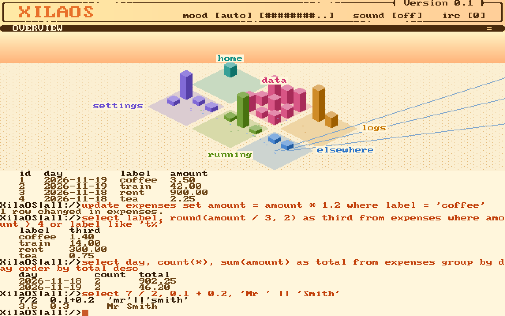
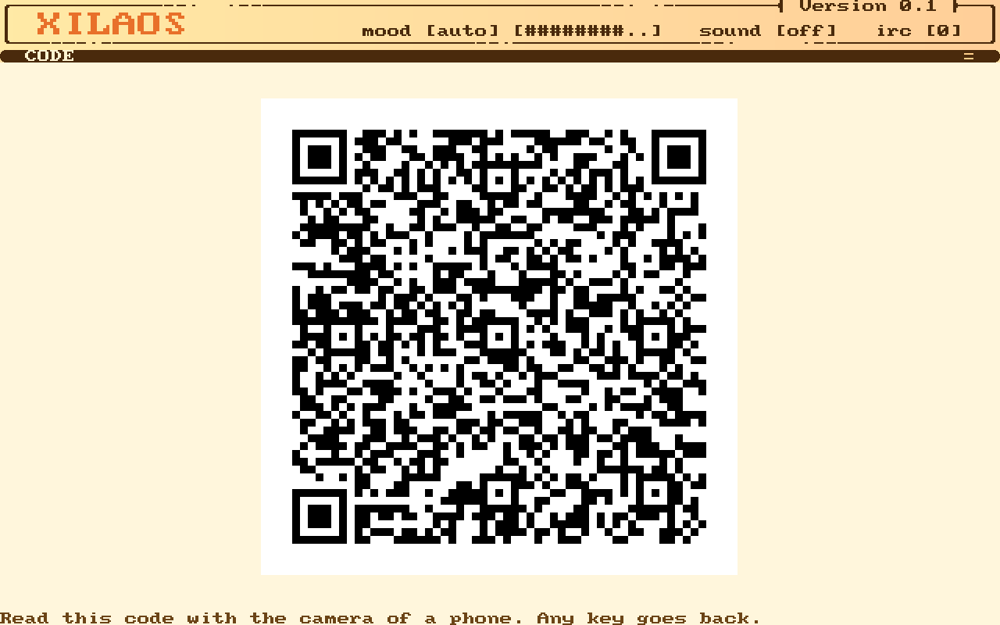

# Getting started

This chapter builds XilaOS, starts it in QEMU, goes through a first
session, and then puts it on a real machine.

## What you need

- **QEMU** with the UEFI firmware it ships (`edk2-x86_64-code.fd`). On
  macOS: `brew install qemu`. Set `XILA_FIRMWARE` to the path of the
  firmware if it is somewhere else.
- **Rust**, in one of two ways:
  - rustup with the target added: `rustup target add x86_64-unknown-uefi`;
  - or Docker. Without that target, `tools/build.sh` makes a small image
    named `xilaos-build` (the official Rust image with the target) and
    compiles in it.
- **Python 3** for the test tools. Nothing to install: they use the
  standard library only. Two checks that compare screenshots use Pillow
  when it is there.

The tools were written and used on macOS. The build and QEMU parts
should work on Linux; `tools/qr.swift` and the screenshot conversion
(`sips`) are macOS only, and the checks that need them are skipped or
fall back to PPM files elsewhere.

## Build and run

```sh
tools/run.sh
```

This compiles the kernel to `build/esp/EFI/BOOT/BOOTX64.EFI` and opens
XilaOS in a QEMU window. The terminal the command was run from becomes
the serial port: it shows the boot log and the same prompt as the
screen. `Ctrl+A` then `X` quits QEMU.

The machine's disk is the file `build/data.img`, made at the first run.
The tables stay there from one run to the next; remove the file to
start from nothing.

```sh
tools/build.sh            # only build
python3 tools/xq.py       # start without a window, print the boot log, stop
```

`cargo build` for the whole workspace does not work on the host,
because the kernel only builds for UEFI. Name the package:
`cargo test -p xila-core -p xila-db`.

## A first session

The keyboard starts as QWERTY (`us`); `keymap fr` switches to AZERTY.
`help` lists where to go next. `Alt+1` shows the boot log, `Alt+0`
comes back to the overview, `Alt+E` opens the menu of screens.

The database first. Type each line at the prompt:

```sql
create table expenses (day text, label text, amount decimal)
listen expenses
insert into expenses values (today, 'coffee', 3.5), (today, 'train', 42)
select sum(amount) from expenses
update expenses set amount = amount * 1.2 where label = 'coffee'
select label, round(amount / 3, 2) as third from expenses where amount > 4 or label like 't%'
select 7 / 2
```

`listen expenses` makes the session hear every change of the table:
each insert and update above prints an event. `select 7 / 2` answers
3.5: division is the calculator's, and decimals are exact.



The system describes itself in tables too:

```sql
tables
select name, state, share from tasks
select * from memory
```

Then the language of the prompt, XilaScript:

```
let total = select sum(amount) from expenses
program report
    for row in select label, amount from expenses order by amount desc
        say row.label + ' ' + row.amount
    end
    say 'Total: ' + total
end
report

on insert into expenses
    if new.amount > 50
        notify alerts, 'big expense: ' + new.label
    end
end
```

While a block is open the prompt becomes `..>` and nothing runs until
its last `end`. `report` is now a command, kept in the database like
any table: it is still there after a restart. The `on` program runs by
itself after every insert into `expenses`.

Stop QEMU, run `tools/run.sh` again: the table, the program and the
theme you chose are back.

More in [Using XilaOS](03-using-xilaos.md),
[The database and SQL](04-sql.md) and [XilaScript](05-xilascript.md).

## Check that everything works

```sh
cargo test -p xila-core -p xila-db          # logic and storage engine, on the host
tools/build.sh && python3 tools/check.py    # the whole system, in QEMU without a window
```

`check.py` takes a few minutes. It prints one line per check and exits
with status 1 if any failed.

To drive the system by hand without a window:

```sh
python3 tools/xq.py cmd:about type:help key:ret peek shot:build/shots/try
```

See [Development and testing](12-development.md).

## On a real machine

Everything below was tried on one machine, a Lenovo ThinkPad T430:
start from the stick, installation, start from the disk, start from
the network. On another PC nothing is guaranteed.

The kernel is a UEFI application. The PC must:

- start in UEFI mode, with **secure boot turned off**;
- have a PS/2 keyboard, which is what the internal keyboard of most
  laptops is (there is no USB driver, so a USB keyboard does nothing);
- for a disk, have its SATA controller in AHCI mode (the default on the
  T430);
- for the network, have an Intel Ethernet card of the e1000 family.

### Make a USB stick

```sh
tools/usb.sh              # builds, then makes build/xilaos-usb.img
```

The script touches no disk: it makes a file of 128 MB, to be copied as
it is onto the stick. On macOS, with the stick plugged in:

```sh
diskutil list                                    # find the stick by its size: /dev/diskN
diskutil unmountDisk /dev/diskN
sudo dd if=build/xilaos-usb.img of=/dev/rdiskN bs=1m
```

**A wrong `N` erases another disk of your computer.** Check the size
shown before running `dd`. Everything the stick held is lost.

Another way, without `dd`: format the stick as FAT32 and copy the
folder `EFI` from `build/esp` onto it.

Start the machine from the stick (`F12` at power-on on a ThinkPad).

### Install on the machine's disk

1. Started from the stick, XilaOS runs from memory. It cannot read the
   stick itself, but it kept a copy of the file it started from.
2. `install` lists the SATA disks, with their size and what they hold.
   Nothing is written.
3. `install 1` says what will be lost on disk 1 and what it will get.
   Nothing is written either.
4. `install 1 yes` erases the whole disk: a start-up partition of
   100 MB with XilaOS in it, and the rest for the tables. What was
   written is read back before the command says it is done.
5. Remove the stick and type `reboot`: the machine starts from its
   disk.

**`install 1 yes` destroys everything on that disk**, other systems
included.

To put a newer kernel on the disk without losing the tables: make the
stick again, start from it (XilaOS finds the tables on the disk), then
type `install system`. Only the start-up partition is rewritten.

If the machine does not start from the disk afterwards, check in the
firmware's setup that the disk is in the start-up list and that UEFI
mode is allowed. XilaOS adds no start-up entry: it relies on the path
every UEFI firmware tries by itself, `\EFI\BOOT\BOOTX64.EFI`.

How `install` works inside is in
[Disk layout and installation](09-disk-layout-and-install.md).

### Give XilaOS only a partition

Without `install`, XilaOS writes only in a partition marked for it.
The rest of the disk, other systems and their data are never touched,
even on a disk that looks empty. This keeps another system on the same
disk, but XilaOS must then be started from the stick each time.

1. The disk must have a GPT partition table. MBR tables are not read.
2. Make a partition of the type
   `04DA9601-6187-4182-88FE-27F226C8DEE9`. From a Linux, for 20 GB in
   the free space of `/dev/sda`:

   ```sh
   sgdisk --new=0:0:+20G --typecode=0:04DA9601-6187-4182-88FE-27F226C8DEE9 /dev/sda
   ```

3. Start XilaOS. The boot log (`Alt+1`) says what it found, for
   example `Disk ................ sata, Samsung SSD 840, partition of 20 GB`.
4. A partition cut out of a disk that was in use holds old data:
   XilaOS refuses it and keeps its tables in memory. `disk erase` says
   what will be lost, `disk erase yes` gives it the partition.

A wrong partition number at step 2 therefore destroys nothing: XilaOS
refuses a partition that holds something else until `disk erase yes`
is typed.

### Getting text out of the machine

The T430 has no serial port in use. `qr` followed by a command, for
example `qr display chip`, shows what the command says as a QR code. A
phone's camera reads it off the screen and the text is copied from
there. Any key brings the terminal back.



### Type commands from another computer

On the XilaOS machine, plugged into the local network by cable:

```
remote on
```

It shows a code and the line to type on the other computer:

```sh
python3 tools/remote.py 192.168.1.11 K7QD-2MXP          # a prompt
python3 tools/remote.py 192.168.1.11 K7QD-2MXP net      # one command
```

`remote off` closes the door; it is closed at every start.

**Nothing is encrypted.** The code and the commands travel in clear on
the local network, and whoever can read them there can use them. Open
it only on a network you trust. Only machines of the same local network
are answered, twenty wrong codes close the prompt, and neither
`install` nor `disk erase` is accepted there.

### See the tables in a browser

```
web on
```

It shows an address of the form `http://192.168.1.11/K7QD-2MXP/`, to
open in the browser of another computer of the same local network: the
list of tables, and for each its rows. The pages only read. `web off`
closes them; they are closed at every start. As with `remote`,
**nothing is encrypted**.

### Start from the network cable, without a stick

The PC and the development machine are on the same local network, one
whose router gives addresses; the PC is plugged in by cable.

```sh
tools/build.sh
python3 tools/netboot.py  # serves the kernel to machines that ask to start from the network; Ctrl+C stops
```

On the PC: in the firmware's setup, turn on starting from the network
in UEFI mode over IPv4, then choose the network card in the start-up
menu (`F12` on a ThinkPad). The script gives no address and answers
only machines that ask to start from the network: it tells them where
the file is, and hands it over. Each newly built kernel is served at
the PC's next start.

### Update the installed system without a stick

With `tools/netboot.py` running on the development machine (here at
`192.168.1.20`), on the XilaOS machine:

```
install from 192.168.1.20
install system
```

The first command fetches the system and shows its size and a check
number; `netboot.py` shows the same on its side. Nothing is written
yet. The second replaces the system on the disk XilaOS starts from,
without touching the tables. Nothing authenticates the server or the
file, so these two commands are only accepted at the machine itself,
never through the remote prompt.

All of this is described in [Networking](10-networking.md).
