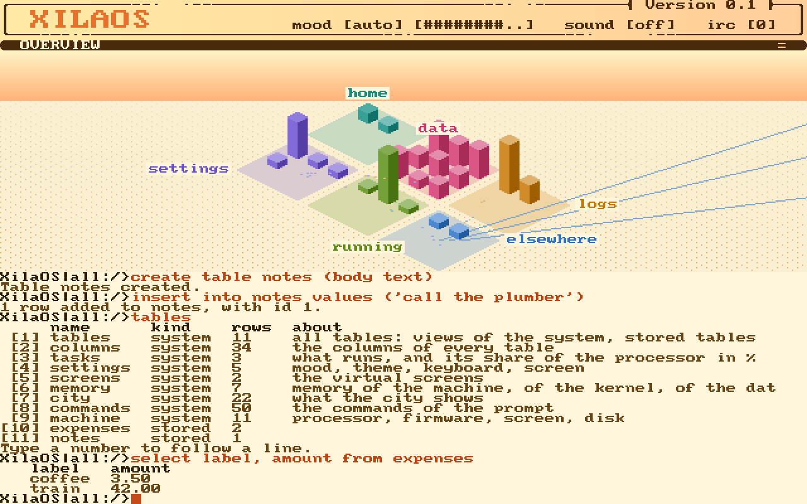
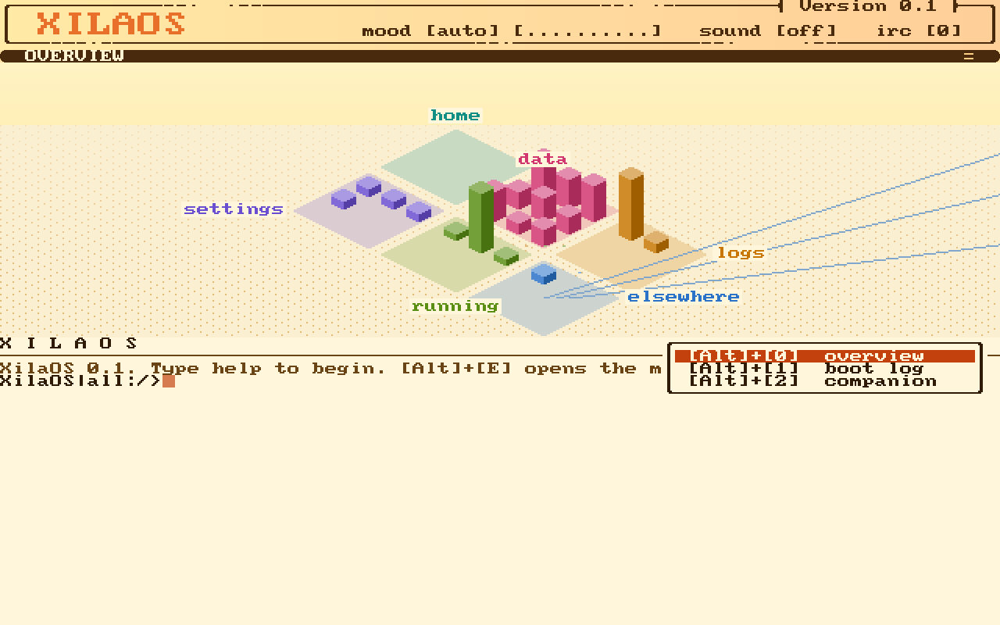
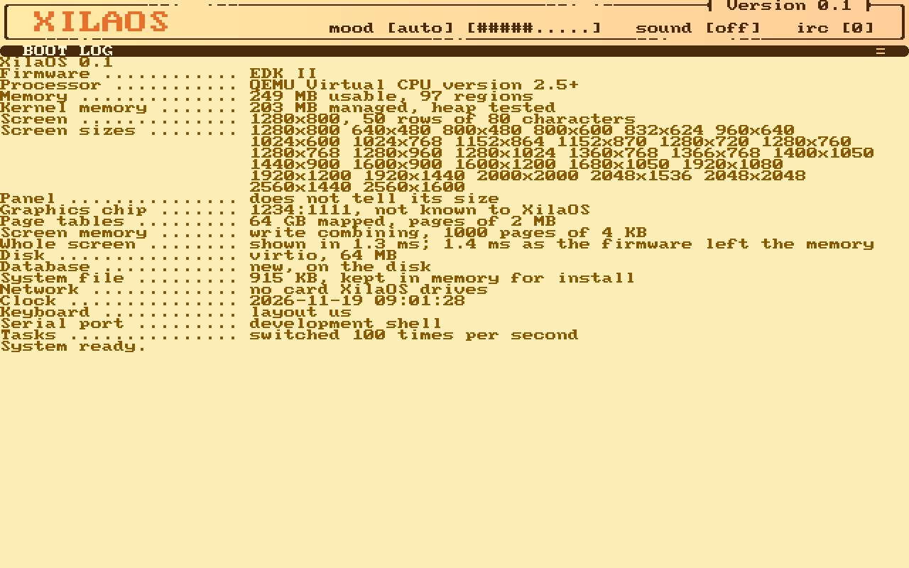
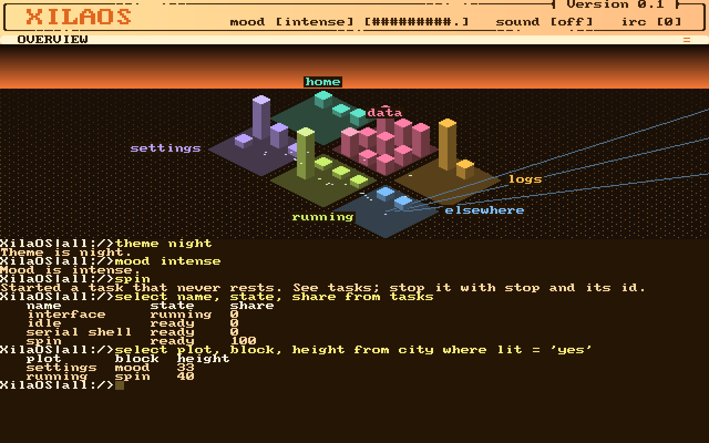
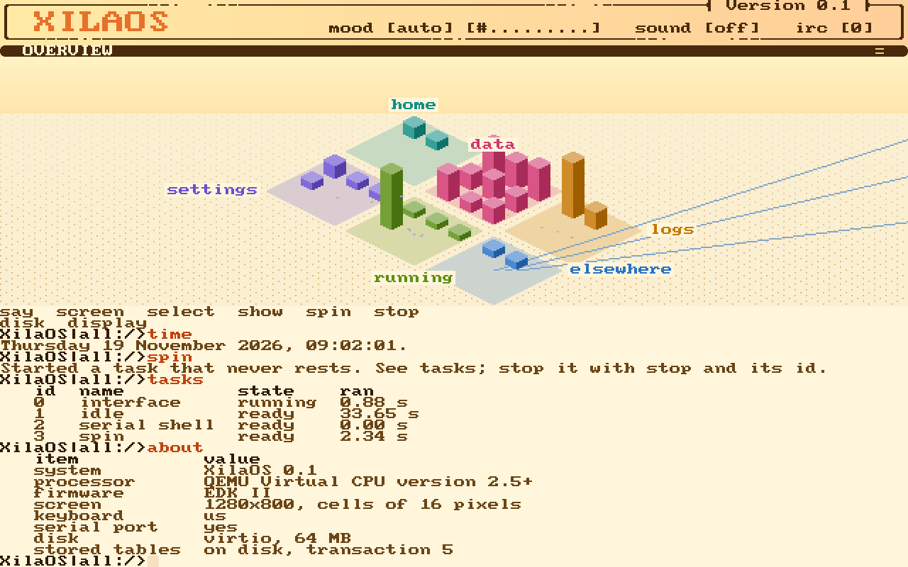

# Using XilaOS

XilaOS is driven by the keyboard only. There is no mouse, no window and no file
manager: one screen of characters, a prompt, and a small city that shows what
the system is doing. This chapter describes what is on the screen and what can
be typed. SQL has its own chapter ([SQL](04-sql.md)), and so has the language
of the prompt ([XilaScript](05-xilascript.md)).

Everything below was run in QEMU with the 0.1 kernel; the outputs are copied
from that run.

## The screen



The screen is a grid of 80 columns of characters, drawn by the system itself
with the 8x8 font of V2_OS. On a 1280x800 screen each cell is 16 pixels wide
and high, which gives 50 rows. On another size the grid stays 80 columns wide:
the largest whole number of screen pixels per font pixel that still leaves 40
rows is taken, and the grid then has as many rows as fit, 50 at most.

From top to bottom:

- **The header** (4 rows): a frame of dashes, the logo `XILAOS` in letters
  twice as large as the others, and a notch that holds `Version 0.1`. On its
  right is the state of the system: `mood [auto] [####......]` is the mood and
  its gauge (see [Mood](#mood)). `sound [off]` and `irc [0]` are fixed labels
  kept from the mockup the interface follows: XilaOS has no sound and no IRC.
- **The title bar** (1 row), dark with rounded ends: the name of the screen
  shown, `OVERVIEW` or `BOOT LOG`, and `CODE` while a QR code is displayed.
  When the prompt or the tables are open to the network, the right of the bar
  says so on every screen: `remote: open`, `web: open`, or the address of the
  machine that asked last (see [Networking](10-networking.md)).
- **The body**: on the overview, the city (22 rows) above the terminal; on the
  boot log, the log alone.

The terminal ends with the prompt:

```
XilaOS|all:/>
```

What is typed shows in orange after it, with a cursor that fades in and out.
Answers are brown, errors pink, the headers of tables and the events the prompt
listens to take the color of the prompt. While a block of the language is open
(`if`, `for`, `program`... without its `end`) the prompt becomes `..>`.

When the system starts, the terminal says:

```
X I L A O S
────────────────────────────────────────────────────────────────────────────────
XilaOS 0.1. Type help to begin. [Alt]+[E] opens the menu of screens.
```

## Screens and keys

There are two virtual screens:

| Key | Screen | What it holds |
|---|---|---|
| `Alt`+`0` | overview | The city and the prompt. |
| `Alt`+`1` | boot log | What the system found at start, then what the programs that run by themselves say. |

`Alt`+`E` opens the menu of screens at the top right of the body. `Up` and
`Down` move the selection, `Enter` shows the selected screen, `Esc` or
`Alt`+`E` again closes the menu.



The `screen` command does the same from the prompt: alone it lists the screens,
`screen 1` or `screen boot log` shows one.

The keys, all of them (`help k` lists them on the system):

| Key | Effect |
|---|---|
| `Alt`+`E` | Opens or closes the menu of screens. |
| `Alt`+`0`, `Alt`+`1` | Shows a screen. The digit is the one printed on the key, so no `Shift` is needed on a French keyboard. |
| `Alt`+`X` | Changes the mood: calm, auto, intense, and calm again. |
| `Esc` | Closes the menu; otherwise goes back to the overview. |
| `PgUp`, `PgDn` | Scrolls the terminal of the screen shown, a page at a time. |
| `Tab` | Completes the command being typed. |
| `Up`, `Down` | Recalls the lines already typed. |
| `Left`, `Right`, `Home`, `End` | Move the cursor in the line. |
| `Backspace`, `Delete` | Remove the character before the cursor, or under it. |
| `Enter` | Runs the line. |

On the boot log screen there is no prompt: only `PgUp`, `PgDn`, `Esc` and the
`Alt` keys do something there. While a QR code is on the screen, any key puts
it away and does nothing else.



## The prompt

### Editing a line

A line holds 160 characters. When it is longer than the row, it slides to the
left under the prompt so that the cursor stays in sight:

```
XilaOS|all:/>are > 0 or name = 'interface' or name = 'idle' order by share desc
```

The last 16 lines are remembered: `Up` goes back through them, `Down` comes
forward again and ends on an empty line. A line typed twice in a row is kept
once. The history is not kept between starts.

The terminal keeps 256 rows. `PgUp` and `PgDn` scroll through them; typing
anything brings the view back to the prompt. `clear` (or `cls`) empties it.

### Completion

`Tab` completes the first word of the line from the names of the commands and
of the words of the language. With one match the name is written, followed by
a space. With several, the line receives what they have in common and the
terminal lists them:

```
say  screen  select  show  spin  stop
XilaOS|all:/>s
```

Only the first word is completed: `Tab` does nothing once the line has a space,
and names of tables are not completed.

### Tables and numbered rows

Commands that return a list show it as a table: a header, then one row per
line. A table has at most 8 columns and 32 rows; a query that finds more says
how many rows are not shown.

Some tables number their rows. Typing the number alone runs the command the
row leads to, which is what replaces a click:

```
XilaOS|all:/>help
     topic   shows
 [1] help c  the commands
 [2] help l  XilaScript, the language
 [3] help k  the keys
Type a number to follow a line.
XilaOS|all:/>3
XilaOS keys:
   [Alt]+[E]             - Opens the menu of screens.
   ...
```

The tables with numbered rows are those of `help` (a topic), `tables` (a row
leads to `select * from` that table), `screen` (shows the screen) and
`programs` (shows the program). The numbers belong to the last such table
shown at that prompt: the screen, the serial port and the prompt over the
network each follow their own list. Before any list, a number answers
`There is no list to follow yet.`; past the last row, `That line leads
nowhere.`

### Help and mistakes

`help` (or `?`) lists three topics: `help c` the commands, `help l` the
language, `help k` the keys. A word the prompt does not know answers
`Unknown command: ` followed by the word. The names of commands are not
sensitive to case; the values of the settings are (`theme night`, not
`theme NIGHT`).

The same prompt answers on the serial port, and over the network once
`remote on` was typed (see [Networking](10-networking.md)). Each of the three
has its own variables and its own subscriptions to events.

## The city

The top of the overview is a picture of 640 by 176 points, redrawn 25 times
per second (30 on the T430, where the screen gives the rhythm). It is not
decoration: every block stands for something that exists in the system, and
its height follows a number of that thing. Blocks grow and shrink smoothly
towards their height, and a *lit* block, brighter and pulsing, is one that is
doing something right now.

There are six plots, of nine blocks at most each (three by three). A block is
4 to 40 points high.

| Plot | One block per | Height follows | Lit |
|---|---|---|---|
| `home` | table the user made | its number of rows | for 3 seconds after the table is read or changed |
| `settings` | `mood`, `theme`, `keymap`, `screen` | the mood's energy; the three others are low for the first choice (day, us, overview) and taller for the other | `mood`, while its energy is above zero |
| `logs` | `boot log`, `terminal`, and `events` while someone listens | the rows of the log, the rows of the terminal, the number of listeners | `events`, for 3 seconds after an event was sent |
| `data` | view of the system (`tables`, `tasks`, `memory`...) | its number of columns | for 3 seconds after a query reads it |
| `running` | task | the share of the processor it got in the last half second | when that share is 2 % or more |
| `elsewhere` | `serial port`, if the machine has one; `disk`, when the tables are kept on one | the traffic of the port; how full the disk is | the port while bytes go by; the disk for 3 seconds after a write |

Grains of light travel between `settings`, `logs`, `running` and `elsewhere`:
more of them, and faster, when the mood's energy is high or the serial port is
busy, in which case they go between `elsewhere` and `running`. The three lines
that leave `elsewhere` for the right edge are fixed. The sky above the horizon
warms up with the mood.

The `data` plot is full: there are nine views of the system and nine places.
A tenth stored table would not show on `home` either.

`city` returns the same scene as a table, which is how a program on the
serial port sees what the user sees. The view of the same name can be queried
(`select plot, block, height from city where lit = 'yes'`):

```
   plot       block         height  lit
   settings   mood          24      yes
   settings   theme         6
   settings   keymap        6
   settings   screen        6
   logs       boot log      40
   logs       terminal      6
   data       tables        24
   data       columns       20
   data       tasks         24
   data       settings      12
   data       screens       16
   data       memory        12
   data       city          20
   data       commands      8
   data       machine       12
   running    interface     5
   running    idle          40      yes
   running    serial shell  5
   elsewhere  serial port   6
   elsewhere  disk          6
```



## Settings

Four commands report a setting when typed alone and change it when given a
value. A wrong value answers with the choices (`Choose one of: day, night`).

| Command | Choices | Effect |
|---|---|---|
| `theme` | `day`, `night` | The colors of everything, city included. |
| `mood` | `calm`, `auto`, `intense` (or `c`, `a`, `i`) | See below. |
| `keymap` | `us`, `fr` | The keyboard layout: QWERTY or AZERTY. |
| `display brightness N` | 5 to 100 | The brightness of the panel, on the Intel graphics chips XilaOS knows (see [Hardware](11-hardware.md)). |

The view `settings` shows what is in use:

```
XilaOS|all:/>select * from settings
   name    value
   mood    auto
   energy  950
   theme   day
   keymap  us
   screen  overview
```

### Mood

The mood is one number, the energy, from 0 to 1000; the gauge of the header
shows it in ten marks. In `auto` every key adds 30 and every command 50, and
the energy falls back to zero in five seconds when nothing is typed. `calm`
holds it at 100 and `intense` at 900, reached within a second. The mood is
only shown: it warms the sky of the city, raises the `mood` block and sends
more grains of light. Nothing else depends on it.

### Keyboard layout

The system starts in `us`. `keymap fr` gives a French AZERTY keyboard, with
the accented letters the font has and `AltGr` for ``~ # { [ | ` \ ^ @ ] }``.
`Caps Lock` works on letters. The key right of `P` is a dead key, as on any
French keyboard: the circumflex, or the diaeresis with `Shift`, goes on the
letter typed next, for the letters the font has with that accent (`a e i o
u` in small letters; with the diaeresis also `y`, `A`, `O`, `U`). Before a
space the accent comes alone, before any other key it comes first, and
`Backspace` takes it back. The font has no diaeresis alone: a double quote
stands for it. There is no other layout.
Only a PS/2 keyboard is read, which is what the internal keyboard of most
laptops is.

### Settings kept between starts

When the tables are kept on a disk, the theme, the mood, the keyboard layout,
the brightness and the way pictures reach the screen are found again at the
next start. Nothing has to be asked: at every tick of its timer the system
compares what is in use with what it last wrote, and writes what differs into
the stored table `kept_settings`, whoever changed it (a command, a key, a
program).

```
XilaOS|all:/>theme night
Theme is night.
XilaOS|all:/>select * from kept_settings
   id  name   value
   1   theme  night
```

The table does not exist until a setting has been changed, and a setting that
was never chosen has no row. At the next start the boot log says how many were
found:

```
Settings ............ 3 kept from before, in the table kept_settings
```

Without a disk the tables live in memory, and the settings are lost with them.

## Keys to services

A service of the Internet is opened by a key: a long word that says who
asks, and pays for what is asked. `key set` keeps one under a name:

```
XilaOS|all:/>key set openrouter ********
The key openrouter is kept. It is never shown.
XilaOS|all:/>key
   name        key
   openrouter  kept, never shown
```

The stars are what the screen shows of the line once it is entered: the
key itself is what was typed. The line is not kept in the history of
the prompt either. `key forget openrouter` forgets it.

A key is never shown again, by anything. `key` lists names only. SQL
does not know the table keys are kept in: it is not listed, and cannot
be read, changed, dropped or made, so neither a `select`, a program,
the pages for browsers nor the companion can show a key. From the
prompt over the network `key set` is refused, since the key would have
crossed the network in clear to get there.

What this is not: a vault. The disk is not encrypted, and a key is
written on it as it was typed, for whoever reads the disk from another
system. On the serial port, the line that sets a key is echoed like
any other.

## Looking at the system



### about, mem, uptime, time

`about` says what the system is and what it runs on:

```
   item           value
   system         XilaOS 0.1
   processor      QEMU Virtual CPU version 2.5+
   firmware       EDK II
   screen         1280x800, cells of 16 pixels
   keyboard       us
   serial port    yes
   disk           virtio, 64 MB
   stored tables  on disk, transaction 5
```

`mem` gives the memory, from the map the firmware handed over and from the
kernel's own count:

```
   kind                   size
   usable                 250 MB
   kept by the firmware   5 MB
   managed by the kernel  204 MB
   free                   203448 KB
   kernel heap in use     4549152 bytes
   regions in the map     97
```

`uptime` answers `Up for 23.06 s.` `time` gives the date and the time:

```
Thursday 19 November 2026, 09:02:01.
```

The time is what the machine's battery clock says, as it is: no time zone, no
daylight saving. XilaOS reads it at start and once a minute, and does not set
it; that is done in the firmware's settings. If the clock holds no valid date,
`time` answers `The clock of this machine does not tell the time.` In QEMU
the clock is the host's, in UTC.

### tasks, spin, stop

`tasks` lists the kernel's tasks, their state and the processor time each one
had:

```
XilaOS|all:/>tasks
   id  name          state    ran
   0   interface     running  0.88 s
   1   idle          ready    33.65 s
   2   serial shell  ready    0.00 s
   3   spin          ready    2.34 s
```

`spin` starts a task that never rests. It is a test: it shows that the others
keep running, and it raises a tower on the `running` plot. `stop 3` stops the
task of that id. The tasks of the system cannot be stopped (`The system needs
that task.`), and there is room for eight tasks in all. The view `tasks` adds
the share of the processor each one got, in percent
(`select name, share from tasks`).

### devices

`devices` lists what the PCI bus of the machine holds and which parts XilaOS
drives:

```
   place    kind                     maker_model  class   driver
   00:00.0  bridge to the processor  8086:29c0    060000  none
   00:01.0  graphics                 1234:1111    030000  none
   00:02.0  disks                    1af4:1001    010000  XilaOS
   00:1f.0  bridge to old devices    8086:2918    060100  none
   00:1f.2  SATA disks               8086:2922    010601  XilaOS
   00:1f.3  bus of small sensors     8086:2930    0c0500  none
```

On an unknown PC this is the first thing to look at.
[Hardware](11-hardware.md) says what is driven and what is not.

### disk

`disk` says where the stored tables are and how much room they have:

```
   item           value
   disk           virtio, 64 MB
   stored tables  on disk, transaction 1
   room           64 MB
   used           0 KB
   pages read     0
```

`pages read` counts the pages that reading and changing the tables went
through since the start, whether the disk gave them or they were still in
memory: read it before and after a query to see what the query cost.

`disk check` reads every page of every stored table and checks it: its
checksum, the order of its tree, the count of its rows. It changes nothing.

```
XilaOS|all:/>disk check
The tables were read whole: 12 pages (48 KB), every one is right.
```

A page that cannot be read or does not hold what its checksum says stops
the check, which names it: `The database is damaged: page 7 cannot be
read.` The machine does nothing else while it reads.

`disk erase` and `install` take a disk for XilaOS; both are described in
[Disk layout and installation](09-disk-layout-and-install.md).

### display

`display` reports how the screen is drawn and how fast:

```
   item                value
   screen              1280x800, cells of 16 pixels
   screen memory       write combining
   pictures change     while the screen is swept
   rhythm              a picture every 4 ticks, 100 ticks a second
   whole screen        1.2 ms to show, at the start
   the firmware's way  1.3 ms to show, at the start
   pictures shown      34 in the last second
   longest picture     10.8 ms
   city                5.3 ms to draw one picture
   pictures skipped    0 since the start
```

`display test` times the drawing and the showing of a whole screen
(`The whole screen: drawn in 4.9 ms, shown in 1.3 ms (best of 5).`). The other
forms, `display chip`, `display registers`, `display flip on|off|try` and
`display brightness`, concern the graphics chip and are covered in
[Hardware](11-hardware.md). In QEMU, which imitates no such chip, they answer
`The graphics chip, 1234:1111, is not one XilaOS knows how to read.`

### peek

`peek` writes the characters that are on the screen, one line per row. It is
meant for the serial port: a program that drives the system there sees what
the user sees, and the checks of the repository use it. The city and a QR
code are pictures, not characters, and show as empty rows.

### reboot

`reboot` answers `Restarting.` and restarts the machine. There is no command
to switch it off: the power button does that. A change to a table is safe on
the disk as soon as its command has answered, so cutting the power loses
nothing that was confirmed.

## Text out of the machine: qr

A laptop without a serial port has one way to hand a long text to another
machine: its screen. `qr` followed by any command runs the command, keeps
what it says, and shows it as a QR code in place of the body of the screen:

```
XilaOS|all:/>qr about
A code of 205 characters is on the screen.
```


A phone's camera reads the code, and the text can be copied from there. Lines
are kept as lines, and the cells of a table are separated by tabs. Any key
puts the code away and brings the terminal back.

The code is as large as the screen allows while keeping dots that a camera can
still tell apart: at least two screen points per dot. On a screen of 50 rows
it holds 2,563 characters (`qr help c`, 2,368 characters, fits), on one of 40
rows 1,465; a QR code cannot hold more than 2,953. When a command says more,
the end is dropped and the answer tells how much (`The last N did not fit.`).
A command that says nothing gives no code.

## Command reference

These are all the words the prompt completes. Words are in English and are not
sensitive to case. `?` is another name for `help`, and `cls` for `clear`.

### Help and screen

| Command | What it does |
|---|---|
| `help [c\|k\|l]` | Lists the topics of the help, or shows one: commands, keys, language. |
| `screen [n]` | Lists the screens, or shows screen `n` (a number or a name). |
| `clear` | Empties the terminal. |
| `theme [day\|night]` | Says or changes the colors. |
| `mood [calm\|auto\|intense]` | Says or sets the mood. Auto follows the typing. |
| `keymap [us\|fr]` | Says or changes the keyboard layout. |
| `key`, `key set name key`, `key forget name` | Lists the keys to services by name; keeps one; forgets one. A key is never shown. |
| `ask question` | Asks the companion, which reads the tables to answer. See [The companion](14-the-companion.md). |
| `companion` | Who the companion is, and what it is doing. |
| `qr command` | Runs a command and shows what it says as a QR code. |
| `peek` | Writes the characters on the screen, one line per row. |

### The machine

| Command | What it does |
|---|---|
| `about` | What the system is and what it runs on. |
| `mem` | Memory: usable, kept by the firmware, managed by the kernel, free. |
| `devices` | The parts of the machine, and which are driven. |
| `time` | The date and the time, by the machine's clock. |
| `uptime` | Time since the system started. |
| `tasks` | The tasks, their state and the time each one ran. |
| `spin` | Starts a task that never rests (a test). |
| `stop n` | Stops task `n`. |
| `city` | The blocks of the city, their heights, and which are lit. |
| `display [test]` | How the screen is drawn and how fast; `test` times a whole screen. |
| `display chip`, `registers`, `flip on\|off\|try`, `brightness [n]` | The Intel graphics chip: see [Hardware](11-hardware.md). |
| `reboot` | Restarts the machine. |

### Disks and installation

See [Disk layout and installation](09-disk-layout-and-install.md).

| Command | What it does |
|---|---|
| `disk` | Where the stored tables are kept, and how full. |
| `disk check` | Reads every page of the stored tables and says whether each is right. |
| `disk erase [yes]` | Gives XilaOS a partition it found and refused because it held something else. |
| `install [n [yes]]` | Lists the disks; with a number, puts XilaOS on that whole disk. |
| `install system` | Rewrites the start-up partition only; the tables stay. |

### Network

See [Networking](10-networking.md).

| Command | What it does |
|---|---|
| `net` | The network card, the cable, the address, the counters. |
| `net ping address`, `net get place`, `net restart`, `net registers` | Asks another machine to answer; fetches a page (through TLS when the place starts with `https://`); sets the card up again; lists its registers. |
| `net post place 'text'` | Sends a text to a page of another machine, and shows what it answers. |
| `net name name`, `net names address` | Finds the address of a machine known by its name; sets who is asked for names. |
| `remote [on\|off]` | Opens this prompt to the local network, or closes it. |
| `web [on\|off]` | Shows the tables to browsers of the local network, or stops. |
| `install from address` | Fetches a newer system from a machine that serves it. |

### Tables and events

See [SQL](04-sql.md).

| Command | What it does |
|---|---|
| `tables` | Lists the tables: the views of the system and the stored ones. |
| `select` | Reads a table. |
| `create`, `drop` | Makes a table (`create table`), removes one (`drop table`). |
| `insert`, `update`, `delete` | Adds, changes and removes rows. |
| `listen [channel]`, `unlisten [channel]` | Starts and stops being told when a table changes or a `notify` is sent. |
| `notify channel ['text']` | Sends an event to those who listen. |

### The language

See [XilaScript](05-xilascript.md).

| Word | What it does |
|---|---|
| `let`, `say` | Keeps a value under a name; shows a value. |
| `if`, `else`, `while`, `for`, `end` | The blocks: conditions and loops, closed by `end`. |
| `program`, `run`, `return` | Keeps lines under a name in the database; runs a program; leaves it. |
| `on`, `every` | Programs that run by themselves: when a table changes, or at a regular pace. |
| `programs`, `show name`, `drop program name` | Lists the programs, shows one, removes one. |
| `vars` | Lists the names that have a value. |
| `cancel` | Drops the lines typed since a block was opened. |

## Limits

- Two screens only, and one prompt on the screen. There are no applications
  yet: the menu lists screens, not programs.
- `sound` and `irc` in the header are labels; nothing is behind them.
- The history holds 16 lines and the terminal 256 rows; neither is kept
  between starts.
- `Tab` completes the first word only.
- A table shows 32 rows and 8 columns at most, and a text cell 48 characters.
- A program that runs holds the interface until it ends: the screen does not
  answer to keys meanwhile.
- No shutdown command, no mouse, no USB keyboard.
