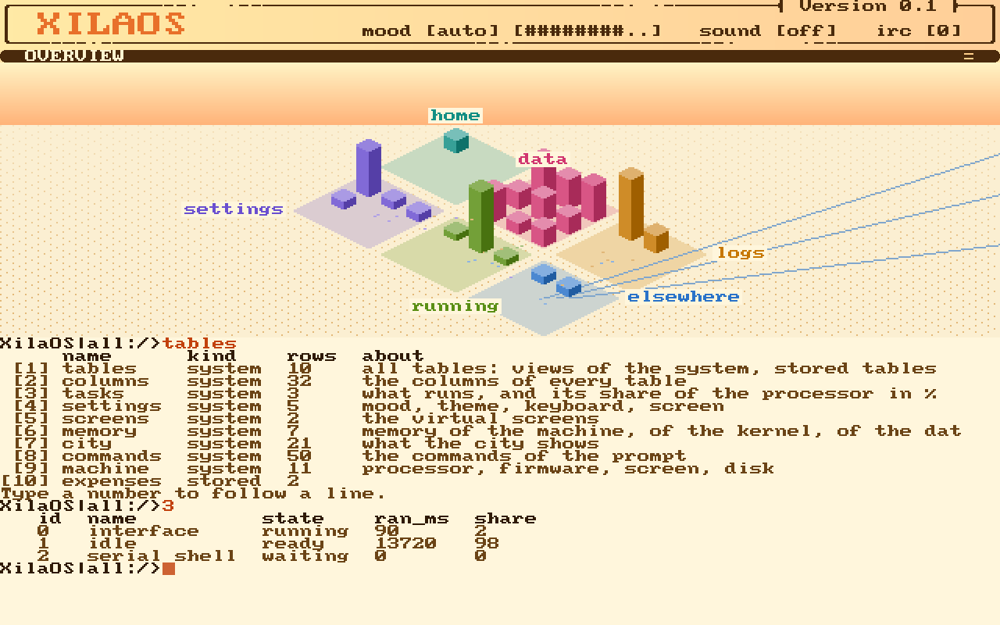
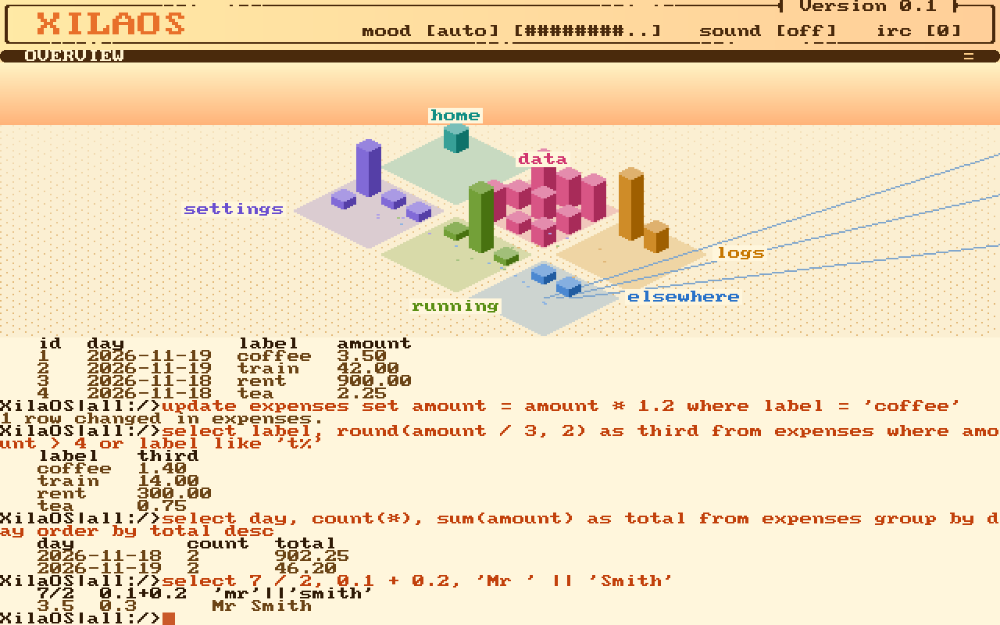
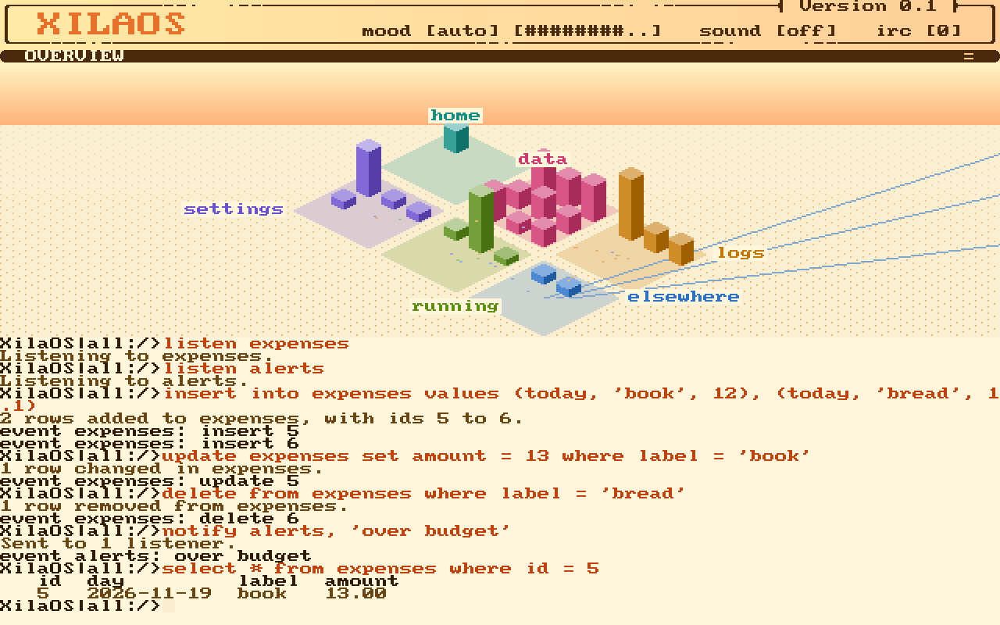

# The database and SQL

XilaOS has no file system. What it keeps, it keeps in tables, and SQL is how
tables are read and changed. SQL is not an application that is started first:
a statement is typed straight at the prompt, on the screen, on the serial port
or from another machine, and it is also a statement of the language of the
prompt ([XilaScript](05-xilascript.md)).

This chapter describes the SQL that is built: what it accepts, how values
behave, how changes are announced (LISTEN / NOTIFY), and where it stops. The
storage engine under it is described in its own chapter.



## The model

- **Everything is a table.** There are two kinds, and a query sees both the
  same way:
  - *system views* show the live state of the system: the tasks, the
    settings, the memory, the city. They are worked out when they are read,
    and cannot be changed with SQL;
  - *stored tables* are made with `create table` and hold rows in the
    storage engine: on the disk when there is one, in memory otherwise.
- **Every stored table has an `id` column**, the first one. The engine fills
  it, counting from 1, and it cannot be set or changed. An id is not given
  twice while the machine runs, not even the ids of a statement that failed.
- **One statement is one transaction.** It is applied whole or not at all,
  and when the prompt answers, the change is safe on the disk. There is no
  `begin`, `commit` or `rollback` at the prompt.
- **Committed changes are announced.** Each row a statement adds, changes or
  removes becomes an event on the channel named after the table, for the
  sessions that listen to it and for the programs that wait for it.
- **Words and names ignore case**: `SELECT Name FROM Tasks` is
  `select name from tasks`. Names are kept in small letters.

`tables` lists every table. On the screen its rows are numbered, and typing
the number of a row reads that table: in the picture above, `3` ran
`select * from tasks`.

## The system views

There are nine. `select * from columns where table_name = 'tasks'` gives the
columns of any of them, and of the stored tables too.

| View | Columns | What it shows |
|---|---|---|
| `tables` | `name`, `kind`, `columns`, `rows`, `about` | Every table. `kind` is `system` or `stored`. |
| `columns` | `table_name`, `position`, `name`, `type` | The columns of every table, in order. |
| `tasks` | `id`, `name`, `state`, `ran_ms`, `share` | The kernel tasks: their state, the time each ran, and its share of the processor in %. |
| `settings` | `name`, `value` | The settings in use: `mood`, `energy`, `theme`, `keymap`, `screen`. |
| `screens` | `id`, `name`, `shown` | The virtual screens; `shown` is `yes` for the one on display. |
| `memory` | `kind`, `kb` | Memory of the machine, of the kernel and of the database, in KB. |
| `city` | `plot`, `block`, `height`, `lit` | What the city of the overview screen shows: one row per block. |
| `commands` | `name` | The words the prompt knows. |
| `machine` | `item`, `value` | Processor, firmware, screen, graphics chip, clock, disk, and where the stored tables are kept. |

The commands `tasks` and `city` read the same state as the views of the same
name. Two real results, in QEMU:

```
XilaOS|all:/>select * from memory
   kind                    kb
   usable                  255756
   kept by the firmware    5476
   managed by the kernel   208788
   free                    203512
   kernel heap in use      4442
   stored tables           0
   room for stored tables  65536
XilaOS|all:/>select item, value from machine
   item                 value
   system               XilaOS 0.1
   processor            QEMU Virtual CPU version 2.5+
   firmware             EDK II
   screen               1280x800
   screen memory        write combining
   pictures per second  0
   serial port          yes
   graphics chip        1234:1111, not known to XilaOS
   clock                2026-11-19 09:01:23
   disk                 virtio, 64 MB
   stored tables        on disk, transaction 1
```

The columns of a view are `int` or `text`. A text is 48 characters at most
everywhere in the system, and the views are not an exception: the `about` of
the `memory` view is longer and is shown cut.

## Types and values

A column of a stored table has one of three types.

| Type | Also written | Holds |
|---|---|---|
| `int` | `integer`, `bigint` | A whole number, 64 bits with its sign. |
| `text` | `varchar`, `char` | Up to 48 characters. |
| `decimal` | `numeric` | An exact decimal number. |

- **`decimal` alone keeps two digits after the point**, which suits accounts.
  `decimal(p, s)` keeps `s` digits after the point, from 0 to 9, and
  `decimal(p)` keeps none. The precision `p` is read and not used: every
  decimal is a 64 bit whole number of its smallest unit, so 12.50 with two
  digits is kept as 1250. `columns` shows such a column as `decimal(18,2)`.
- **A decimal is exact.** `0.1 + 0.2` is `0.3`. There is no floating point
  number anywhere.
- **A length after a type is accepted and ignored**: `varchar(20)` is `text`.
- **`null` is nothing.** Any column but `id` may hold it; a column left out
  of an `insert` gets it. It is shown as an empty cell.
- **A value goes into a column only if nothing is lost.** `1.5` does not go
  into an `int` column, nor `1.234` into a `decimal` with two digits:

```
XilaOS|all:/>insert into expenses values ('x', 'y', 1.234)
Column amount keeps 2 digits after the point.
XilaOS|all:/>insert into expenses values ('x', 'y', 'z')
Column amount takes a number.
```

A text is written between apostrophes: `'coffee'`. There is no way to write
an apostrophe inside a text. Text is bytes in the character set of the
system's font (ASCII below 128), not UTF-8.

There is no date type. `today` and `now` (see below) are texts written so
that they sort in the order of time.

## Reading: SELECT

```
SELECT * | expression [AS name], COUNT(*), SUM(expression), ...
  [FROM table]
  [WHERE condition]
  [GROUP BY column]
  [ORDER BY expression | name or position in the result [ASC | DESC]]
  [LIMIT n]
```



- **The list** is `*` (every column of the table), or expressions separated
  by commas, or both. An item is named by its column, or by what was typed
  without its spaces and in small letters (`amount*2`), or by `AS name`. The
  word `AS` is required to give a name.
- **Without `FROM`** a SELECT is a calculation: `select 7 / 2` gives `3.5`.
  It takes no `WHERE`.
- **`FROM`** takes one table. There are no joins and no subqueries.
- **`WHERE`** takes any condition (see *Expressions*).
- **Functions over rows**: `count(*)`, `count(x)`, `sum(x)`, `avg(x)`,
  `min(x)`, `max(x)`, where `x` is any expression of the row
  (`sum(price * stock)`). As in SQL they skip what is nothing, and
  `count(*)` counts rows. Without `GROUP BY` they give one row, even for an
  empty table: `count` is then 0 and the others are nothing. `sum` and `avg`
  take numbers; `min` and `max` take texts too. A function over rows cannot
  be part of a calculation: `sum(a) / count(*)` is refused, `avg(a)` exists.
- **`GROUP BY`** takes one column. Whatever in the list is not a function
  over rows must be that column.
- **`ORDER BY`** takes one key: a column of the result by its name or by its
  position (`order by 2`), or, when the query has no function over rows, any
  expression of the row, which the result need not show
  (`order by price * stock desc`). Nothing sorts first, then numbers, then
  texts. Rows that are equal keep the order they were read in.
- **`LIMIT n`** keeps the first `n` rows.

A result holds 32 rows at most. When more rows match, the first 32 of the
order asked for are shown, and the prompt says how many are missing:

```
18 more rows are not shown. Narrow the query with WHERE.
```

With a `LIMIT` of 32 or less, nothing is said: fewer rows were asked for than
fit.

```
XilaOS|all:/>select sum(amount), avg(amount), min(amount), max(amount), count(*), count(day) from expenses
   sum    avg        min   max    count  count
   47.75  15.916667  2.25  42.00  3      2
XilaOS|all:/>select day, sum(amount) as total from expenses group by day order by total desc
   day         total
   2026-11-18  45.50
               2.25
```

## Changing: CREATE, INSERT, UPDATE, DELETE, DROP

```
CREATE TABLE name (column type, ...)
DROP TABLE name
INSERT INTO name [(column, ...)] VALUES (value, ...) [, (value, ...)] ...
UPDATE name SET column = expression [, ...] [WHERE condition]
DELETE FROM name [WHERE condition]
```

- **`create table`** takes one to seven columns; `id` is added in front. A
  name is a letter, then letters, digits or `_`, 24 characters at most, and
  not the name of a system view. There are no keys, constraints or defaults
  to declare.
- **`insert`** adds one to eight rows. Without a list of columns, the values
  are those of every column after `id`, in order; with one, the columns left
  out get nothing. A value is an expression without columns: a number, a
  text, `null`, a calculation, a variable of the prompt, `today`.
- **`update`** works each new value out from the row as it was before the
  statement: `set amount = amount * 1.2`. Several columns may be set at once.
- **`delete`** and **`update`** without `WHERE` take every row.
- **`drop table`** removes the table and its rows.

Each statement says what it did:

```
XilaOS|all:/>create table expenses (day text, label text, amount decimal)
Table expenses created.
XilaOS|all:/>insert into expenses values ('2026-11-18', 'coffee', 3.5), ('2026-11-18', 'train', 42)
2 rows added to expenses, with ids 1 to 2.
XilaOS|all:/>insert into expenses (label, amount) values ('tea', 2.25)
1 row added to expenses, with id 3.
XilaOS|all:/>update expenses set amount = amount * 1.2 where label = 'coffee'
1 row changed in expenses.
XilaOS|all:/>delete from expenses where day is null
1 row removed from expenses.
XilaOS|all:/>drop table expenses
Table expenses removed, with its 2 rows.
```

A statement that fails changes nothing. An `insert` of three rows whose third
row is wrong adds none of them; the ids the first two would have had are
simply not used.

## Expressions

Whatever stands for a value is an expression: an item of a SELECT, a
condition after `WHERE`, a value of `insert`, the right side of `set`, the
text of `notify`, and every value in XilaScript.

```
amount * 2            price + tax           'Mr ' || name        -amount
amount > 10 and (tag = 'food' or tag is null)        not label like 'a%'
round(amount / 3, 2)  length(label)  upper(tag)  abs(n)  coalesce(tag, '-')
```

From what binds least to what binds most:

| Level | Operators |
|---|---|
| 1 | `or` |
| 2 | `and` |
| 3 | `not` |
| 4 | `=` `!=` `<>` `<` `<=` `>` `>=` `like`, `is null`, `is not null` (one comparison: they do not chain) |
| 5 | `+` `-` `\|\|` |
| 6 | `*` `/` `%` |
| 7 | `-` in front of a value |
| 8 | numbers, `'texts'`, `null`, `true`, `false`, names, functions, parentheses |

How values behave:

- **Numbers are exact.** Adding, subtracting and multiplying keep every
  digit, up to nine after the point: `1.10 + 2.205` is `3.305`, `3 * 1.10`
  is `3.30`. A product with more than nine digits after the point is rounded
  to nine.
- **A number too large is an error, never a wrong result**:
  `select 9223372036854775807 + 1` answers `That number is too large.`
- **`/` divides as a calculator does**: `7 / 2` is `3.5` and `6 / 2` is `3`.
  It keeps up to six digits after the point, rounded, and drops the zeros at
  the end: `1 / 3` is `0.333333`, `2 / 3` is `0.666667`. Dividing a decimal
  keeps at least its own digits: `1.00 / 4` is `0.25`.
- **`%`** is the remainder of whole numbers.
- **`||` joins texts**, and so does `+` when one side is a text:
  `'n=' + 3` is `n=3`. The result is 48 characters at most.
- **Nothing in, nothing out.** `null` in a calculation or a comparison gives
  nothing, and a condition that gives nothing does not hold. `and` and `or`
  can still be settled by their other side: `0 and null` is 0, `1 or null`
  is 1.
- **A condition is a number**: 1 when it holds, 0 when it does not. `true`
  is 1 and `false` is 0. A text cannot be a condition.
- **Texts compare byte by byte**, so capital letters come before small ones
  and `'Train' = 'train'` does not hold. `like` is the exception: it ignores
  case, with `%` for any run of characters and `_` for any one.
- **A number and a text cannot be compared**: it is an error, not a guess.

The functions:

| Function | Gives |
|---|---|
| `length(x)` | The number of characters of `x` as it is shown. |
| `upper(x)`, `lower(x)` | The text in capital or small letters. |
| `abs(n)` | The number without its sign. |
| `round(n)`, `round(n, d)` | The number with `d` digits after the point (0 to 9, 0 when not given), halves away from zero: `round(2.5)` is 3, `round(-1.5)` is -2. |
| `coalesce(a, b)` | `a`, or `b` when `a` is nothing. |

Every function but `coalesce` gives nothing for nothing.

### Names

A name in an expression is looked for in this order:

1. a column of the table of the statement;
2. a variable of the session (`let floor = 10`, see
   [XilaScript](05-xilascript.md));
3. `now` and `today`: the moment the line was given, by the clock of the
   machine, as texts that sort (`2026-11-19 09:01:23` and `2026-11-19`).
   They exist only when the clock tells the time.

So a column hides a variable of the same name, and a variable named `today`
hides the date. A name is not written with its table in front: `tasks.name`
is not known.

```
XilaOS|all:/>let floor = 10
XilaOS|all:/>select label from expenses where amount > floor
   label
   train
XilaOS|all:/>insert into expenses values (today, 'tea', floor / 4)
1 row added to expenses, with id 3.
```

## LISTEN / NOTIFY

The system tells whoever wants to know that something changed, in the manner
of PostgreSQL.

```
listen [channel]            starts listening; alone, lists the channels listened to
unlisten [channel]          stops; every channel when none is named (or *)
notify channel [, 'text']   sends an event to those who listen
```

A channel is a name. If it is the name of a stored table, the system sends
on it every committed change to that table. On any other name, events are
those sent with `notify`. A channel does not have to exist before it is
listened to.



What the system sends by itself:

| Event text | When |
|---|---|
| `insert 5` | A row was added; 5 is its `id`. One event per row. |
| `update 5` | A row was changed. |
| `delete 5` | A row was removed. |
| `create`, `drop` | The table itself was made or removed. |
| `program report`, `drop report` | On the channel `programs`: a program was kept or removed. |

- **An event says little**: the channel and a short text. Who receives it
  reads the row with a query, by its id.
- **Events are sent after the commit.** A statement that fails sends none.
- **Events are not kept** for those who were not listening.
- **The text of `notify`** is an expression: `notify alerts, 'total ' + 3`.
  The comma is optional. `notify` says how many sessions it reached:
  `Sent to 1 listener.` or `Nobody listens to alerts.`

### Sessions

Who listens is a *session*, one of the three prompts: the screen, the serial
port, and the prompt another machine types at over the network (`remote
on`). Each has its own channels.

- **On the screen**, an event is shown in the terminal as it happens:
  `event expenses: insert 5`.
- **On the serial port and over the network**, events are written when a
  command ends, after what it says and just before its status line: one
  line each, the channel and the text separated by a tab. Those a command
  causes itself come with it; those that happen while nothing is typed wait
  for the next command, and an empty line is enough to ask for them:

```
XilaOS|all:/>insert into expenses values (today, 'coffee', 3.5), (today, 'train', 42)
2 rows added to expenses, with ids 1 to 2.
#event expenses	insert 1
#event expenses	insert 2
#ok
```

Sixteen events wait for one session at most. Beyond that they are counted
and dropped: the serial port then gets a line `#lost 4`, and the screen says
`4 more events came too fast to be shown.` Sixteen channels are listened to
at most, over all sessions.

Programs do not listen. A program that should run when something happens is
written with `on` (see [XilaScript](05-xilascript.md)): such programs get
every event through a queue of their own, whether or not a session listens.

## Errors

A statement that cannot be run says why in one sentence, and the prompt
reports a failure (`#error` on the serial port). Some of them:

```
Unknown table: nowhere. Type tables to list them.
Unknown column: nope
Expected FROM, found: /
Expected a table, but the query ends.
This must be in GROUP BY, or in a function: label
A number and a text cannot be compared.
Division by zero.
3 values are expected for each row, not 2.
Column n takes a whole number.
id is given by the system and cannot be changed.
tasks is a view of the system and cannot be changed.
tasks is a table of the system. Pick another name.
Unknown type: blob. Types are int, decimal and text.
Two columns have the same name. Every table already has id.
A table has one to seven columns, besides id.
One INSERT adds eight rows at most.
A text takes 48 characters at most, for now.
This calculation is too long.
```

Errors of the disk are worded the same way: `The disk does not answer.
Nothing was changed.`, `The database is damaged: page 12 cannot be read.`,
`The database is full. Remove rows or tables to make room.`

## Limits

The SQL engine works without a heap, in buffers of fixed size. Its limits
follow from that, and from what is not built yet.

| What | Limit |
|---|---|
| Columns of a table | 8, `id` included |
| Columns of a result | 8 |
| Rows of a result | 32; the rest is counted, not shown |
| Groups of a `GROUP BY` | 32 |
| Rows of one `INSERT` | 8 |
| An expression | 16 values and operations; parentheses, signs and `not` nest 12 deep |
| A text | 48 characters, no apostrophe inside |
| A name of table or column | 24 characters |
| Stored tables | 64 |
| Digits after the point | 9 in a column, 6 from a division |
| Channels listened to | 16, over all sessions |
| Events waiting for a session | 16 |

What SQL has and this one does not:

- joins, subqueries, `union`, `distinct`, `having`;
- `in`, `between`, `case`; `not like` is written `not x like '...'`;
- more than one column in `GROUP BY`, more than one key in `ORDER BY`;
- a calculation on functions over rows (`sum(a) / count(*)`);
- `insert into ... select`;
- `alter table`, keys, indexes, `not null`, `unique`, defaults;
- `begin`, `commit`, `rollback`;
- dates and times as a type, and objects larger than a text.

Every query reads the whole table. There is no index besides the order of
the rows by `id`, and `where id = 5` does not use it yet.

## How it is implemented

All of this is in `core/`, the crate that holds the logic of the system
without hardware and without a heap. It is tested on the development
machine with `cargo test -p xila-core`.

- **`sql.rs`** holds the `Lexer` (words, numbers, decimals, `'texts'`,
  symbols) and `query`, which runs a SELECT. The list of what to show is
  skipped at first, until `FROM` has named the table, then read with the
  columns known. The table is then scanned once: each row goes through the
  condition, and either takes its place among the 32 rows of the result
  (kept in order as they come, so that the first 32 of the order stay), or
  feeds the running results of its group. The result is a `Rows` of values,
  turned into a `shell::Table` of texts to be shown.
- **`expr.rs`** reads an expression once, by recursive descent, into a small
  tree kept in a fixed array of 16 nodes (`Expr`), then works it out for
  each row with `eval`, or `holds` for a condition. A name is settled when
  the expression is read: a column becomes its position in the row, a
  variable becomes its value.
- **`Source`** is the trait a query reads through: `schema(name)` describes
  a table, `scan(table, visit)` calls `visit` with each of its rows.
  `System` is the only implementation (`catalog.rs`): the views of
  `catalog::TABLES` are numbered first, each an arm of `scan` that makes
  rows from the live state; the stored tables of `System::db` are numbered
  after them and scanned through the engine.
- **`change.rs`** runs the five statements that change stored tables.
  `change(db, statement, report)` reads the statement, calls the engine
  (`create`, `insert`, `update_each`, `delete`, `remove`), then `commit`s; on
  any error it calls `rollback` instead. `commit` returns once the change is
  safe on the volume, and calls `report` for each changed row: this is where
  `shell::change` sends the events. Errors of the engine are worded for the
  user by `engine_error`.
- **`events.rs`** keeps who listens to what, a queue of 16 events per
  session, and one more queue for the programs that wait for events.
- **Values** are `Null`, `Int(i64)`, `Dec(units, scale)` or `Text` (48
  bytes): small values that are copied, never allocated. A result and its
  work tables are values on the stack of the task that runs the query,
  about 50 KB for a SELECT, which is one reason kernel tasks have stacks of
  256 KB.

The storage engine itself (`db/`, `xila-db`) knows nothing of SQL: it keeps
typed records in B-trees and changes them in transactions.
