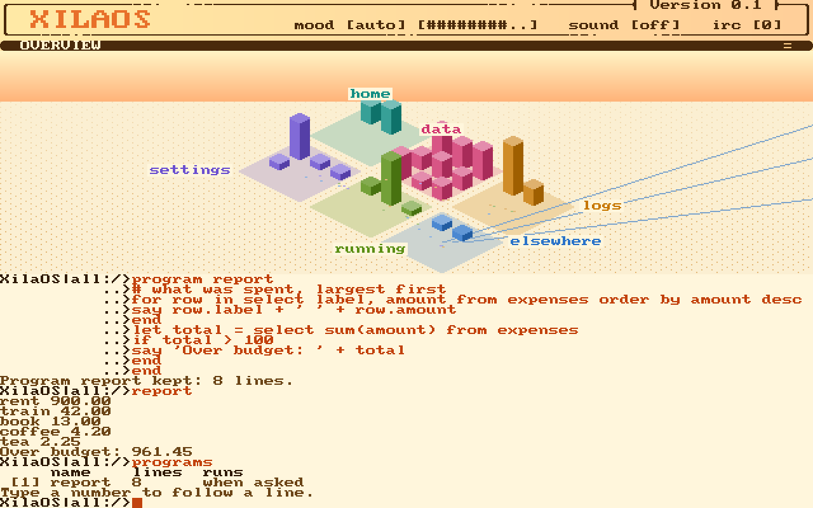
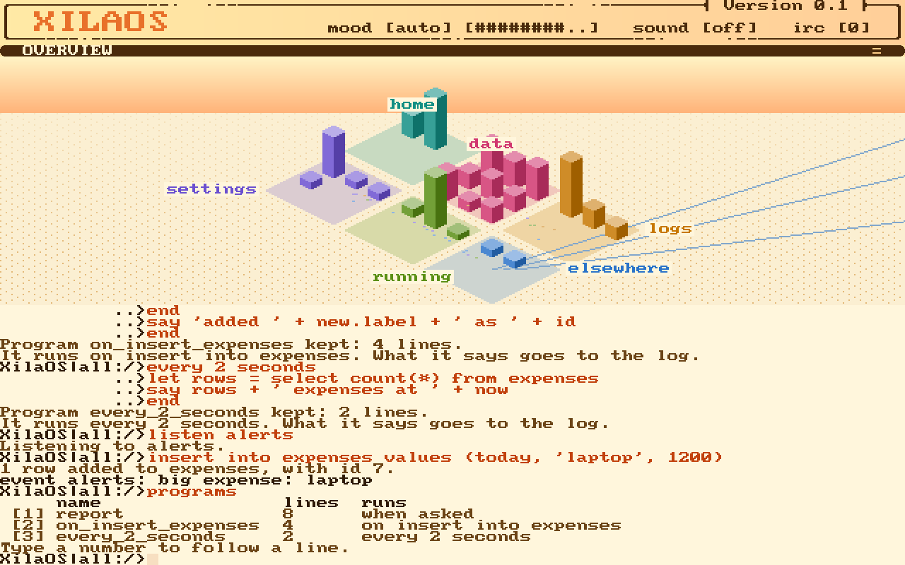
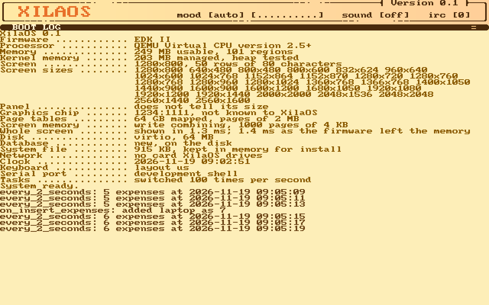

# XilaScript

XilaScript is the language of XilaOS. It is the language of the command
prompt: everything in this chapter is typed as it is written here, on the
screen, on the serial port or from another machine. Its words are English.

It is small on purpose: names that keep values, conditions, loops, programs
kept in the database, and programs that run by themselves when a table
changes or when their time comes. SQL is part of it: every SQL statement is
a statement of the language, and its values are the expressions of SQL
(see [The database and SQL](04-sql.md)).



## At a glance

The examples use these two tables:

```
create table expenses (day text, label text, amount decimal)
create table samples (at text, free_kb int)
```

```
let total = select sum(amount) from expenses
say 'Total: ' + total

if total > 100
    notify alerts, 'over budget'
else if total > 50
    say 'careful'
else
    say 'fine'
end

for row in select label, amount from expenses where amount > 10
    say row.label + ': ' + row.amount
end

program report
    # what was spent, largest first
    for row in select label, amount from expenses order by amount desc
        say row.label + ' ' + row.amount
    end
end

report

on insert into expenses
    if new.amount > 50
        notify alerts, 'big expense: ' + new.label
    end
end

every 1 hour
    let free = select kb from memory where kind = 'free'
    insert into samples values (now, free)
end
```

## The rules

- **One statement per line.** No semicolons, no braces. Spaces at the start
  of a line do not count; the examples indent for the reader only.
- **A block** starts with `if`, `while`, `for`, `program`, `on` or `every`
  and ends with `end`. While a block is open nothing runs: the prompt of the
  screen becomes `..>`, and the serial port answers each line with `#more`.
  At the last `end` the whole block runs, or is kept if it is a program.
  `cancel` drops the lines typed so far.
- **A block is compiled before it runs.** What is wrong with its form is
  told at the last `end`, with its line, and then nothing of it runs: an
  `else` that belongs to no `if`, a `for` that is not `for row in select
  ...`, a calculation that cannot be read.

  ```
  XilaOS|all:/>if total > 100
  ..>say 'large'
  ..>else
  ..>else
  ..>end
  After else comes nothing, or if and a condition; a plain else is last.
  Line 4 is not right: nothing was run.
  ```

  What cannot be known before it runs is told when it runs, as a line that
  fails: a name that has no value, a table or a program that is not there,
  what a command or a `select` says. A name that has no value fails only
  where its value is asked for: `if 1 = 1 or missing > 2` holds, since the
  first side settles it.
- **A line that starts with `#`** is a note.
- **Every command of the prompt is a statement**, SQL included: `mood calm`,
  `insert into ...`, `notify ...` are written in a program as at the prompt.
- **Capital and small letters** are the same in the words of the language
  and in names.

## The statements

| Statement | What it does |
|---|---|
| `let name = value` | Keeps a value under a name. The same word changes it: `let n = n + 1`. |
| `say value` | Shows a value. Alone, it shows an empty line. |
| `if condition` ... `else if condition` ... `else` ... `end` | Runs the lines of the first condition that holds. A plain `else` comes last. |
| `while condition` ... `end` | Runs the lines again and again while the condition holds. |
| `for row in select ...` ... `end` | Runs the lines for each row of the result; `row.column` gives its values. Any name can stand in place of `row`. |
| `program name` ... `end` | Keeps the lines under a name, in the database. |
| `run name`, or `name` alone | Runs a program. At the screen and at the serial port the prompt waits for it while the rest of the system lives ([jobs](#jobs)). |
| `submit name` | Runs a program as a job nobody waits for: the prompt answers at once. |
| `jobs` | Lists the jobs: those that run, and those that ended and are still listed. |
| `job 3` | Shows a job, and the last lines it said. `job 3 end` stops it, `job 3 hold` keeps it from running, `job 3 release` lets it go on. |
| `return` | Leaves the program that is running. |
| `on insert into table` ... `end` | Keeps the lines, and runs them each time a row is added. Also `on update table`, `on delete from table`, `on notify channel`. |
| `every 5 minutes` ... `end` | Keeps the lines, and runs them again and again: `seconds`, `minutes`, `hours`, `days`. |
| `every day at 8:00` ... `end` | Keeps the lines, and runs them once a day, when the clock of the machine shows that time. |
| `programs` | Lists the programs, how many lines each has, and when it runs. |
| `show name` | Shows the lines of a program, as they can be typed again. (`show table name` shows a table: see [SQL](04-sql.md#what-a-column-asks).) |
| `drop program name` | Removes a program. |
| `vars` | Lists the names that have a value. |
| `cancel` | Drops the lines of the block being typed. |

`help l` shows a summary of this table on the system itself.

## Values

A value is an expression, the same as in SQL: exact numbers, texts between
apostrophes, names, `+ - * / %`, `||`, comparisons, `and`, `or`, `not`,
parentheses, and the functions `length`, `upper`, `lower`, `abs`, `round`
and `coalesce`. `+` joins when one side is a text, which is how a line to
show is put together: `say 'Total: ' + total`. The rules of calculation are
those of SQL: numbers are exact, `7 / 2` is `3.5`, and nothing (`null`) in a
calculation gives nothing.

A value can also be a whole `select`: it is then the first column of its
first row, or nothing when there is no row.

```
XilaOS|all:/>let count = select count(*) from expenses
XilaOS|all:/>let t = select label from expenses where amount > 5000
XilaOS|all:/>say coalesce(t, 'none')
none
```

A `select` cannot be a piece of a calculation, nor a condition. It is kept
with `let` first:

```
XilaOS|all:/>say 'Total: ' + select 1
A select cannot be part of a calculation: keep it with let first.
```

A condition is a value that holds (a number that is not zero) or does not
(zero, or nothing). A text is not a condition.

### Names

A name is a letter, then letters, digits or `_`, 24 characters at most. It
cannot be a word of the language or a command: `let mood = 3` is refused,
since `mood` is a command.

Names belong to the *session*: the screen, the serial port and the prompt
for the network each have their own, 32 at most. They are kept in memory
only: a restart forgets them. The columns of the row of a `for` are names like the others
(`row.label`, `row.amount`): they count among the 32, and keep the values of
the last row after the loop.

Two names exist everywhere, in a calculation as in a query, as long as no
name of yours hides them:

| Name | Is |
|---|---|
| `today` | The date, as a text: `2026-11-19`. |
| `now` | The date and the time: `2026-11-19 09:05:13`. It is the moment the line was given; in a program that runs by itself, the moment it was started. |

Written this way, dates compare and sort as texts: `where day < today`.
There is no date type and no calculation on dates. On a machine whose clock
tells no time, the two names do not exist.

### Names in SQL

A name given by `let` can be used wherever SQL takes a value:

```
let floor = 10
select label from expenses where amount > floor
insert into expenses values (today, 'tea', floor / 4)
```

If a column of the table has the same name, the column wins.

## Programs

A program is not a file. Its lines are rows of the stored table `programs`
(`name`, `line`, `text`), kept on the disk like any table and found again at
the next start. The name of a program becomes a command.

```
XilaOS|all:/>programs
     name    lines  runs
 [1] report  4      when asked
Type a number to follow a line.
XilaOS|all:/>show report
program report
    # what was spent, largest first
    for row in select label, amount from expenses order by amount desc
        say row.label + ' ' + row.amount
    end
end
XilaOS|all:/>report
rent 900.00
train 42.00
coffee 3.50
```

- **Typing a program again replaces it.** There is no editor: `show name`
  gives the lines back, to be typed again with the change.
- **A program has no parameters and no names of its own.** It sees and
  changes the names of the session that runs it. Its name is typed alone:
  `report now` is an unknown command.
- **Programs run programs**, three deep at most.
- **A program is made at the prompt**: `program`, `on` and `every` inside a
  block or a program are refused.
- **A program whose form is wrong is not kept**, and says which line:
  `Line 2 is not right: the program is not kept.` If a program of that name
  was there, it stays as it was, with what starts it. A program kept by a
  system from before 27 November 2026, which kept anything, says what is
  wrong with it when it is run, and stops there.
- **Inside a program, commands do not say that they succeeded.** At the
  prompt, `insert` answers `1 row added to expenses, with id 4.`; in a
  program, only `say`, the results of `select` and errors are shown.
- **When a line fails, the program stops and says where:**

```
XilaOS|all:/>broken
1
Division by zero.
Stopped at line 2 of broken.
```

`select * from programs` shows the table, with each line cut at the 48
characters a text takes in a result; the lines themselves are kept whole.
The system refuses to keep programs in a table named `programs` that was
made by hand with other columns.

## Programs that run by themselves

`on` and `every` keep their lines as `program` does, under a name made from
their first line:

| First line | Name |
|---|---|
| `on insert into expenses` | `on_insert_expenses` |
| `on update expenses` | `on_update_expenses` |
| `on delete from expenses` | `on_delete_expenses` |
| `on notify alerts` | `on_notify_alerts` |
| `every 5 minutes` | `every_5_minutes` |
| `every day at 8:00` | `every_day_at_8h00` |

Typing one again replaces it; `drop program on_insert_expenses` removes it.
They are kept on the disk and start again with the machine. `programs` says
when each one runs.



What they say does not go to the prompt, which may be busy with something
else, but to the log (the second screen, `Alt+1`), each line after the name
of the program:



### What an `on` program knows

| Name | Is |
|---|---|
| `channel` | The name of the table, or of the channel for `on notify`. |
| `id` | The `id` of the row that was added, changed or removed. |
| `new.column` | The values of the row, for `on insert` and `on update`. |
| `text` | The text that was sent, for `on notify`. |

`on insert`, `on update` and `on delete` take a stored table that exists. A
system view is refused: it does not say when it changes. What happens to
the machine itself is heard with `on notify`: the channels `start`,
`network`, `disk`, `tasks` and `memory`
([LISTEN / NOTIFY](04-sql.md#listen--notify)).

### Asking the companion

A program can ask the [companion](14-the-companion.md) something, which
is how the companion reacts to what happens:

```
on insert into expenses
    if new.amount > 50
        ask is {new.label} at {new.amount} unusual among my expenses?
    end
end

every day at 8:00
    ask sum up what the tables say changed since yesterday
end

on notify network
    ask the network says: {text}. Is there anything I should do?
end
```

`ask` takes the rest of the line as it is. Between `{` and `}`, a name
or a calculation is replaced by its value. The program does not wait:
the question takes its turn (eight may wait), and what is asked and
answered is written on the companion's screen, under the name of the
program. The companion may act on what it is asked: a program that
asks it about rows that come from elsewhere hands those rows to a
model that can change the tables ([what holds it](14-the-companion.md#what-holds-it)).

### How they run

- **After the change**, never during it: the statement that added the row is
  already committed. An `on` program that fails undoes nothing.
- **Once per row**: an `insert` of three rows runs the program three times.
- **With names of their own**, empty at each run. They do not see the names
  of a prompt; what must last goes into a table.
- **They cannot `listen`**: only a prompt does. They can `notify`, and
  change tables, which may start other programs.
- **`qr` is refused to them**: its code takes the screen of who asked
  for it, and they are nobody at a prompt.
- **Errors go to the log too**, with the line where the program stopped.
- **What takes a disk or opens the machine is refused to them**:
  `install`, `disk erase`, `remote on` and `web on` are typed at the
  machine itself, or run by a program started there with `run`. A
  program that runs by itself may have been written by somebody at the
  prompt over the network, to whom those commands are refused.
- **The values from before** an `update` or a `delete` are not known: only
  `id`.
- **The row is read when the program starts**, a moment after the change. If
  it is gone by then, the program does not run for it.
- **A chain of programs that start each other is cut**: after four programs
  in a row, the next one is not run, and the log says
  `not run, programs kept starting each other.` This is what stops a program
  `on insert into t` that itself adds a row to `t`.
- **`every 5 minutes`** counts from the moment the program is made, or from
  the start of the machine. A missed round is not made up. The count goes
  from 1 to 10000.
- **`every day at 8:00`** follows the clock of the machine as it is set: no
  time zone, no summer time. A machine that is off at 8:00 does not run the
  program late when it starts; the next round is the next day. On a machine
  whose clock tells no time, the program is kept and waits.

## Limits

| What | Limit |
|---|---|
| A line | 240 characters; the edit line of the screen takes 160 |
| A block typed at the prompt | 48 lines, its first line and its last `end` included |
| Names with a value, per session | 32 |
| A name | 24 characters; with its `row.` in front, 32 |
| A text | 48 characters, as in the tables |
| Rows a `for` goes through | Any number, for a `select` of one stored table that neither sorts, groups nor limits; 32 for any other (a join, a view, `order by`, `group by`, a function over the rows): with more, it refuses to start rather than forget some |
| Loops over rows, one inside the other | 4, the programs that are running counted together |
| Calculations in one program | About ten values and operations a line for 48 lines (512 in all); beyond, the program is refused when it is kept: `Too many calculations for one program: split it in two.` |
| Rounds of a `while` | 10 000, then it is stopped, for a program that runs by itself and for what runs at once; none for a job a person started |
| Jobs running or held | 8, the programs that run by themselves apart |
| Statements run by a program that runs by itself, or by what runs at once | 100 000, then it is stopped: that is also how far its loop over a large table goes, one statement for each line of its body at each row. None for a job a person started |
| Programs that run programs | 3 deep. A program run through a command that types a line (`qr name`) counts for two |
| `on` programs | 16 |
| `every` programs, `every day at` included | 8 |
| Events waiting for the `on` programs | 16; more are lost, and the log says how many |

What is not there:

- `insert into t select ...`: a value that was read is kept with `let`
  first, as in the `every 1 hour` example above.
- Parameters, and names that belong to one program.
- A `select` inside a calculation; texts longer than 48 characters.
- The values from before the change in `on update` and `on delete`.
- Other rhythms by the clock (`every monday at 9:00`).
- An editor.
- **What still holds the system while it runs**: one instruction, however
  long (a `select` over a large table, `disk check`, `net get`), and whole
  programs started from the prompt over the network or run for the
  companion, which are not jobs yet. Those two keep the limits that stop a
  program nobody watches.

## Jobs

A program no longer holds the system while it runs. It runs as a *job*:
some of its instructions, then the system is given back, then some more.
Between two instructions of a job the screen answers, the network is
served and other jobs run. One statement is still whole, which is what
keeps two jobs that change the same table from seeing half of what the
other does.

**At the prompt, a program is waited for.** At the screen and at the
serial port, a program run by its name or by `run`, and a block typed
there, become a job that prompt waits for. What it says is shown as it
runs. At the screen the edit row says so, and how to have the prompt back:

```
XilaOS|all:/>inventory
Counting shelves...
Running inventory. [Esc] stops it, [Alt]+[B] sends it to the background.
```

A line that a command of the program types (`qr about`) runs at once,
inside it, and its code is shown then. (To a job nobody waits for, `qr`
is refused: its code would take the screen of nobody.)

`Esc` stops it and says where it was (`Stopped at line 12 of inventory.`).
`Alt`+`B` lets it go on with nobody waiting: `Job 7 goes on in the
background: job 7 shows it, job 7 end stops it.` At the serial port the
status line comes when the job has ended, which is what a program that
drives the machine wants; a Ctrl+C byte stops the job, and what is typed
ahead meanwhile, a line of it, is run once the job has ended. A single line
that is no program is not a job: it has run when the prompt comes back,
so `jobs` and `job 3 end` can always be typed.

**`submit name` runs a program that nobody waits for.**

```
XilaOS|all:/>submit inventory
Job 7 submitted: inventory.
XilaOS|all:/>jobs
     job  program    state    by      since     statements
 [1] 7    inventory  running  screen  14:02:10  4310
XilaOS|all:/>1
Job 7 is running: inventory
Started at the screen at 14:02:10. 4310 statements run.
Counting shelves...
```

- **What it says is kept with it**, its last lines (two thousand
  characters), for as long as it is listed. `job 7` shows them.
- **It has names of its own.** A job nobody waits for does not see the
  names of the prompt that started it, and its own are gone when it ends.
  A program that counts on a name made at the prompt (`let floor = 3`,
  then `submit report`) stops with `Unknown name: floor`. Programs have no
  parameters yet: what a submitted program needs, it reads from a table.
  A job the prompt waits for sees and changes the names of that prompt,
  as a program always did; sent to the background, it leaves with a copy.
- **It is who started it.** A job submitted from the prompt over the
  network runs as that prompt: `web on` in it is refused, as it is there.
- **Eight jobs** may run or be held at one time, beside the programs that
  run by themselves. A ninth is refused: `Eight jobs are running or held:
  end one, or wait.` A job that ended stays listed until its place is
  needed. Those a prompt waited for leave first, the oldest of them
  first: what they said was seen there. Those nobody waited for, whose
  last lines are only kept with them, leave last. Numbers count up from
  the start of the machine and are never given twice; the programs that
  run by themselves take numbers from the same count.
- **A job is not stopped or held by one of its own lines**: `job 7 end`
  in job 7 is refused (`Job 7 is the one that asks: it ends with return,
  or from a prompt.`).
- **`statements`** counts the statements a job ran and the rounds of its
  loops, so that a loop that does nothing else is seen to run.
- **`job 7 hold`** keeps a job from running, **`job 7 release`** lets it
  go on, **`job 7 end`** stops it for good.
- **When it ends, it is written in the stored table `job_log`**: `job`,
  `program`, `by` (`screen`, `serial`, `network`, `program`), `began`,
  `ended`, `went` (`done`, `failed at line 3 of name`, `stopped`),
  `statements`. Only the jobs nobody waited for. Nobody is told of those
  rows (no `on insert into job_log` starts), and nothing trims the table:
  `delete from job_log where ended < '2026-12-01'` does.
- **`select * from jobs`** reads the same list as a view: `job`, `program`,
  `state`, `by`, `began`, `statements`.

**The programs that run by themselves are jobs too**, one after the
other. Those that run by the clock and those that hear something take
turns, so that one that takes longer than its rhythm keeps no other
from running. The one that runs, or the last that ran, shows in `jobs`,
started `by` `program`. It can be ended (`job 7 end`) but not held:
held, it would keep all the others waiting. What they say still goes to
the log, and they are not written in `job_log`. A job submitted by such
a program is one step further down the chain of programs that start
each other, which is cut as it always was.

**The limits that stop a program nobody watches are not a job's.** A
loop typed at the screen or submitted goes on until it ends or is
stopped. The programs that run by themselves keep them (10 000 rounds of
a `while`, 100 000 statements), and so does what runs at once.

**The companion** neither submits nor stops jobs: `Jobs are not the
companion's to start or stop.` Nothing it starts outlives its answer.

## How a loop reads its rows

A `for` over a `select` of one stored table, with no `order by`, `group
by`, function over the rows or `limit`, walks the table by `id`, 32 rows
at a time. So it may read any number of rows, and what it sees is this:

- **The rows that were there when the loop began**, in the order of
  their `id`. A row added meanwhile, by the loop itself or by a program
  that runs by itself, is not given: a loop that adds to the table it
  reads ends.
- **Each row as it is when its 32 are read.** A row changed or removed
  ahead of the loop is seen changed, or not at all; one of the 32 already
  read is given as it was.
- **The names of its `select` as they were when the loop began.**
  Changing one inside the loop does not change which rows come.

Any other `select` is worked out whole before the first round, as at the
prompt, and gives 32 rows at most.

## How it is implemented

The language is three modules of `core/`, with no heap: `lang.rs` (blocks,
the table of programs, the programs that run by themselves), `code.rs`
(the compiler) and `machine.rs` (the virtual machine). Until 27 November
2026 `lang.rs` interpreted each line as it read it.

- **Every line goes through it.** `shell::exec` gives each line typed at a
  prompt to `lang`. A line that opens a block, or that comes while one is
  open, is added to `System::blocks[session]` (48 lines of 240 bytes) and a
  depth is counted: up at each opening word, down at each `end`. At depth
  zero the block is run, or stored if its first word is `program`, `on` or
  `every`. Any other line is a block of one line.
- **Lines are compiled** (`code::compile`) into a *unit*: instructions that
  hold numbers only (the line each came from, where to jump, where its
  calculation is kept), beside the lines themselves, from which an
  instruction reads the texts it needs (the name of a `let`, a `select`, a
  command). `let`, `say`, `if`, `while`, `for`, `return` and `run` have
  instructions of their own; any other line is the instruction `command`,
  which is the name of a program or goes to `shell::command` when it runs:
  that is how every command is a statement. The jumps of a block are
  settled once, when it is compiled.

  ```
  for item in select name, qty        0  open   c0
      from stock where qty < 5        1  next   c0, else 4
    say item.name                     2  say    item.name
  end                                 3  jump   1
                                      4  close  c0
  ```

- **The machine** (`machine.rs`) runs the unit at the top: one instruction,
  then the next. A program that is run is one more unit above the one that
  runs it. Everything it knows of a run is in `System::vm` (which units
  are in use, where each is, the rounds of its loops, the cursors), not on
  the stack of the task: a run can be left between two instructions, which
  is what jobs rest on. One case is not so yet: a command that types a
  line (`qr`) runs that line to its end from inside the instruction. Its room is fixed: four units, for lines typed
  and programs three deep, and four cursors. A command that types at the
  prompt from inside a program (`qr`) enters the machine again on the next
  unit.
- **Values** are worked out by the expression code of SQL (`expr.rs`), with
  the variables of the session (`System::vars[session]`, an `expr::Vars`:
  two fixed arrays of 32 names and 32 values). A calculation is read once,
  when its line is compiled (`expr::Names::late`), and kept in the pool of
  its unit (`expr::Pool`); the value of a name in it is looked up each time
  it is worked out. A line that starts with `select` goes to `sql::query`
  when it runs.
- **A `for`** reads its rows through a `sql::Cursor`, which walks a stored
  table by `id` or takes a result whole (see above).
- **Jobs** (`jobs.rs`). The machine runs in *turns* (`machine::turn`):
  instructions until its time is over, asked after each one and never
  inside. A job is a run of the machine in a *room* of its own, one of
  nine machines the kernel makes in its memory at start
  (`System::rooms`); the machine inside `System` still runs what runs at
  once. Each turn of a job sets the session that started it, the
  companion's mark and its names, and puts them back. Three places give
  turns: the interface task to the job the screen waits for (eight
  milliseconds of each tick), the serial task to its own, and a kernel
  task, `jobs`, to those nobody waits for, three milliseconds at a time,
  each in its turn. `lang::background` no longer runs the programs that
  run by themselves: it starts the next one as a job when the one before
  has ended.
- **Programs** are read from and written to the table `programs` through
  the storage engine directly, not through SQL, because a line is longer
  than the 48 bytes a SQL value holds. Storing a program is one
  transaction: the old lines are deleted and the new ones inserted. A
  program that runs by itself has one more row, its line 0, which holds its
  first line (`on insert into expenses`).
- **Programs that run by themselves** are found by reading that table into
  `System::triggers` (16 `on` entries, 8 `every` entries), again whenever it
  may have changed. `lang::background` is called by `Ui::tick`, the tick of
  the interface task. It starts the `every` programs whose tick has come,
  or whose second has come by the clock for `every day at`. Then it takes
  up to eight events from the queue `Events` fills for programs and starts
  the `on` programs that match each one.
- **They run as a pseudo session**, `events::BACKGROUND`, which has
  variables but no prompt, no block and no channels. Its variables are
  emptied before each run, then filled with `channel`, `id`, `text` and the
  `new.` columns, read with a `select * from table where id = ...`. Output
  goes through a wrapper that puts the name of the program before each
  line, into the terminal of the log screen.
- **The chain limit** rides on the events: an event sent while a program
  started by an event runs carries that program's depth plus one, and an
  event of depth four starts nothing.
- **Room.** A running program keeps nothing on the stack of its task but
  what one instruction needs: its lines, its instructions and its rows are
  in `System::vm`, about 270 KB (four units of 46 KB, four cursors of
  20 KB), which makes a `System` about 440 KB with the list of the jobs. The lines of a program are
  on the stack, 12 KB, only while it is loaded and compiled.
