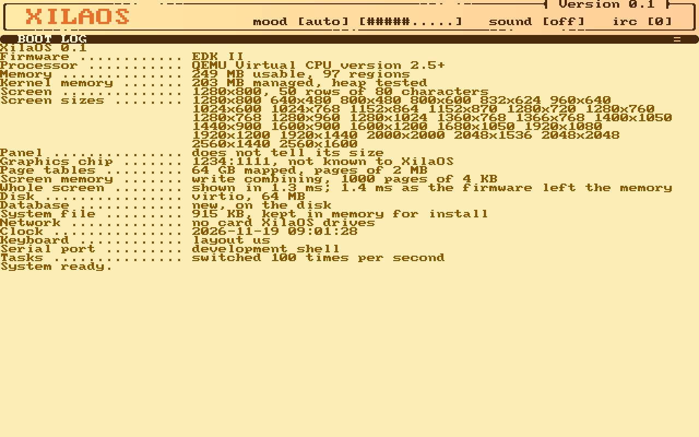

# The kernel

The kernel is the crate `xila-kernel`, in `kernel/`: about 4,700 lines
of Rust, some 260 of them assembly for the interrupt entry points (most
of those are the 32 exception stubs).
It builds with stable Rust for the target `x86_64-unknown-uefi` and
comes out as one file, `BOOTX64.EFI`, of 1.4 MB, of which 0.4 MB are
TLS: the only code in it that comes from outside the workspace (see
[Networking](10-networking.md#tls)).

It is a small kernel in the plainest sense: it owns the machine and
everything runs inside it.

- **One address space.** Memory is used at its physical addresses,
  through an identity map. There is no user mode and no protection
  between tasks: every task is kernel code.
- **One processor.** The other cores are never started.
- **Preemptive tasks.** Up to eight, switched by the timer 100 times
  per second.
- **Polled devices.** Only the timer interrupt does anything. Every
  other device is asked by a task, once per tick.
- **No logic.** Whatever can be decided without touching the machine
  lives in `xila-core`, where it is tested on the development machine.
  The kernel feeds it scancodes, bytes, frames and ticks, and copies the
  character grid it produces to the screen.

Programs outside the kernel, a virtual machine to run them and isolated
zones are part of the plan and are not built yet: see
[Status and roadmap](13-status-and-roadmap.md).

## The files

| File | Lines | What it does |
|---|---|---|
| `main.rs` | 900 | Entry point, the shared state, the interface task, the serial shell task, kernel requests. |
| `uefi.rs` | 424 | Hand-written bindings for the few firmware calls used; graphics mode, memory map, leaving the boot services. |
| `arch.rs` | 850 | Ports, GDT, IDT, interrupt controllers, timer, PS/2 keyboard, page tables, clocks, the interrupt entry in assembly. |
| `task.rs` | 250 | Tasks, the scheduler, `sleep`, the mutex. |
| `memory.rs` | 104 | Gives the firmware's free memory to `xila_core::mem` and makes it the global allocator. |
| `fb.rs` | 347 | The screen: a prepared picture, copies of what changed. |
| `chip.rs` | 200 | The Intel graphics chip: found on the PCI bus, its registers read for `xila_core::intel`. |
| `pci.rs` | 75 | Scans the PCI bus. |
| `serial.rs` | 87 | COM1, polled. |
| `virtio.rs` | 234 | The virtio disk of QEMU (legacy interface). |
| `ahci.rs` | 305 | SATA disks through an AHCI controller. |
| `disk.rs` | 293 | Picks the disk at boot, opens the database on it, runs `install`. |
| `e1000.rs` | 601 | Intel Ethernet cards of the e1000 family. |

## From the firmware to the first task

The kernel is a UEFI application: there is no boot loader. The firmware
of the machine (or of QEMU) loads `\EFI\BOOT\BOOTX64.EFI` from a FAT
partition and calls `efi_main` with a handle and a table of services.

```text
 efi_main (main.rs)
   Serial::init                 COM1 at 115200 baud, tested by loop-back, interrupts off
   uefi::boot
     graphics                   list the modes, pick one, describe the framebuffer
     own_file                   read BOOTX64.EFI itself into memory, for `install`
     get_memory_map             ┐ twice if needed: the map must be the
     exit_boot_services         ┘ latest one when leaving
   memory::init                 the free regions go to the page allocator
   arch::init                   GDT, IDT, interrupt controllers, timer, keyboard
   task::init                   this flow becomes the idle task
   task::spawn("interface")     the first real task, with its own stack
   task::idle                   hlt, forever
```

### What is asked of the firmware

`uefi.rs` declares, by hand and against the specification, only what it
uses: five boot services (`GetMemoryMap`, `AllocatePool`,
`HandleProtocol`, `ExitBootServices`, `LocateProtocol`) and four
protocols (graphics output, the active EDID, the loaded image, the
simple file system). The unused entries of each table are kept as
padding so that the used ones sit at their place.

1. **The screen.** The graphics output protocol lists the modes the
   firmware offers. `grid::choose` picks the panel's own size when the
   panel tells it (through its EDID), else 1280x800, else the sharpest.
   The kernel keeps the address of the framebuffer, its size, its
   stride and the order of the colors. From then on the screen is a
   block of memory.
2. **The kernel's own file.** XilaOS has no USB driver, so once the
   firmware is gone nothing can read the stick the machine started
   from. The kernel therefore reads its own file now, through the
   firmware, into memory that stays its own. `install` writes that copy
   on a disk later.
3. **The memory map.** Read into a static 64 KB buffer, then
   `ExitBootServices` is called with its key. Asking for the map can
   itself change it, so both calls are tried twice.

After `ExitBootServices` the firmware is out of the way. No runtime
service is used afterwards: the clock is read from its chip, and
`reboot` goes through the keyboard controller.

### The interface task sets up the rest

`efi_main` runs on the small stack the firmware gave it, so it does as
little as possible and starts the `interface` task, which has a 256 KB
stack. That task finishes the start-up, in this order:

1. turns interrupts on and measures the processor's counter against the
   timer (`arch::clock_init`);
2. creates the screen (`fb::Screen::new`) and times one whole black
   screen with the memory as the firmware left it;
3. installs the kernel's own page tables (`arch::map_memory`) and times
   the same screen again;
4. under the lock of the shared state: describes the machine, finds the
   graphics chip, opens the database on a disk (`disk::open`), scans the
   PCI bus for the `devices` table and starts the network card, reads
   the clock, loads the kept settings, and writes the boot log;
5. starts the `serial shell` task if there is a serial port;
6. enters its loop.

The serial port is tested first of all, while the firmware still runs:
a byte written with the chip looped back on itself must come back. The
firmware's console reads the same port at every tick of its timer and
would take that byte for a key typed there, so interrupts are off for
the test. (Before that was understood, about one start in 250 in QEMU
found no serial port.)

The boot log goes to its own screen (`Alt+1`) and to the serial port.
In QEMU it reads:

```text
XilaOS 0.1
Firmware ............ EDK II
Processor ........... QEMU Virtual CPU version 2.5+
Memory .............. 249 MB usable, 99 regions
Kernel memory ....... 203 MB managed, heap tested
Screen .............. 1280x800, 50 rows of 80 characters
Screen sizes ........ 1280x800 640x480 800x480 800x600 832x624 960x640
                      ...
Panel ............... does not tell its size
Graphics chip ....... 1234:1111, not known to XilaOS
Page tables ......... 64 GB mapped, pages of 2 MB
Screen memory ....... write combining, 1000 pages of 4 KB
Whole screen ........ shown in 1.3 ms; 1.3 ms as the firmware left the memory
Disk ................ virtio, 64 MB
Database ............ new, on the disk
System file ......... 915 KB, kept in memory for install
Network ............. no card XilaOS drives
Clock ............... 2026-11-19 09:01:14
Chance .............. none good enough for keys: no https
Keyboard ............ layout us
Serial port ......... development shell
Tasks ............... switched 100 times per second
System ready.
```



## Memory

### Free pages and the heap

The firmware's memory map is a list of regions with a type. The kernel
takes the regions that were free all along (type 7, conventional
memory) above the first megabyte, 48 regions at most. The memory of the
boot services is free too after the exit, but the idle task still runs
on a stack the firmware put there, so it is left alone.

Those regions go to two structures of `core/src/mem.rs`, which touch no
memory they were not given and are tested on the development machine
with a plain buffer standing in for the RAM:

- **`Pages`**: the free pages, as a sorted list of up to 64 regions
  that never touch each other. `alloc(n)` takes *n* pages in a row from
  the first region that has them (first fit); `free` merges the pages
  back with their neighbours.
- **`Heap`**: eight sizes of blocks, from 16 to 2,048 bytes, each a
  power of two. A request gets a block of the next size up. When a list
  is empty a page is cut into blocks of that size and chained; a freed
  block goes back on the list of its size. Larger requests take whole
  pages and give them back.

`kernel/src/memory.rs` wraps both in a `GlobalAlloc`, so `Box`, `Vec`
and `String` work in the kernel. Every access happens with interrupts
off, which on one processor is a lock. At start, `memory::self_test`
allocates and frees a few thousand values of mixed sizes and checks
that the heap count comes back to where it was; the boot log says
`heap tested`.

Who allocates: the storage engine (`xila-db`), the task stacks, the
drivers' buffers, the prepared picture of the screen. `xila-core`
itself uses fixed-size buffers only.

### The kernel's own page tables

UEFI hands over an identity map of the memory it reported, and says
nothing certain about what lies outside it. The registers of devices
(the AHCI controller, the network card, the graphics chip) are outside
it. So `arch::map_memory` builds a new map and loads it into `CR3`:

- every address is itself, as before;
- the top-level table has one entry, a second-level table whose entries
  each map 1 GB: with a 1 GB page when the processor has them (up to
  512 GB), else through a table of 512 pages of 2 MB (up to 64 GB,
  since each gigabyte then costs a table);
- the map covers what the processor can address within those limits;
  if it would not reach the end of the framebuffer, or if the processor
  runs five-level tables, nothing is changed and the firmware's map
  stays.

`arch::mapped()` says how far the map goes. A driver may only touch
registers that lie below it.

### Write combining for the screen

Writing to the memory of a real screen one access at a time is slow. A
processor can be told to gather the writes to some pages and send them
64 bytes at a time: write combining. The kernel puts that kind in entry
1 of the page attribute table (MSR `0x277`) and marks the pages of the
framebuffer with it, and only those: around a screen there can be
registers of a device, which must stay as they are. To mark exactly the
screen, the large pages at its two ends are cut into smaller ones, down
to 4 KB (`arch::combine`).

`arch::combines(address)` reads the answer back from the tables in use,
whoever built them. The boot log reports how many pages around the
screen gather their writes (`1000 pages of 4 KB` for 1280x800: exactly
the framebuffer), and times a whole screen with and without. QEMU does
not imitate the slowness of screen memory, so the two times are equal
there. On the T430 they were 0.3 ms with write combining and 9.4 ms
without (measured at 640x480, the mode in use that day).

## Interrupts

`arch::init` runs once, right after the boot services are left:

- **GDT**: three entries (null, 64-bit code, data), loaded in place of
  the firmware's, whose memory is free now.
- **IDT**: 256 gates. Vectors 0 to 31 are the processor's exceptions,
  32 is the timer, 33 to 47 the other hardware interrupts, `0x30` the
  yield. All are interrupt gates: interrupts stay off while a handler
  runs.
- **Interrupt controllers**: the two legacy 8259 controllers are moved
  to vectors 32 to 47, away from the exceptions, and every line is
  masked except the timer (0) and the keyboard (1).
- **Timer**: the legacy interval timer, set to 100 interrupts per
  second (1,193,182 Hz divided by 11,932).
- **Keyboard controller**: scancodes of set 1, keyboard port enabled.

| Vector | Source | What the handler does |
|---|---|---|
| 0-31 | Processor exception | Reports on the serial port and stops the machine. |
| 32 | Timer | Counts a tick, acknowledges, switches task. |
| 33-47 | Other hardware lines | Acknowledge and return. |
| `0x30` | `int 0x30`, raised by a task | Switches task. |
| others | | Return. |

An exception is not recovered from. Its stub pushes its number and
calls `exception`, which writes `#fatal processor exception N, code C,
at ADDRESS` on the serial port and halts with interrupts off. A Rust
panic ends the same way. On a machine without a serial port nothing
shows it; this is one of the rough edges of a system that never ran
programs of its own.

The APIC is not used, and no device raises an interrupt that matters:
the keyboard's only acknowledges, and the keyboard is read by the
interface task.

## Tasks

A task is a flow of execution with its own stack. `task.rs` keeps a
table of eight:

```rust
struct Task {
    state: State,          // Free, Ready, Sleeping
    name: &'static [u8],
    stack: u64,            // stack pointer while it is not running
    memory: usize,         // its 256 KB of stack; 0 for the idle task
    wake: u64,             // tick at which a sleeping task becomes ready
    ran: u64,              // ticks during which it had the processor
    system: bool,          // cannot be stopped
}
```

### Switching is changing stacks

The state of a task that is not running is on its own stack, where the
interrupt entry saved it. The timer entry in `arch.rs`:

```asm
irq_timer:
    push rax ... push r15        ; fifteen registers
    sub rsp, 512
    fxsave64 [rsp]               ; floating point state
    lock inc qword ptr [TICKS]
    mov al, 0x20
    out 0x20, al                 ; acknowledge
    mov rcx, rsp                 ; first argument: this task's stack
    mov edx, 1                   ; second: the timer caused this
switch_task:
    sub rsp, 32
    call schedule                ; returns the stack of the next task
    mov rsp, rax
    fxrstor64 [rsp]
    add rsp, 512
    pop r15 ... pop rax
    iretq
```

`task::schedule(stack, tick)` is the only Rust that runs in interrupt
context, and it touches only the task table:

1. stores the stack pointer of the task that was running, and counts a
   tick for it if the timer caused the call;
2. wakes the sleeping tasks whose time has come;
3. picks the next ready task after the one that ran, in turn; the idle
   task if there is none;
4. returns its stack pointer.

The entry code then restores from that stack and `iretq` continues the
other task where it was interrupted. There are no priorities.

A task gives up the processor through the same path: `arch::yield_now`
is `int 0x30`, whose entry is the same code without the tick.
`task::sleep(ticks)` marks the task sleeping, sets its wake tick and
yields.

### Starting and stopping

`task::spawn(name, entry, argument, system)` takes 64 pages for the
stack and fills its top so that it looks like a task interrupted at the
first instruction of `entry`: a clean floating point state, fifteen
registers (the argument in `rcx`), and the five values the processor
pushes on an interrupt (address, code segment, flags with interrupts
on, stack pointer, stack segment). The first switch to it simply
"returns" into `entry`.

`task::stop(id)` frees the stack and the slot. A task marked `system`
cannot be stopped, nor can the calling task.

Stacks are 256 KB because `xila-core` builds its results on the stack:
a `SELECT` takes about 50 KB of tables and buffers. A running program
keeps its lines and its rows in the room of the virtual machine
(`System::vm`), not there.

### The tasks that exist

| Task | What it does |
|---|---|
| `idle` | The flow that booted. Halts the processor until the next interrupt. Runs when no other task is ready. |
| `interface` | Keyboard, the interface, the network, the screen. One pass per tick. |
| `serial shell` | Reads lines from COM1 and runs them. One pass per tick. |
| `spin` | Started by the `spin` command: a loop that never rests, there to show that the others keep running. `stop N` ends it. |

The `tasks` command shows them with the time each one had the
processor, and the `tasks` table adds the share each one gets, computed
from `ran`. On the overview screen each task is a tower of the city, as
tall as its share.

```text
XilaOS|all:/>tasks
id  name          state    ran
0   interface     ready    0.08 s
1   idle          ready    0.02 s
2   serial shell  running  0.00 s
```

### The lock

`task::Mutex<T>` is a flag and a value. `lock` swaps the flag and
yields while another task holds it; dropping the guard clears it. It is
enough for one processor and a handful of tasks.

## One lock for everything

Everything the tasks share is one value behind one mutex:

```rust
struct Shared {
    ui: Ui,                    // the interface: screens, terminals, the grid
    sys: System,               // the state commands read and change
    stage: Option<Stage>,      // the screen, the city and its picture
    disks: disk::Disks,        // the SATA disks, for `install`
    system: &'static [u8],     // the kernel's own file
    nic: Option<e1000::Nic>,   // the network card
    answer: remote::Answer,    // the last answer sent to the network prompt
    page: web::Page,           // the page being given to a browser
}
static SHARED: task::Mutex<Shared> = ...;
```

A task locks it, does its work for this tick, unlocks, and sleeps one
tick. The database, and so the disk, is only ever used by the task that
holds this lock, which is why the disk drivers can run one request at a
time without a lock of their own.

### The interface task, tick by tick

Each pass of the loop in `interface` (`main.rs`):

1. `observe`: copies into `System` what commands may ask about the
   kernel (the task table, memory figures) and stirs the pool of
   chance;
2. reads every scancode the keyboard has, decodes it
   (`keys::Decoder`), gives the key to `Ui::key`, then serves what the
   command asked of the kernel;
3. `Ui::tick`: events, background programs, kept settings;
4. the network: takes the frames that came, lets the stack answer,
   runs a command that came for the network prompt, moves the web
   server and TCP forward;
5. once a minute, reads the battery clock again;
6. redraws: `Ui::render` rewrites the character grid when something
   changed, `Screen::compose` draws the changed cells into the prepared
   picture, the city (or a QR code) is drawn over its rows, and
   `Screen::show` copies what changed to the screen;
7. `task::sleep(1)`.

What moves by itself (the city, the cursor) advances one picture every
four ticks, 25 per second. What the user changes is shown at the next
tick. The display path is described in
[Hardware and graphics](11-hardware.md).

### The serial shell task

`serial_shell` reads bytes from COM1 into a line of 240 characters,
with echo and backspace. On Enter it locks the shared state, sets
`sys.session` to the serial session, and calls `shell::exec` with an
`Out` that writes plain text: lines as they are, tables as tab
separated rows between `#table` and `#end`. Events the session listens
to follow as `#event` lines, then `#ok` or `#error`, then the prompt.
This protocol is what the test tools read; see
[Development and testing](12-development.md).

### Kernel requests

A command lives in `xila-core` and cannot call the kernel. When it
needs the machine it leaves a `shell::Request` in `System`, and the
task that ran it calls `serve` (`main.rs`) right after:

| Request | What the kernel does |
|---|---|
| `Spin`, `Stop(id)` | Starts or stops a task. |
| `Measure` | Times the drawing of a whole screen (`display test`). |
| `Flip(..)`, `Light(..)`, `Chip {..}` | Graphics chip: two pictures in turn, brightness, reading its state. |
| `Ping(ip)`, `NetRegisters`, `NetRestart` | Network card and stack. |
| `Ask { to, port, secret, post }` | One HTTP question over TCP (`net get`, `net post`), after finding the address of the machine if it was named; through TLS if asked, with keys drawn from the processor's source of chance (`arch::random`) and a client made on the heap for the time of the question. |
| `Name` | Finds the address of a machine by its name (`net name`). |
| `Fetch(ip)` | Fetches a system by TFTP (`install from`). |
| `Install { disk, whole }` | Writes XilaOS on a disk. |

When the request has an answer, the kernel leaves it in `System` and
the task calls `shell::served`, which words it where the command was
typed and returns false when the answer is a failure: the command then
ends with `#error`, whatever it said when it left its request. In the other direction, `observe` copies kernel state into
`System` before each command, so that `tasks` or `select * from memory`
read plain data.

A request that waits (a ping waits a second, `net get` up to five,
`install from` up to a minute) holds the lock while it does: the
screen does not move meanwhile. That was simple, and enough for tools
of trial.

## Time

| Clock | Source | Used for |
|---|---|---|
| `arch::ticks()` | The timer interrupt, 100 per second | Scheduling, sleeping, timeouts, the pace of pictures. |
| `arch::micros()` | The processor's counter (`rdtsc`), measured against the timer over 50 ms at start | Measuring how long things take. |
| `arch::clock_read()` | The battery clock, through ports `0x70` and `0x71` | The date and the time. |

The battery clock is read until two readings in a row agree, at start
and then once a minute; between two readings the timer counts.
`core/src/clock.rs` turns its registers into a number of seconds since
the year 2000. The time is taken as it is: no time zone.

`arch::chance()` mixes the processor's counter with its random number
instruction when it has one. The interface task stirs it into
`System::chance` at every pass and every key, and the codes of
`remote on` and `web on` and the first numbers of TCP conversations are
drawn from it.

## Devices

How each device is driven:

| Device | File | How |
|---|---|---|
| Screen | `fb.rs` | The framebuffer the firmware set up. A picture is prepared in ordinary memory and the spans that changed are copied with `rep movs`. |
| Keyboard | `arch.rs` | PS/2 controller, ports `0x60` and `0x64`, polled each tick. Bytes of the pointing device are dropped. |
| Serial port | `serial.rs` | COM1 at 115,200 baud, polled. A loop-back test at start tells whether the port exists. |
| PCI bus | `pci.rs` | Configuration through ports `0xcf8` and `0xcfc`; `scan` calls back with each function's place, identifier and class. |
| virtio disk | `virtio.rs` | The legacy interface over I/O ports; one queue; a request is a chain of three buffers. |
| SATA disk | `ahci.rs` | AHCI registers in memory; `READ DMA EXT`, `WRITE DMA EXT`, `IDENTIFY`, flush. The ports are taken as the firmware left them. |
| Ethernet | `e1000.rs` | Intel e1000 family; two rings of descriptors; polled each tick. See [Networking](10-networking.md). |
| Graphics chip | `chip.rs` | Intel HD Graphics of 2011-2012: registers read, one written. See [Hardware and graphics](11-hardware.md). |
| Battery clock | `arch.rs` | Ports `0x70` and `0x71`. |

The drivers share a style. A device is found on the PCI bus by its
class when a standard exists, not by its model. One request runs at a
time and the driver waits for it by looking, with a timeout counted in
timer ticks (`disk::wait_for`), so interrupts must be on while a driver
works. Whatever a driver has to decide without touching the machine
(partition tables, what a register's bits mean, the network protocols)
is in `xila-core` behind a small trait, and tested there.

The kernel is compiled without vector instructions (the Rust UEFI
target turns them off), so there are no SSE intrinsics; the floating
point state is still saved and restored for each task.

## What the kernel does not have

- User mode, system calls, per-program address spaces.
- More than one processor.
- The APIC, MSI, or any interrupt-driven device.
- ACPI: no clean power-off, no battery level, no sleep. `reboot` is the
  only way out besides the power button.
- USB, NVMe, sound, Wi-Fi.
- A way to show a fatal error on the screen.

What a wider range of machines would need first is in
[Hardware and graphics](11-hardware.md).
