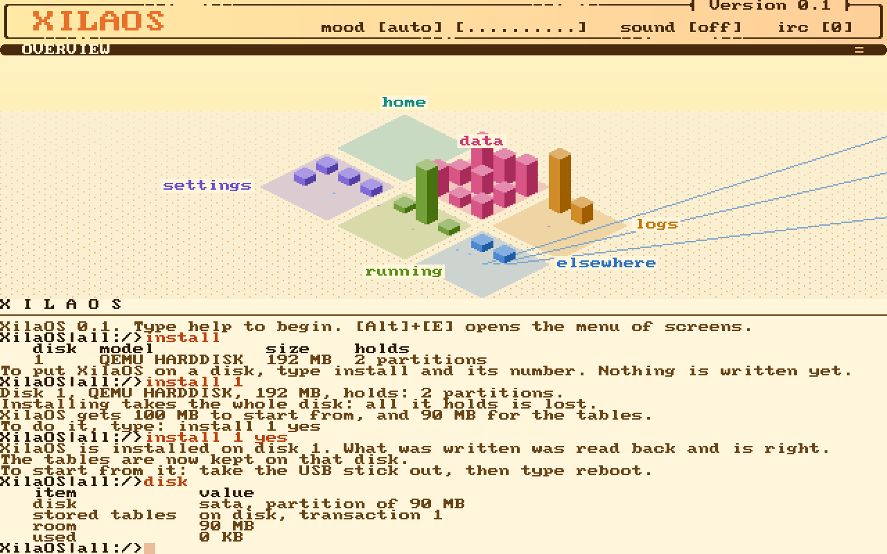
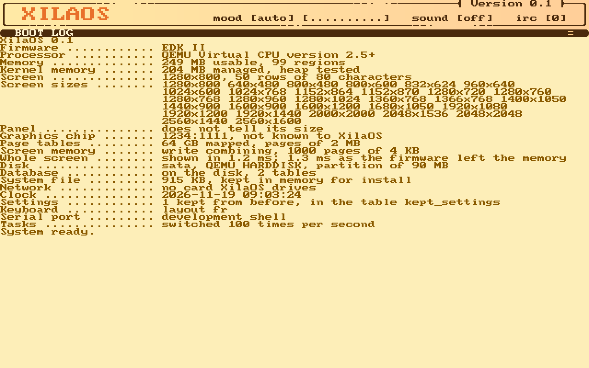
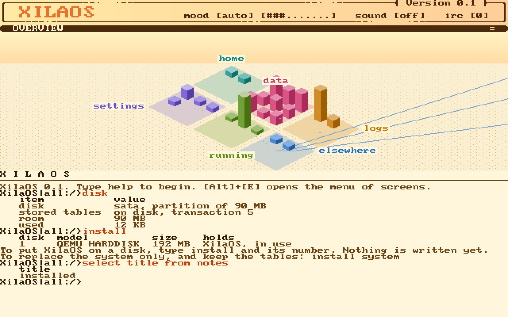

# Disk layout and installation

XilaOS has no file system. Its tables live in a range of 4 KB pages that the storage engine owns, and this chapter is about that range: which one the kernel picks when the machine starts, what it refuses to touch, and how `install` turns a whole disk into one a PC starts from.

The steps a user follows are in [Getting started](02-getting-started.md). This chapter describes what happens inside. What the engine does with its pages once it has them is in [The storage engine](08-storage.md).

| Part | File |
|---|---|
| Choosing the disk at start, giving a disk to `install` | `kernel/src/disk.rs` |
| Partition tables (GPT): reading, describing, writing | `core/src/gpt.rs` |
| The start-up partition (FAT32, one file) | `core/src/fat.rs` |
| The sequence of writes and the read back | `core/src/install.rs` |
| The `disk` and `install` commands | `core/src/shell.rs` |
| The image of a USB stick, made on the host | `core/examples/usb.rs`, `tools/usb.sh` |

Everything that decides something is in `core/`, with unit tests that run on the development machine. The kernel only supplies a disk that reads and writes sectors.

## Where the tables are kept

At start, `disk::open` scans the PCI bus once and decides, in this order:

1. **A virtio disk**, as QEMU gives one, is taken whole. It is the disk of development.
2. **Otherwise, the SATA disks**, in the order of their ports. On each, the partition table is read, and the first partition whose type is the one of XilaOS is taken. Only that partition: nothing else on the disk is ever written.
3. **Otherwise the tables live in memory**, and the system says so. They may take a quarter of the usable memory, and are lost when the machine stops.

The type of a XilaOS partition is an identifier drawn at random for it:

```
04DA9601-6187-4182-88FE-27F226C8DEE9
```

The boot log and the `disk` command say what was found. These are the lines the kernel can write:

| Boot log line `Disk ......` | Meaning |
|---|---|
| `virtio, 64 MB` | A virtio disk, taken whole. |
| `sata, QEMU HARDDISK, partition of 90 MB` | The XilaOS partition of a SATA disk, with the model of the disk. |
| `sata, 504 MB, no XilaOS partition: not used` | One SATA disk, and no partition for XilaOS on it. |
| `2 sata disks, no XilaOS partition: not used` | The same, with several disks. |
| `sata partition, holds something else: not used` | A XilaOS partition whose first pages are neither empty nor a database. |
| `sata partition, damaged at page N: not used` | A database whose header cannot be right. |
| `sata partition, too small: not used` | Too few pages for a database. |
| `none` | No disk the kernel drives. |

The next line, `Database ......`, is `new, on the disk`, `on the disk, N tables`, or `in memory, lost when the machine stops`.

### The rules that protect what a disk holds

A real disk holds other systems and their data. Three rules keep them safe, and all three are checked in QEMU by comparing every byte outside the partition before and after.

- **A partition table is believed only when it is whole.** `gpt::entries` wants the signature `EFI PART`, a header whose CRC-32 is right and which says it is at sector 1, entries of a sane size, and a CRC-32 of all the entries that matches. Anything else is `Damaged`, and the disk is not used. The second copy of the table, at the end of the disk, is not consulted.
- **A partition counts only if its range is one a partition may have**: inside what the table calls usable, inside the disk, first sector before last.
- **Marking a partition is not enough.** The storage engine reads the two header pages of the place it is given. If both are all zeros it starts a new database there. If one is a valid header it opens the database. Otherwise the place holds something else (`Error::Foreign`), and it is left exactly as it is: a wrong partition number in a partitioning tool destroys nothing.

A disk with the old kind of partition table (MBR), with 4 KB sectors, or without 48-bit addresses is not used. Neither is an NVMe disk: there is no driver for it.

### Giving XilaOS a partition that was refused

A partition that was refused because it holds something else, or a damaged database, is not forgotten: the kernel keeps the volume in `System::spare`. The `disk` command then ends with a hint, and `disk erase` explains before `disk erase yes` acts. This is a real session, on a 60 MB partition of the right type that held somebody else's data:

```
XilaOS|all:/>disk
   item           value
   disk           sata partition, holds something else: not used
   stored tables  in memory, lost when the machine stops
   room           62 MB
   used           0 KB
The disk was not used. To give it to XilaOS, type: disk erase
XilaOS|all:/>create table notes (title text)
Table notes created.
XilaOS|all:/>disk erase
This erases the 60 MB that were found on the disk and not used,
and starts an empty database there. What the disk holds is lost.
The tables made since the start are in memory: they are lost too.
To do it, type: disk erase yes
XilaOS|all:/>disk erase yes
The disk is erased. The tables are now kept on it.
XilaOS|all:/>disk
   item           value
   disk           sata, 60 MB
   stored tables  on disk, transaction 1
   room           60 MB
   used           0 KB
```

`disk erase yes` calls `Database::format` on the spare volume, makes that database the one of the system, and clears `System::kept` so that the settings in use are written to the new place at the next tick. Without a spare volume the command answers `There is no disk to erase.` It is refused from the network prompt: `disk erase takes a disk: it is typed at the machine itself.`

The `room` of 62 MB in the first table is the memory the tables may take while there is no disk: a quarter of the 249 MB this virtual machine has.

## A disk installed by XilaOS

`install n yes` is the only command that takes a whole disk. What it writes is a disk any UEFI firmware starts from, with two partitions. On the 192 MB disk of the session below, read back by a few lines of Python that share no code with XilaOS:

| Sectors | Size | What |
|---|---|---|
| 0 | 1 sector | The guard for old tools: one partition of kind `EE` that covers the disk. |
| 1 | 1 sector | The header of the partition table. |
| 2 to 33 | 32 sectors | 128 entries of 128 bytes; two are used. |
| 2048 to 206847 | 100 MB | Partition 1, type `C12A7328-F81F-11D2-BA4B-00A0C93EC93B` (EFI system partition), named `XilaOS start`. |
| 206848 to 391167 | 90 MB | Partition 2, type `04DA9601-6187-4182-88FE-27F226C8DEE9`, named `XilaOS`. The tables. |
| 393183 to 393214 | 32 sectors | The second copy of the entries. |
| 393215 | 1 sector | The second copy of the header. |

`gpt::Layout::new(sectors, seed)` computes this for any disk:

- the start-up partition begins at 1 MB and takes 100 MB, as other systems make it;
- the partition of the tables takes the rest, down to a whole megabyte, leaving the last 33 sectors for the second copy of the table;
- at least 16 MB must be left for the tables, which is why a disk under 118 MB is refused (`Disk 1 is too small: XilaOS needs 118 MB at least.`);
- the disk and each partition get an identifier of the random kind (version 4), drawn from a seed the kernel makes from the processor's counter, the tick count and the size of the disk, so that two installations never share one.

The name `XilaOS start` matters: `gpt::describe` says that a disk "holds XilaOS" only when it finds a start-up partition of that name together with a partition of XilaOS's type. That is how `install system` knows which partition it may rewrite, and why it never touches the start-up partition of another system.

### The start-up partition

A firmware starts a system from the file `EFI\BOOT\BOOTX64.EFI` of a partition laid out as FAT32. XilaOS keeps nothing in files, but it has to be started, so `fat::Fat` makes exactly that: a FAT32 partition with three directories (the root, `EFI`, `BOOT`) and one file, which is the kernel.

- **It is not a file system of XilaOS.** The module only makes the partition, whole and new each time. Nothing in XilaOS reads such a partition or changes one.
- **Nothing is built in memory.** `Fat::sector(at, file, out)` tells what any sector of the partition holds: the description of the partition (sector 0, copied at sector 6), its notes on free clusters (sectors 1 and 7), the two tables, a directory, a piece of the file, or zeros. Whoever writes the partition needs room for the sectors it is writing and no more. The installer writes eight at a time.
- **Clusters are one sector each**, so that a 100 MB partition has 201 616 of them: under 65 525 a firmware would read the tables as FAT16. The directories are clusters 2, 3 and 4, and the file follows from cluster 5, in one run.
- **Only what is used is written**: the 32 reserved sectors, the two tables, the three directories and the file. For a kernel of 915 KB that is about 5 000 sectors, 2.4 MB of the 100. What the other clusters hold does not matter, since the tables say they are free.
- Every entry is dated 1 January 2026, and the volume is named `XILAOS`.

No entry is added to the firmware's start-up settings. A firmware that follows the standard tries `EFI\BOOT\BOOTX64.EFI` on its own, and the T430 does.

## The `install` command

`install` is typed at the machine itself, on the keyboard or the serial port. From the network prompt every form of it is refused: `install takes a disk: it is typed at the machine itself.`

It has three steps, and only the third writes:

| Command | What it does |
|---|---|
| `install` | Lists the SATA disks (eight at most), with their size and what each holds. |
| `install 1` | Says what disk 1 holds, what will be lost and what XilaOS gets. |
| `install 1 yes` | Takes the whole disk. |
| `install system` | Replaces the kernel on the disk XilaOS is installed on; the tables stay. |

What `holds` can say comes from `gpt::describe`: `nothing`, `an old kind of partition table`, `something, without partitions`, `a damaged partition table`, `2 partitions`, `XilaOS`, `XilaOS and 1 other partition`, `does not answer`, with `, in use` when the tables of the running system are on that disk.

### A session

This was captured in QEMU. The machine starts from the image of a USB stick; its SATA disk holds two partitions of another system and random data.

```
XilaOS|all:/>install
   disk  model          size    holds
   1     QEMU HARDDISK  192 MB  2 partitions
To put XilaOS on a disk, type install and its number. Nothing is written yet.
XilaOS|all:/>install 1
Disk 1, QEMU HARDDISK, 192 MB, holds: 2 partitions.
Installing takes the whole disk: all it holds is lost.
XilaOS gets 100 MB to start from, and 90 MB for the tables.
To do it, type: install 1 yes
XilaOS|all:/>install 1 yes
XilaOS is installed on disk 1. What was written was read back and is right.
The tables are now kept on that disk.
To start from it: take the USB stick out, then type reboot.
XilaOS|all:/>disk
   item           value
   disk           sata, partition of 90 MB
   stored tables  on disk, transaction 1
   room           90 MB
   used           0 KB
```



Started again without the stick, the same virtual machine finds its system and its tables on the disk. A table and a keyboard layout chosen before the restart are there:

```
Disk ................ sata, QEMU HARDDISK, partition of 90 MB
Database ............ on the disk, 2 tables
System file ......... 915 KB, kept in memory for install
...
Settings ............ 1 kept from before, in the table kept_settings
Keyboard ............ layout fr
```





### What `install n yes` does

The command itself cannot touch a disk: it lives in `core/`. It leaves a `Request::Install` in `System`; the task that ran it calls `disk::install` in the kernel, and the answer is shown where the command was typed.

In the kernel (`kernel/src/disk.rs`):

1. The layout and the start-up partition are computed first. A disk that is too small, or a start-up partition with no room for the kernel, is refused before anything is given up or written.
2. If the tables of the running system are on a partition of that disk, the database lets go of it: the partition is about to be gone. Until the installation is over, the tables are an empty database in memory.
3. `install::whole` does the writes, through the `Sectors` trait (read, write, flush), which the kernel implements with the SATA driver.
4. The database is opened on the new partition, which is empty, so a new database starts there. `System::kept` is cleared: the settings in use (keyboard, theme, mood, brightness) are written to the new place at the next tick. That is why a `keymap fr` typed on the stick is remembered by the installed disk.

Tables made in memory since the start are not copied. `install 1` says so when there are any: `The tables made since the start are in memory: they are lost too.`

In `install::whole` (`core/src/install.rs`), the order of the writes is chosen so that a disk never looks like something it is not:

1. **The first 128 sectors of the future partition of the tables are emptied.** If the disk was installed before, the new partition is where the old one was, and its old database must not be taken for the new one.
2. **The partition table**: the second copy at the end of the disk first, then the entries at sector 2, the guard at sector 0, and the header at sector 1 last. A table counts from the moment its header is there.
3. **The start-up partition**, eight sectors at a time, each computed by `Fat::sector`.
4. **A flush**: the command does not go on until the disk says everything is written.
5. **The read back.** The partition table is read by `gpt::describe`, the same reading that will look for it at the next start, and must give exactly two partitions at the expected places. The start-up partition is then compared with what should have been written, sector by sector.

While the start-up partition is written and then read back, a second or two on a real disk during which the machine does nothing else, the last row of the screen shows how far it is (`install::Progress`, `Ui::progress`):

```
 Writing the disk  [##########..............................]  25%
 Reading it back   [##############################..........]  75%
```

The boot log keeps a line of it: `Install: disk 1, 1907 sectors written and read back, shown in 41 steps.`

Only then does the command say `What was written was read back and is right.` A disk that does not keep what it is given must be found out now, not at the next start. What can go wrong is told with the sector:

```
The disk refused to write sector N.
The disk could not read back sector N.
Sector N of the disk does not hold what was written in it.
The installation is not complete: do it again, or take another disk.
```

### Replacing the system only

`install system` calls `install::system`: it rewrites the start-up partition, flushes, and reads it back. Nothing else on the disk is written, so it asks for no confirmation.

```
XilaOS|all:/>install system
The system on disk 1 is replaced. What was written was read back and is right.
The tables were not touched. It runs at the next start: type reboot.
```

Without a number it picks the one disk that holds XilaOS; with several, it asks for `install system` and a number. On a disk XilaOS was not installed on it answers `XilaOS is not on disk 1: there is no system to replace. See: install 1`.

This is how a newer kernel reaches an installed machine: start from a new stick, which finds and uses the tables of the disk, then type `install system`.

### Where the kernel comes from

The kernel has no USB driver, so it cannot read the stick it was started from. Only the firmware can, and only before the boot services are left. So `kernel/src/uefi.rs` asks the firmware which file it started, reads that file whole into memory that stays with the kernel (32 MB at most), and checks that it begins as a program a firmware starts does. The boot log says:

```
System file ......... 915 KB, kept in memory for install
```

or `System file ......... not kept:` and the reason. That copy is what `install` writes: the installed kernel is byte for byte the one that is running.

A machine started from its network cable has no such file. `install` then says `This XilaOS cannot install: the firmware did not give it its own file.` and points to the other source: `install from ADDRESS` fetches the kernel by TFTP from a machine that runs `tools/netboot.py`, and makes it the system that `install` and `install system` write. See [Networking](10-networking.md).

## The image of a USB stick

`tools/usb.sh` builds the kernel and makes `build/xilaos-usb.img`, 128 MB, to be copied whole to a stick. The script never writes to a disk or a stick itself.

The image is not made by a host tool. `core/examples/usb.rs` implements `Sectors` over a file and calls `install::whole`: a stick is a disk installed like any other, with its partition table, its start-up partition and an empty partition for tables that nothing uses, since the running kernel cannot see the stick.

```sh
cargo run -p xila-core --example usb -- BOOTX64.EFI stick.img [MEGABYTES]
```

Starting QEMU from that image (`Xila(stick=image)` in `tools/xq.py`, which plugs it in as a USB device) therefore checks the code of `install` with a real firmware before any real disk is written.

## How it is checked

A partition a firmware refuses is found out late and on the wrong machine, so what `install` writes is read by three readers that share no code with what wrote it:

- **A test reader in `core/src/fat.rs`** follows the partition the way a firmware does, from its description to the directories to the chain of clusters, and must find the file whole.
- **A reader in Python in `tools/check.py`** parses the partition table with both copies, then the FAT32 partition, and compares the file it finds with the kernel that was built.
- **`fsck_msdos`**, the checker macOS ships, is run on the start-up partition and must find nothing to repair. On the disk of the session above:

```
** Phase 1 - Preparing FAT
** Phase 2 - Checking Directories
** Phase 3 - Checking for Orphan Clusters
Warning: 4 files, 99890 KiB free (199780 clusters)
```

It exits with status 0. The fourth file it counts, besides the two directories and the kernel, is `NvVars`, which QEMU's firmware writes for itself in the first start-up partition it finds once the machine has started from that disk.

Around them:

- **Unit tests** (`cargo test -p xila-core`): identifiers stored as tools store them, a damaged table not trusted, the partition of XilaOS found among others; and for `install`, a disk that refuses a write, one that refuses to read back, and one that forgets what it was given are each found out, while a disk that cannot take the system is left alone.
- **In QEMU** (`tools/check.py`): until `yes` is typed the disk is exactly as it was; after `install 1 yes` the machine starts from its disk without the stick and finds its tables; the disk the system runs from can be taken again; `install system` leaves the partition of the tables and the partition table exactly as they were; a 100 MB disk is refused and nothing is written on it.
- **On a real machine**: on 2026-11-18 a Lenovo T430 was started from the stick, installed with `install`, and started from its disk. The same day its system was replaced without a stick, by `install from` and `install system`.

## Limits

- `install` takes a whole disk. It cannot install beside another system, in free space. To share a disk with another system, make a partition of XilaOS's type yourself and start from the stick each time (see [Getting started](02-getting-started.md)).
- Only SATA disks behind an AHCI controller, with 512-byte sectors. No NVMe, no USB disk, no MBR table.
- One disk holds the tables. There is no mirror; the place for one is the `Volume` layer of the storage engine.
- The SATA driver has written to one real disk, the T430's. It is written from the AHCI specification, but only QEMU's controller and that one have run it.
- Nothing shows progress while the disk is written: the prompt waits one or two seconds.
- Nothing authenticates a kernel fetched by `install from`. That is why every form of `install` is refused from the network prompt.
