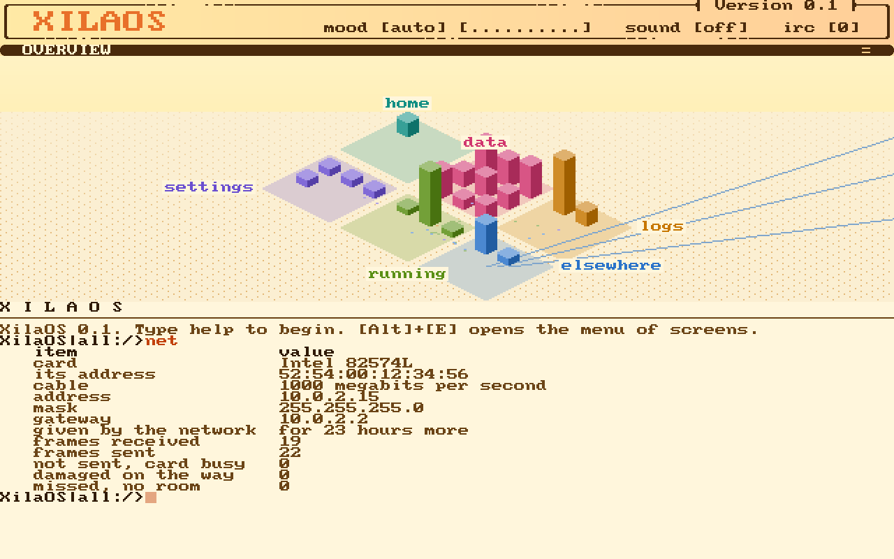
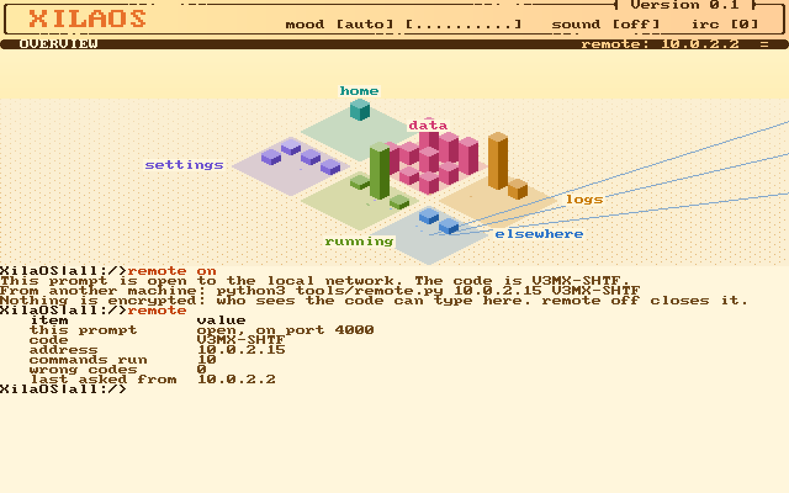
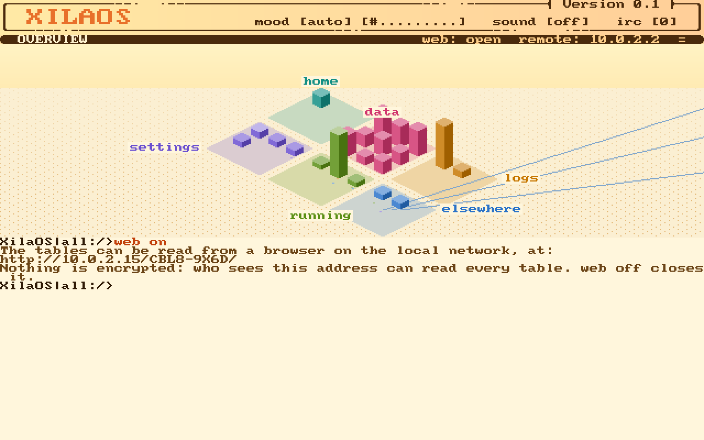
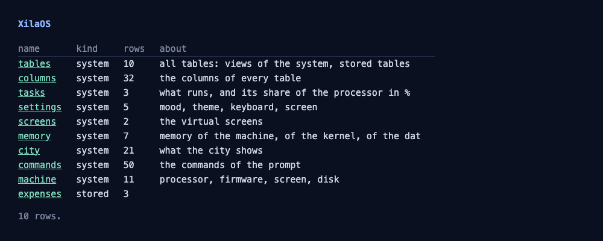
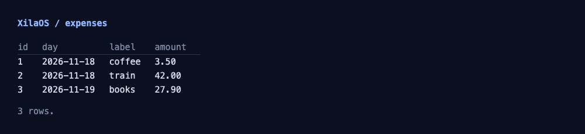

# Networking

XilaOS has a small network stack of its own, written for it: no code from another system, no heap, no interrupt. Plugged by a cable into a local network, the machine asks for an address, answers a `ping`, and can do four things with other machines: take commands from one (`remote`), show its tables to a browser (`web`), ask one for a page (`net get`), and fetch a new system from one (`install from`).

> **Nothing is encrypted.** Every code, command, table and file described in this chapter crosses the network as it is. All of it is meant for a local network one trusts, and all of it is closed when the machine starts. See [Security](#security).

## What exists

| Layer | State | Where |
|---|---|---|
| Ethernet | Frames up to 1514 bytes; short ones are filled to 60. | `core/src/net.rs` |
| ARP | Answers for its own address, asks for others. Eight addresses remembered, each for five minutes. | `core/src/net.rs` |
| IPv4 | To the cable directly, or through the gateway. No fragments: a packet cut in pieces on the way is dropped, and none is ever sent. | `core/src/net.rs` |
| ICMP | Answers an echo request, sends one (`net ping`). Nothing else. | `core/src/net.rs` |
| UDP | Messages to and from a port, with their checksum. | `core/src/net.rs` |
| DHCP | Client only: asks for an address, a mask and a gateway, and asks again at half of the lease. | `core/src/net.rs` |
| TCP | Both sides: listens and calls. Eight conversations at once, four ports listened on. No out-of-order reassembly, no window scaling, no selective acknowledgement. | `core/src/tcp.rs` |
| HTTP, asking | One `GET` (the code can also write a `POST`), HTTP/1.0, the first kilobyte of the answer is kept. | `core/src/ask.rs` |
| HTTP, serving | Read-only pages of the tables, one browser at a time. | `core/src/web.rs` |
| Remote prompt | One command per UDP message on port 4000. | `core/src/remote.rs`, `tools/remote.py` |
| TFTP | Client only, for one file: the system. | `core/src/tftp.rs` |
| Network boot | A script on another computer serves the kernel to a PC that starts from its cable. | `tools/netboot.py` |
| Driver | Intel cards of the e1000 family only. | `kernel/src/e1000.rs` |

What does not exist: DNS (machines are named by their address), TLS or any other encryption, IPv6, Wi-Fi, any card that is not an Intel e1000, sockets for programs (XilaScript has no statement that opens a conversation), routing, and a firewall. An encrypted protocol between XilaOS machines was designed and never built.

## Using it

Everything below was run in QEMU, with QEMU's own small network: the guest gets the address 10.0.2.15, and 10.0.2.2 is the host. Tables are shown as the screen draws them; the serial port gives the same rows between `#table` and `#end`.

### net

The boot log (`Alt+1`) says which card was found:

```
Network ............. Intel 82574L, 52:54:00:12:34:56
```

or `Network ............. no card XilaOS drives`. In that case every `net` command answers `XilaOS drives no network card of this machine. Type devices to see what it has.`

`net` shows the card, the cable, the address and the counters:



```
XilaOS|all:/>net
   item                  value
   card                  Intel 82574L
   its address           52:54:00:12:34:56
   cable                 1000 megabits per second
   address               10.0.2.15
   mask                  255.255.255.0
   gateway               10.0.2.2
   given by the network  for 23 hours more
   frames received       19
   frames sent           22
   not sent, card busy   0
   damaged on the way    0
   missed, no room       0
```

Without a cable the `cable` row says `not plugged in, or the other end is silent` and the address `none: no cable`; with a cable and no answer yet from the network, `none yet: asking the network for one`. The card's own counters are read once per second, so `frames sent` can be a second late.

### net ping

```
XilaOS|all:/>net ping 10.0.2.2
10.0.2.2 answered in 1.0 ms.
XilaOS|all:/>net ping 10.0.2.99
10.0.2.99 did not answer within a second.
```

The machine waits up to one second for the answer and does nothing else meanwhile. It is a trial tool, not a measuring one.

### net restart

Resets the card and sets it up again, as at start, and asks the network for an address anew:

```
XilaOS|all:/>net restart
The card was reset and set up again. It asks the network for an address.
```

### net registers

Lists 32 values: 26 registers of the card under the names Linux's `e1000e` driver gives them, with their address, then what the driver itself knows. It only reads. It exists for the day a card does not do what it should, and it is sized to fit one QR code (`qr net registers`), which is how text leaves a machine without a working network. An extract, from QEMU's 82574L (lines left out are marked):

```
XilaOS|all:/>net registers
   register           address  value
   CTRL               00000    00140241
   STATUS             00008    00080283
   CTRL_EXT           00018    00000000
   RCTL               00100    04008002
   TCTL               00400    0103f0fa
   ...
   TDH                03810    00000005
   TDT                03818    00000005
   ...
   TDFH               03410    00000600
   TDFT               03418    00000600
   ...
   phy link           0001a    ffffffff
   phy power          00011    ffffffff
   k1                 00000    00000000
   given to the card  00000    00000005
   first, its status  00000    00000001
   words lost         00000    00000000
```

`TDH` and `TDT` are how far the card has sent and how far it may; equal, and equal to `given to the card`, means every frame left. `TDFH` and `TDFT` are where the card reads and writes in its own send memory. The `phy` rows read the chip near the socket on an 82579 and are `ffffffff` on any other card.

### net get

Asks another machine for a page over HTTP and shows how it went and the start of what it said. It is the calling side of TCP, tried by hand. The place is an address, with or without `http://`, a port (80 if none) and a path:

```
XilaOS|all:/>net get 10.0.2.2:55485/hello.txt
10.0.2.2:55485 answered 200.
hello from the host
this page is served by python3 -m http.server
XilaOS|all:/>net get 10.0.2.2:55485/missing
10.0.2.2:55485 answered 404.
<!DOCTYPE HTML>
<html lang="en">
<head>
<meta charset="utf-8">
<title>Error response</title>
</head>
<body>
<h1>Error response</h1>
(and more)
XilaOS|all:/>net get 10.0.2.2:1/
10.0.2.2:1 does not answer.
```

What comes back is shown and never run. The other failures say `took the call and then said nothing`, `answered something that is not a page`, or `cannot be asked now: too many conversations at once`. A machine that has not finished answering after five seconds is given up. There is no DNS, so a name in place of the address is refused, and no TLS, so `https://` is too.

### remote: the prompt from another computer

On the XilaOS machine, at its keyboard or its serial port:

```
XilaOS|all:/>remote on
This prompt is open to the local network. The code is V3MX-SHTF.
From another machine: python3 tools/remote.py 10.0.2.15 V3MX-SHTF
Nothing is encrypted: who sees the code can type here. remote off closes it.
```

On the other computer, with Python 3 and this repository:

```sh
python3 tools/remote.py 10.0.2.15 V3MX-SHTF                 # a prompt: xila>
python3 tools/remote.py 10.0.2.15 V3MX-SHTF tasks           # one command
```

```
  id  name          state    ran
  0   interface     running  0.17 s
  1   idle          ready    8.40 s
  2   serial shell  waiting  1.02 s
```

The tool's exit status is 0 if the command succeeded, 1 if it failed or if no answer came. `--port` picks another port, which is what a forwarded port in QEMU needs.

The prompt for the network is a third session, beside the screen and the serial port: it has its own names (`let`), its own open blocks and its own `listen`. A block is typed over several commands, as on the serial port. Events it listens to arrive with the answer to its next command.

While it is open, the title bar of every screen says `remote: open`, then the address of whoever typed there last. `remote` alone shows the state:



`remote off` closes it, from the machine or from the network session itself.

### web: the tables in a browser

```
XilaOS|all:/>web on
The tables can be read from a browser on the local network, at:
http://10.0.2.15/CBL8-9X6D/
Nothing is encrypted: who sees this address can read every table. web off closes it.
```



That address, opened in the browser of another computer of the same local network, lists the tables: the views of the system's live state and the stored ones.



Each name leads to the rows of that table, at `/CODE/t/NAME`:



A page is the result of one `select * from NAME`, with the limits of any `select` at the prompt: 32 rows at most, and the page then says `The first 32 rows of 50.` The pages are built when asked for; nothing refreshes by itself. `web` alone shows the state (address, pages given, wrong codes, who asked last) and `web off` closes it.

### install from: a new system without a USB stick

`tools/netboot.py`, running on a computer of the local network, serves the kernel file. A running XilaOS fetches it and then puts it on its disk:

```
XilaOS|all:/>install from 10.0.2.2
10.0.2.2 gave a system of 936960 bytes, check 53531b3d.
Nothing is written yet. To put it on a disk: install, or install system.
XilaOS|all:/>install system
```

The first command only fetches, into memory. It prints the size and a check number (the CRC-32 of the file); `netboot.py` prints the same two on its side, to compare by eye. The second replaces the system on the start-up partition and leaves the tables alone (see the chapter on installing). A server that is not there gives `10.0.2.99 does not answer. Is tools/netboot.py running there?`; one without the file, `has no system to give.`; a file that is not a UEFI program for a 64-bit PC, `gave something that is not a system for this machine.`

### Starting a PC from its network cable

```sh
tools/build.sh
python3 tools/netboot.py            # serves build/esp/EFI/BOOT/BOOTX64.EFI; Ctrl+C stops
python3 tools/netboot.py --check    # tries both of its servers on this machine alone
```

On the PC: in the firmware's setup, turn on starting from the network in UEFI mode over IPv4, then choose the network card in the start-up menu (F12 on a ThinkPad). The PC and the serving computer must be on the same local network, and that network must already give addresses, as a home router does.

The script is two small servers:

- **On UDP ports 67 and 4011, a proxy DHCP.** It gives no address. It only answers machines that say they start from the network (`PXEClient`) and that they are 64-bit UEFI PCs, and tells them where the file is. Firmwares differ in the answer they accept, so it gives the two forms in turn at each new question from the same card: the plain one ("come and ask on port 4011") and the full one (the name of the file in the offer itself).
- **On UDP port 69, TFTP.** It serves one file, the kernel, whatever folder the asker names, and refuses any other name. Blocks are 512 bytes, or what the asker asks for up to 1428.

It prints a line for each thing a machine asks and for each file handed over, with its size and check number. `--address` sets the serving computer's address when the script picks the wrong one, `--kernel` another file.

Started this way, XilaOS has no copy of its own file (only a firmware that read it from a disk hands it over), so `install` says so and points to `install from`. Each new kernel built on the serving computer is the one the PC gets at its next start.

This was tried on one real machine, the T430, on a home network, with the script running on a laptop on Wi-Fi.

## Security

This is stated in the commands' own output and repeated here because it is the most important thing to know.

- **Nothing is encrypted.** The code of `remote`, the commands typed there and their answers, the address of `web` and every page, the kernel fetched by `install from`: all of it crosses the network in clear. A machine that can listen to the local network can read a code and use it.
- **Closed at every start.** Neither `remote` nor `web` is ever open unless someone typed `remote on` or `web on` at the machine itself, since the last start. Nothing of them is kept on disk.
- **The code** is eight characters out of 32 (letters and digits, without `I`, `O`, `0` and `1`), drawn anew at each `on`. It comes from the processor's cycle counter, stirred at every key and every pass of the kernel's loop, and from the processor's random source when it has one. It is compared in constant time, in either case, with or without its dash.
- **Local network only.** A sender whose address is not on the machine's own network (by its mask) gets no answer at all from `remote`, and its TCP call to `web` is cut.
- **Wrong codes.** A message to `remote` with a wrong code gets no answer, so that nothing tells a stranger a prompt is there. A page asked of `web` without the code gets `404 Not Found`, the same as a page that does not exist. After twenty wrong codes each door closes itself, and says so at the machine: `closed itself after 20 wrong codes`.
- **What the network session may not do.** `install` (every form), `disk erase`, `remote on` and `web on` are refused there with a message such as `install takes a disk: it is typed at the machine itself.` Everything else is allowed, `drop table` and `reboot` included: whoever has the code has the prompt.
- **The web pages cannot change anything.** This is by construction and not by a check: nothing a browser sends reaches the shell. The first line of its request is read, the name of a table is accepted only if it is letters, digits and underscores, and the only thing ever run is `select`, through a reference to the system that does not allow changes. Any method but `GET` gets `405 Method Not Allowed`. Cell contents are escaped. The pages ask browsers not to keep them (`Cache-Control: no-store`) and not to tell other sites their address (`Referrer-Policy: no-referrer`).
- **TFTP authenticates nothing.** Nothing says who the server is nor that the file is the right one; `install from` only checks that the file has the shape of a UEFI program for this kind of machine. That is why it only fetches, shows a size and a check number, and writes nothing until `install system` is typed at the machine, and why no form of `install` is accepted from the network.
- **`net get` shows and never runs** what comes back.

## How it is built

### A stack with no hardware in it

`net::Net`, kept in `System::net`, is the whole stack below TCP, and it never touches a device. The driver gives it what happens and it hands frames back through one small trait:

```rust
pub trait Wire {
    fn send(&mut self, frame: &[u8]);
}
```

- `receive(frame, now, wire)` takes a frame from the cable. It answers what any machine must (an ARP question for its address, a ping), feeds DHCP answers to the client and TCP segments to `tcp`, and returns a `Message` when the frame carries a UDP message for a port of this machine.
- `tick(now, wire)` lets time pass: the DHCP client, then TCP's timers.
- `ping(to, now, wire)` and `message(to, to_port, from_port, bytes, now, wire)` send.
- `speak(now, wire)` sends what the TCP conversations have to say, twelve segments at most in one call.

Time is the kernel's count of timer ticks, 100 per second. Since nothing here needs a card, the unit tests of `core/` play the other machine: they hand in frames built by hand and read what comes out of a `Wire` that keeps them in a list. Everything uses fixed buffers; one packet at a time can wait for an ARP answer.

The DHCP client asks after 2, 4, then every 8 seconds until it is offered an address, takes a lease of between one minute and thirty days, asks again at half of it and then every minute, and gives the address up if the lease runs out unanswered.

### Polled at every tick

The card raises no interrupt. The interface task, the one that also reads the keyboard and redraws the screen, calls `network` in `kernel/src/main.rs` at each pass of its loop: it takes up to 32 frames from the card, gives each to `Net::receive`, then calls `Net::tick`. A packet therefore waits up to a hundredth of a second. If one of the messages is a command for the remote prompt, it is run there and then, exactly as the serial task runs a line. Then `web::step` does a little of the pages' work and `Net::speak` sends what TCP has ready.

Commands that wait for the network (`net ping`, `net get`, `install from`) run their own loop of the same kind while the command is served, holding the system for up to one second, five seconds and one minute respectively.

### The e1000 driver

`e1000::Nic` drives four cards, found by what they say on the PCI bus: the 82540EM and 82574L that QEMU imitates (`-device e1000` and `e1000e`), and the 82579LM and 82579V of ThinkPads of 2012. `devices` shows the card with `XilaOS` as its driver.

A card of this family is driven through registers in memory and two rings it shares with the driver. Each ring is a list of 16-byte descriptors: an address in memory, a length, a status.

- **Receive:** 32 descriptors, each pointing to a 2048-byte buffer. The card fills them and marks them done; `Nic::receive` copies a frame out, gives the buffer back and moves the tail register.
- **Transmit:** 16 descriptors. `Wire::send` copies the frame into a buffer, writes a descriptor and moves the tail. One descriptor always stays free, since a full ring looks like an empty one to the card. A frame the card has no room for is counted (`not sent, card busy`) and dropped: the network makes no promise, and nor does the driver.

At start, and at `net restart`, the part of the card that counts frames is reset before it is set up, as Linux and iPXE do. Taking the card as the firmware left it worked only when the firmware had not used it: after a start from the network the card went on with the firmware's rings.

The 82579 is two chips, one in the machine's main chip and one near the socket (the PHY), and it is shared with the machine's management engine (ME). What the driver does for it, following Linux's `e1000e`:

- it tells the ME that a driver has taken the card;
- before each register write it waits for the ME not to be writing, or the write is lost;
- it sets the bits the card's maker asks for on the transmit side;
- when the link comes up at 100 or 1000 megabits, it turns off a way of saving power between the two chips (K1) that loses packets, by a register of the PHY reached through `Nic::phy`.

None of this runs in QEMU, which imitates no 82579.

### TCP

`tcp::Tcp` (in `Net::tcp`) is a state machine with no hardware and no clock of its own:

- `input(from, to, segment, now)` takes a segment that arrived;
- `tick(now)` lets time pass;
- `output(ours, now, into)` writes the next segment to send, and is called until it returns nothing.

`Net::receive` calls `input`, `Net::tick` calls `tick`, and `Net::speak` drains `output` into IP packets.

A program in the kernel uses it through a handful of calls: `listen(port)` and `accept(port)` on the side that is called, `connect(to, port, now)` and `connected(id)` on the side that calls, then `read`, `write`, `room`, `close`, `abort`, `alive` and `ended`. `write` takes what fits and says how much; whoever has more to say gives the rest as room is made.

Its limits are deliberate and small:

| | |
|---|---|
| Conversations at once | 8 |
| Ports listened on | 4 |
| Kept of what arrived and is not read yet | 1024 bytes, which is the window it announces |
| Kept of what was written and is not acknowledged | 4096 bytes |
| Largest segment | 1460 bytes |
| Sent again after | 0.5 s, doubling up to 8 s; ended after 6 tries |
| Silent conversation ended after | 60 s |
| Place kept after both sides closed | 2 s, unless a new caller needs it |

What arrives out of order is dropped and acknowledged at the point reached, so the other side sends it again: slow on a bad network, free on a good one. No more is sent than the other side has room for; when it has none, one byte is sent to hear when it has some again. A segment for no conversation gets a reset. The first sequence number of a conversation is drawn from the same stirred chance as the codes. There is no congestion control beyond these limits.

The tests in `tcp.rs` play the other side (`Peer`), with segments that are lost and segments that come out of order.

### The remote protocol

A request is one UDP message to port 4000, plain text:

```
CODE NUMBER line
```

for example `V3MX-SHTF 7 uptime`. The line is 240 characters at most. `Remote::asked` decides what to do with it: nothing (closed, not from this network, wrong code, not a request), run it, or send the last answer again.

The number is what makes UDP good enough. The network may lose a message or deliver it twice, so the answer to the last request is kept: the same number from the same address gets the same answer and **the line is not run twice**. `tools/remote.py` sends a request up to three times, three seconds apart, with the same number.

The answer is the text the serial prompt would have written, in a `remote::Answer`: lines, tables between `#table` and `#end`, `#event` lines, `#more` while a block is open, and `#ok` or `#error` last. It is cut into parts of 1200 bytes, twelve at most, each a UDP message that starts with a line `NUMBER PART COUNT`:

```
7 1 1
Up for 9.49 s.
#ok
```

An answer longer than twelve parts ends with `#cut` and the number of bytes left out. While the machine serves `net ping`, `net get` or `install from`, a request that arrives is not run; the sender asks again.

### The web pages

`web on` makes TCP listen on port 80. `web::step`, called at every pass of the interface task, serves one browser at a time:

1. it accepts a conversation, and cuts it at once if the caller is not on the local network;
2. it reads until the empty line that ends a request (512 bytes at most, five seconds at most) and looks at the first line only;
3. it builds the whole page in `web::Page`, a 48 KB buffer the kernel keeps, with `sql::select` on `&System`;
4. it writes the page to TCP as room is made, over as many passes as it takes, then closes.

The other browsers wait in TCP's places for their turn, which is short. The pages are HTTP/1.0 with `Connection: close`: one conversation, one page. Characters outside plain ASCII become `?`, since the system's own character set is not a browser's.

In QEMU the pages are reached through a forwarded host port. Many connections opened at the very same moment are reset by QEMU's forwarding itself, before XilaOS sees them.

### TFTP

`tftp::Fetch` asks the server's port 69 for `BOOTX64.EFI` from its own port 4069, in blocks of 1400 bytes if the server agrees (512 otherwise), and acknowledges each block by its number. A block shorter than the others is the last. A message without an answer is sent again after a second, five times. The kernel keeps 8 MB for the file, and `tftp::is_system` then checks its shape: `MZ`, `PE`, an x86-64 machine, 64-bit addresses, the EFI application subsystem.

## The card that received everything and sent nothing

The first run on the T430 found a card that worked by half: `net` counted every frame of the network coming in, and not one frame left. In QEMU the same driver worked.

Four trials changed settings after reading Linux's driver: wake-up from the network, the size of the send memory, the speed, the PHY, power, K1. None of them taught anything, because each was a guess about which setting mattered.

The fifth trial measured instead. On one start, the driver set the card up in several ways in turn, sent a frame to itself after each, and recorded where the card said the frame was: `TDFH` and `TDFT`, where the card reads and writes in its send memory. One way sent, the one that copied iPXE's sequence, and the difference with the others was one line. The driver wrote the transmit control register, `TCTL`, **whole**. The top bits of that register are named in no table of this family of cards; they say how the card reads a frame back out of its send memory. Written as 0, frames went into that memory and never left it. QEMU does not model those bits, so no test in QEMU could have caught it. The firmware's driver and iPXE's change only their own bits there.

The rule the driver now follows, and the one worth keeping: **change a register bit by bit; never write it whole unless every bit is known.**

```rust
// only the bits this driver means
let kept = self.get(TRANSMIT) & !(0xff << 4 | 0x3ff << 12);
self.set(TRANSMIT, kept | TRANSMIT_ON | TRANSMIT_FILL | TRANSMIT_COLLISIONS);
```

The scaffolding of that trial was taken out of the driver once the cause was found. `net registers` keeps `TDFH` and `TDFT`. Starting the T430 from the network cable helped twice: no USB stick between two trials, and a state of the card in which it does send, the firmware's, to compare with the driver's own.

## Trying it in QEMU

`tools/xq.py` plugs a card into QEMU's small network and forwards host ports to the guest, which nothing else can reach:

```python
from xq import Xila
from remote import Machine

with Xila(net="e1000e", forward=4000, web=8080, tftp="some/folder") as x:
    ok, lines = x.cmd("remote on")           # lines[0] holds the code
    far = Machine("127.0.0.1", CODE, 4000)   # far.cmd("tasks") returns what x.cmd does
```

`net="e1000"` gives the 82540EM instead. `forward` is a UDP port of the host that leads to port 4000 of the guest, `web` a TCP port that leads to port 80, and `tftp` a folder whose files QEMU serves at 10.0.2.2, which is how `install from 10.0.2.2` is checked. From the guest, a server on the host is at 10.0.2.2: `python3 -m http.server` answers `net get`.

Every frame that goes by is kept in `build/net.pcap`. `tools/check.py` reads that file back with code of its own and checks the lengths and checksums of everything XilaOS sent, so that the stack is not only checked against itself.

## Limits

- One card, one address, one gateway. No DNS, no IPv6, no fragments.
- A packet waits up to 10 ms for the next tick; throughput is whatever 100 passes per second and a 1 KB receive window allow. This is enough for pages of tables and a 1 MB kernel, and not meant for more.
- `net ping`, `net get` and `install from` hold the whole system while they wait.
- TCP is only used by the kernel's own `web` and `net get`; the language has no way to open a conversation.
- The parts specific to the 82579 ran on a single T430. The driver has never met another real card.
- No encryption anywhere.
