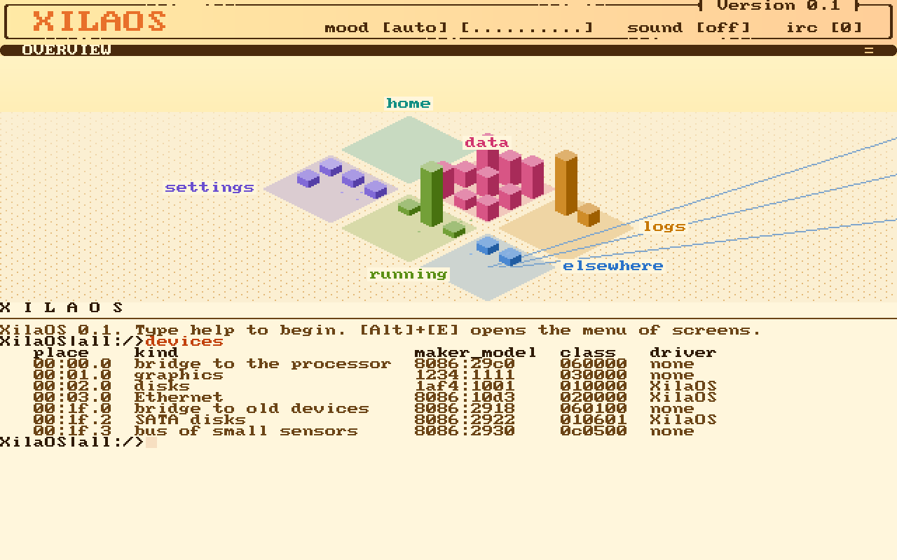
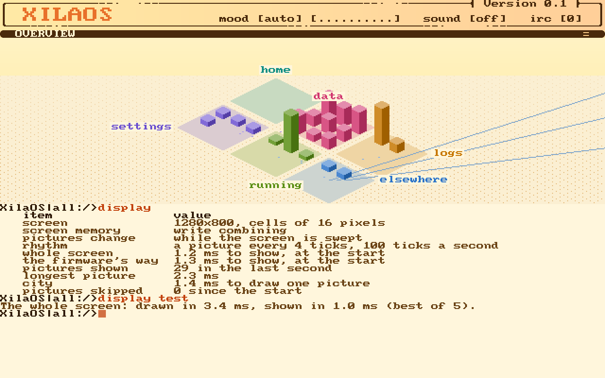
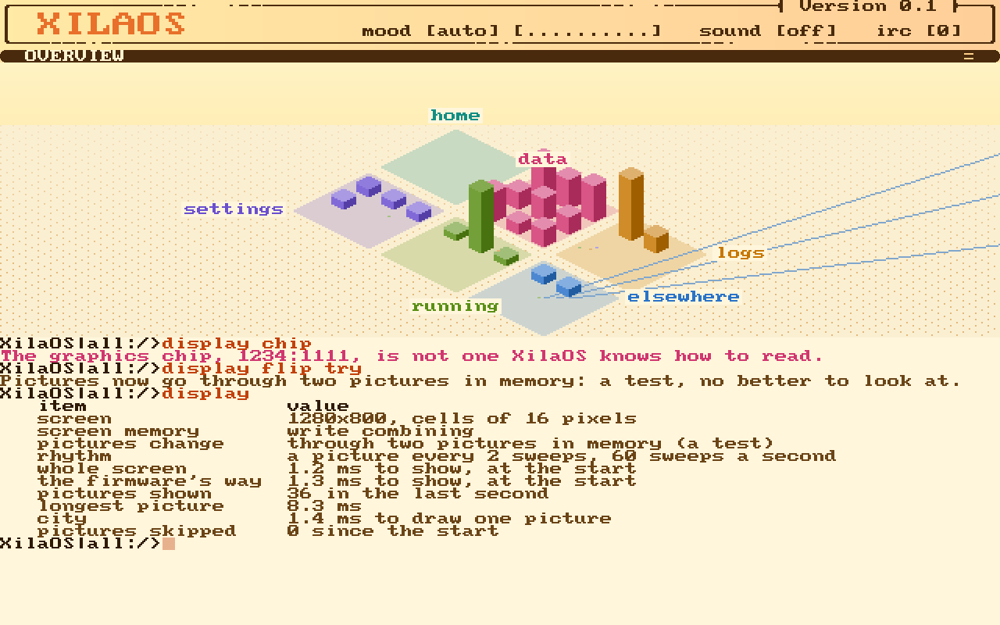

# Hardware and graphics

This chapter says what hardware XilaOS drives, how a driver is written here, what is realistic on other PCs, and how a picture gets from the character grid to the screen, including what the kernel does with the Intel graphics chip of a 2012 laptop.

XilaOS has run on one real machine, a Lenovo T430 (Core i5-3320M, Intel HD Graphics 4000, a 1600x900 panel). Everything else was run in QEMU. Where a statement was confirmed on the T430, the text says so; the rest is to be taken as "works in QEMU, written from the standard".

## What is driven today

| Device | State | File |
|---|---|---|
| Screen | The one the UEFI firmware prepares (GOP): a block of memory where the kernel writes pixels itself. Works on any UEFI PC, with no graphics driver. The kernel picks the size. | `kernel/src/uefi.rs`, `kernel/src/fb.rs` |
| Graphics chip | Intel HD Graphics 2000, 3000, 2500, 4000 (2011 and 2012): state read, pictures changed between two sweeps of the screen, panel brightness. Nothing is drawn by the chip. | `core/src/intel.rs`, `kernel/src/chip.rs` |
| Keyboard | PS/2 only, scancodes of set 1, `us` and `fr` layouts. Bytes of the pointing device are dropped. | `kernel/src/arch.rs`, `core/src/keys.rs` |
| Disk | SATA through AHCI (512-byte sectors, 48-bit addresses, one GPT partition), and virtio in QEMU. | `kernel/src/ahci.rs`, `kernel/src/virtio.rs`, `kernel/src/disk.rs` |
| Network | Intel cards of the e1000 family: 82540EM and 82574L (QEMU), 82579LM and 82579V (the T430 has the LM). | `kernel/src/e1000.rs` |
| Serial port | COM1, 115200 baud, for development. | `kernel/src/serial.rs` |
| Timer | The old interval timer of the PC, 100 ticks per second. | `kernel/src/arch.rs` |
| Clock | The battery clock of the PC, read at start and once a minute. Not set by XilaOS. | `kernel/src/arch.rs`, `core/src/clock.rs` |
| Bus | PCI, through the two old ports. | `kernel/src/pci.rs` |
| Interrupts | The two old interrupt controllers. Only the timer and the keyboard are let through. | `kernel/src/arch.rs` |

Not driven: USB in any form, NVMe disks, sound, Wi-Fi, Bluetooth, touchpads, ACPI (power off, battery, sleep), the newer interrupt controllers.

The `devices` command lists what the PCI bus of the machine holds and what XilaOS drives:



The kind is the class the device declares, in plain words; `maker_model` is what to look up when a device has no driver. On the T430 this is how the network card was identified: `8086:1502`, an Intel 82579LM.

### What a PC needs to run XilaOS

- A 64-bit x86 processor and a firmware that starts in UEFI mode, with secure boot turned off: the kernel is not signed.
- A screen mode of at least 640x320 with 32-bit pixels among those the firmware offers.
- A PS/2 keyboard. The internal keyboard of many laptops is one; a USB keyboard does nothing.
- To keep tables on disk: a SATA disk behind a controller in AHCI mode. Without one, the system runs with its tables in memory.
- For the network: a wired Intel card of the list above.

### What ran on the T430

Started from a USB stick, installed with `install`, started from its disk, and started from the network cable. The screen at the panel's own 1600x900; the graphics chip read and understood; pictures changed between two sweeps from the start; the wired network, including the prompt and the pages of tables from another machine. The T430 has no serial port in use: what is known of those runs is what was read on its screen, or taken off it with `qr`.

## What the kernel offers a driver

- **Finding the device**: `pci::scan` calls a function for every device with its place, its maker and model, and its class. `Function::read` and `write` reach its configuration, `enable` lets it answer.
- **Reaching its registers**: after `arch::map_memory` every address is itself, up to `arch::mapped()`. A device whose registers lie above that cannot be reached, and its driver must say so rather than try.
- **Memory**: `memory::pages(n)` gives whole pages that follow each other, for rings and buffers a device reads by address.
- **Waiting**: `disk::wait_for(ticks, done)` calls a condition until it holds or a number of timer ticks have passed. `arch::micros` is a fine clock, the processor's counter measured against the timer.

How the kernel starts, schedules its tasks and maps the memory is in [The kernel](07-kernel.md).

Every driver polls. The two disk drivers run one request at a time and look until it is done; the network card is asked at every tick whether frames came, so a packet waits up to a hundredth of a second. No device but the timer raises an interrupt that does anything.

## Three meanings of "firmware"

The word covers three things that do not call for the same answer.

**1. The firmware of the machine (UEFI).** It offers services until the system takes over (screen, disks, network), and a few afterwards. XilaOS uses it for the screen, the map of the memory, and the reading of its own file, which it keeps in memory for `install` since it has no USB driver; then it leaves the boot services. It would be possible to stay longer and use the firmware's own disk and network drivers, which would work on almost any PC without writing one. But the firmware is not made for that: no multitasking, no interrupts of one's own, poor performance. It is a spare wheel, not a road.

**2. Code to load into a device.** Some components do nothing until they are sent a program from their maker, as a binary: Wi-Fi and Bluetooth cards, recent graphics chips, some network controllers. The linux-firmware project gathers these files. Each has its licence, most often "may be redistributed unchanged". For XilaOS they are not programs of the system but data a driver sends to hardware: they would be kept as objects of the database, apart from the code under the AGPL, and the licence of each is to be read before shipping it. The Intel graphics chips of 2011 and 2012 need none.

**3. The tables the firmware leaves behind.** ACPI describes the machine: processors, interrupts, battery, sleep, power off. Part of it is plain tables; part is code to interpret (AML). Clean power off, the battery and sleep go through that code. XilaOS reads none of it yet.

## Aim at standards, not models

A driver per model of PC cannot be kept up. Most of a recent PC speaks standard interfaces: one driver per standard covers almost every machine.

| Need | Standard to aim at | Covers | State or difficulty | Can be tried in QEMU |
|---|---|---|---|---|
| Screen | UEFI GOP | Every UEFI PC | Done | Yes |
| Disk | AHCI (SATA) | PCs until about 2018, 2.5-inch disks | Done | Yes |
| Disk | NVMe | Every recent PC | Medium | Yes (`-device nvme`) |
| Internal keyboard | PS/2 | Many laptops, not all recent ones | Done | Yes |
| USB (keyboard, stick, network) | xHCI, then HID and storage | Every PC since about 2012 | High: a stack, not a driver | Yes (`-device qemu-xhci`) |
| Wired network | Intel e1000e | Many Ethernet sockets | Done for four models | Yes |
| Wired network | Realtek r8169 | Most of the others | Medium | No |
| Network in a virtual machine | virtio-net | QEMU and hosting providers | Low | Yes |
| Sound | Intel HD Audio | Almost every PC | Medium to high | Yes (`-device intel-hda`) |
| Interrupts | APIC, MSI | Every PC | Medium | Yes |
| Time | CMOS clock | Every PC | Done | Yes |
| Power off, battery, sleep | ACPI | Every PC | High (an AML interpreter) | Partly |

What has no standard and needs a driver per maker: graphics beyond the basic screen, Wi-Fi, Bluetooth, recent touchpads.

### What changes on a recent PC

The T430 dates from 2012 and keeps a lot of legacy. A PC of 2020 or later has less:

- **An NVMe disk**, no SATA. This is the first driver to write for those machines.
- **The keyboard** is often still seen as PS/2, but not always. Without it, the USB stack is needed.
- **No serial port**, which is the channel of development. The boot log on the screen, `qr`, and the prompt over the network take its place.
- **Secure boot** on by default: to be turned off in the settings, or the kernel must be signed.
- **The old timer and interrupt controllers** are usually still there but no longer promised. The APIC and its timer would replace them.
- **More memory, registers above 4 GB**: already handled by the kernel's own page tables.
- **Graphics**: the basic screen always works. Beyond it, see below.
- **Wi-Fi only**, no Ethernet socket on many laptops. Wi-Fi is the heaviest driver of all. The practical way is a USB Ethernet adapter, or a phone sharing its connection over USB, both simple standards once the USB stack exists.

## Reusing existing drivers: the licence question

XilaOS is under the AGPL, version 3 or later. That limits what can be taken:

- **Linux drivers are under the GPL version 2 only.** According to the FSF, code under GPL 2 only does not combine with code under GPL 3, and the AGPL 3 is built on the GPL 3. A Linux driver cannot be copied into XilaOS. It can be read to understand hardware that is poorly documented, and then one's own written. That is what was done for the network card and for the register addresses of the graphics chip.
- **BSD drivers** (FreeBSD, OpenBSD, NetBSD) are under permissive licences, which are compatible. They are good references, and code one would have the right to adapt. They are in C: in a Rust kernel they get rewritten rather than copied.
- **The makers' documents** are the best source when they exist: Intel publishes manuals for its graphics chips and network cards, and the standards (AHCI, NVMe, xHCI, HD Audio, ACPI, UEFI) are public.

This is an analysis, not legal advice. It is worth confirming before taking third-party code.

## How a driver is written here

The method that served for the disks, the network card and the graphics chip:

1. **Start from the standard or the maker's manual**, not from another driver. Write at the top of the file what was kept of it.
2. **Find the device by its class** on the PCI bus, not by its model, when a standard exists.
3. **Put in `core/` everything that can be decided without touching the machine**, with tests. Partition tables, the network stack and the whole reading of the graphics chip are tested on the development machine that way; the kernel only supplies "read a register" or "send a frame".
4. **Make it work in QEMU**, driven through the serial port, with a check in `tools/check.py`.
5. **Assume nothing the firmware did not promise.** QEMU forgives; real hardware does not.
6. **Protect data**: a driver that writes only writes where XilaOS was allowed to.
7. **Say what was found**: a line in the boot log, a row in `devices`, a command that shows the state as it is (`display chip`, `net registers`).
8. **Try it on the real machine**, and correct from what the machine says.

One rule was paid for on the T430. **Change a register bit by bit; never write it whole unless every bit is known.** A register often has bits no table names, set by the firmware to values the device needs. Written whole with zeros there, the network card of the T430 received everything and sent nothing, and QEMU never showed it. [Networking](10-networking.md) tells how that was found. The graphics code follows the rule: the brightness is set by keeping the half of its register that is not the brightness.

What the kernel still lacks for the next drivers, most useful first: device interrupts (APIC, then MSI), waiting for a device without keeping the processor busy, reading the simple ACPI tables, and one shape for all drivers, which today are wired by hand in `kernel/src/main.rs` and `kernel/src/disk.rs`.

## From the grid to the screen

XilaOS draws a grid of 80 columns by up to 50 rows of characters, with the 8x8 font of V2_OS, and above it small pictures: the city, a QR code. The grid is not the text mode of the hardware. The kernel draws every pixel into the screen the firmware set up.

### Choosing the size of the screen

Before it leaves the boot services, the kernel lists the sizes the firmware offers with a pixel it can write (32 bits, blue first or red first), asks the screen for its own size (the first timing of its EDID), and lets `grid::choose` pick:

1. the size of the panel itself, if characters get at least two screen pixels per pixel of the font there: a flat screen is only sharp at its own size;
2. else 1280x800, the size the interface was designed on, which is what QEMU gives;
3. else the size with the largest whole scale, and among equals the one the grid fills most.

`grid::fit` then gives the scale and the rows: the largest whole scale that leaves 40 rows, and as many rows as fit, 50 at most. The grid is centered and the margins take the page color.

| Screen | Cells | Rows |
|---|---|---|
| 1280x800 (QEMU) | 16 pixels | 50 |
| 1600x900 (the T430) | 16 pixels | 50, with margins |
| 1360x768 | 16 pixels | 48 |
| 1920x1080 | 24 pixels | 45 |
| 1024x768 | 8 pixels | 50 |

The boot log shows every size offered, what the panel said, and what was taken.

### Drawing

Nothing is drawn in the memory of the screen itself.

1. **The grid.** `Ui::render` rewrites the grid from the state of the system. A cell holds a character, two color roles of the theme and effect bits; the grid remembers which cells really changed.
2. **The picture.** `fb::Screen::compose` draws the changed cells, and only those, into a picture in ordinary memory, already in the pixel order of the screen. `blit` puts the city or a code over its rows. Each records, per row of the grid, the span of pixels it touched (`grid::Changes`).
3. **The copy.** `show` copies those spans to the screen, line by line, with the processor's own block copy (`rep movsq`), then `sfence`. In order and without a gap: that is how the memory of a screen takes writes best, and nothing is ever seen half drawn.

The kernel is compiled without vector instructions (the Rust UEFI target turns them off), so there are no SSE copies. For write-combining memory the block copy does the same work.

### Write combining

The memory of a screen is slow when written a pixel at a time. `arch::map_memory`, which replaces the firmware's page tables by the kernel's own, marks the pages of the screen, and only those, as write combining: the processor gathers the writes and sends them 64 bytes at a time. Around a screen there can be the registers of a device, which must stay as they are, so the large pages at both ends are cut into 4 KB pages. The setting is read back from the tables in use (`arch::combines`), and the boot log says how many pages have it: 1000 for a 1280x800 screen, which is exactly the screen. A processor without that feature keeps the screen as it was, slower but right.

To know what it gains on a machine, the kernel shows one whole screen before changing the page tables and one after, and logs both:

```
Screen memory ....... write combining, 1000 pages of 4 KB
Whole screen ........ shown in 1.2 ms; 1.3 ms as the firmware left the memory
```

In QEMU the two are equal: QEMU does not imitate the slowness of real screen memory. On the T430 a whole 1600x900 screen takes 1.1 ms with write combining and 44 ms without. An earlier run at 640x480 gave 0.3 ms against 9.4 ms.

### The pace

The interface task runs once per timer tick, a hundred times a second. What the user changes is shown at the next tick. What moves by itself, the city and the cursor, advances one picture every 4 ticks: 25 pictures per second.

`display` reports what was measured, and `display test` times a whole screen, drawn then shown, best of five:



Times in QEMU depend on how busy the host is; compare like with like. On the T430, with pictures changed by the chip: 33 pictures shown per second, none skipped, the longest in 0.9 ms.

## The Intel graphics chip

`core/src/intel.rs` knows the graphics chip inside Intel processors of 2011 and 2012: HD Graphics 2000, 3000 and P3000 (Sandy Bridge), 2500, 4000 and P4000 (Ivy Bridge). These chips need no code loaded into them.

All the reading and decoding is in `core/`, behind a small trait, so that it is tested without a chip:

```rust
pub trait Chip {
    fn read(&mut self, register: u32) -> u32;
    fn micros(&mut self) -> u64;
    fn write(&mut self, register: u32, value: u32);
}
```

`kernel/src/chip.rs` finds the first graphics device on the PCI bus and gives the trait real registers, if they lie below `arch::mapped()`. The register addresses and the meaning of their bits are those of the Linux driver (`i915_reg.h`, v4.9): read there and checked against it, not copied. The unit tests work on a chip made up from that description.

### Reading: `display chip` and `display registers`

Both only read. `display chip` says in plain words what the firmware set up, in the order a picture travels: the pipe that is on and its picture, pictures per second (counted for about half a second on the chip's own counter, or on the line being shown if that counter stands still), the size sent to the screen, whether the panel fitter stretches it, the plane and its pixels, where its memory is and how much graphics memory is mapped behind it, the panel and its power, the sockets in use, the brightness. `display registers` lists the 32 registers as read, with their Linux names, for whoever wants to check the first against the description of the chip.

One row checks the reading itself: `the firmware's screen` says `is this plane` when the plane the chip shows is, to the byte, the framebuffer the firmware gave the kernel. The T430 confirmed it: the picture is 1600x900 at 60.07 pictures per second, 64 MB of graphics memory are mapped in one piece behind the screen, the panel fitter is on without changing the size, and the brightness was 4437 of 4437.

On any other chip the commands say why not. QEMU's:

```
XilaOS|all:/>display chip
The graphics chip, 1234:1111, is not one XilaOS knows how to read.
```

### Two pictures, changed between two sweeps

Written directly, the screen is changed while it is being swept: a picture can be seen with its top new and its bottom old. `intel::Flip` removes that. A second picture is placed in graphics memory right behind the first, on a 2 MB boundary, inside what the firmware has already mapped. One register says which picture the plane shows, and the chip takes a new value at the start of the next sweep. So `fb::Screen::show` copies what changed to the picture that is not shown, asks for the change, and never writes the one on the screen.

- **Each picture misses what the other received.** `grid::Changes::take_for_other` therefore gives each copy what changed now and what changed the time before.
- **It is refused unless everything is as expected**, with nothing changed: a pipe and a plane on, plain 32-bit pixels in lines, the plane exactly the firmware's screen, room for a second picture in one piece, and memory that can be made write combining for it (a second picture written slowly would cost thirty times more).
- **It must prove itself.** The current picture is shown through the second one, and the chip is given 200 ms to say it shows it. If it does not, the screen is written directly and the boot log says `the chip did not follow`.
- **It is watched.** If the chip stops changing pictures later, the kernel goes back to writing the screen directly and logs it.

It is on from the start where the chip allows it; the boot log says `Pictures ............ change between two sweeps of the screen`, or why not. `display flip off` and `display flip on` switch it, and the choice is kept for the next start. The T430 proved it on 2026-11-18.

### The screen gives the rhythm

With a chip that counts its sweeps, the timer no longer paces what moves. `ui::Rhythm` reads the count: a picture stays a whole number of sweeps, as near to 25 pictures per second as that allows. At 60 sweeps per second that is a picture every two sweeps, 30 per second, and every picture is seen for exactly as long as the others. `display` says `a picture every 2 sweeps, 60 sweeps a second`.

### Brightness

`intel::Light` sets how long the light behind the panel is on in each of its cycles. `display brightness` tells it, `display brightness 60` sets it, from 5 to 100: below 5 the screen could not be read to set it back. The value is kept for the next start. The brightness keys of the T430 go through a circuit XilaOS does not drive.

### What QEMU can check

QEMU imitates no such chip, so in `tools/check.py` everything above stops at "not one XilaOS knows how to read". The logic around it is still exercised: `display flip try` does the same with two pictures in ordinary memory, on any machine. Showing one is copying it whole to the screen, it takes a moment to change as a chip would, and it makes up a count of 60 sweeps per second from the timer, so that `Changes` and `Rhythm` run for real.



## Levels of graphics acceleration

The word covers several things, from the cheapest to the most expensive.

**Level 1: write the screen well (any PC).** Done: a prepared picture, block copies of what changed, write combining, a fixed pace, and commands that measure. It needs no maker's document and serves every machine.

**Level 2: drive the display part of the Intel chip (the T430).** Partly done: the state is read, pictures change between two sweeps, the screen gives the rhythm, the brightness is set. What would come next: a hardware plane for animated characters laid over the grid without redrawing what is under them, hardware scaling for a screen in pixels (a 320x200 game stretched to the panel with no computation), turning the screen off. None of it can be tried in QEMU.

**Level 3: make the chip draw.** Not started. The 2D copy engine would gain little at this screen size. The 3D engine is what would render the city with a moving camera; under Linux it is the work of two large projects (the i915 driver and Mesa). It is feasible in a reduced form, and it is a project of its own, not a step.

On other PCs: newer Intel chips are the same family but each generation has its registers, and recent ones need loaded code for their sleep states, so level 2 would be redone per generation. For AMD and Nvidia no driver is realistic; level 1 works. In a virtual machine, virtio-gpu is a simple standard that QEMU can check.

## Text out of a machine with no port

The T430 has no serial port in use, and a table of registers cannot be copied by hand. `qr COMMAND` runs the command, keeps what it says, and shows it as a QR code over the body of the screen; a phone reads it and the text is pasted from there. `qr display chip`, `qr devices` and `qr net registers` are how the readings in this chapter left the machine. The code holds up to 2953 characters, less on a small screen, and any key puts it away. Usage is in [Using XilaOS](03-using-xilaos.md).

## Sources

- [Intel manuals for graphics developers](https://www.intel.com/content/www/us/en/docs/graphics-for-linux/developer-reference/1-0/overview.html)
- [Ivy Bridge manuals (HD 4000), x.org copy](https://www.x.org/docs/intel/IVB/IHD_OS_Vol1_Part1.pdf)
- [Sandy Bridge manuals (HD 3000), x.org copy](https://www.x.org/docs/intel/SNB/IHD_OS_Vol1_Part1.pdf)
- [QEMU: giving a real Intel card to a virtual machine](https://qemu.googlesource.com/qemu/+/refs/heads/staging/docs/igd-assign.txt) (QEMU imitates none)
- [FSF: say clearly which version of the GPL applies](https://www.gnu.org/licenses/identify-licenses-clearly.html) (GPL 2 only and GPL 3 do not combine)
- [Lenovo's sheet for the T430](https://psref.lenovo.com/syspool/sys/pdf/withdrawnbook/thinkpad_t430.pdf)
