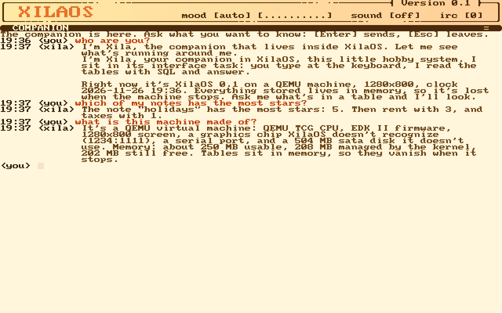

# The companion

XilaOS has a companion: something to ask, at the prompt, which answers
in a few lines, reads the tables to do so, and does what it is asked
to do in them. Its name is Xila.

It does not think here. A question is sent, over HTTPS, to a language
model on the Internet, with what was said before; what the model says
back is the answer. What makes it a companion of *this* system, and
not a window on a chat service, is what it is told and what it may do:
it is told what XilaOS is, it has a way to look at the machine it
lives in, and another to type at its prompt.

> **What is asked leaves the machine.** A question, the last turns of
> the conversation and the rows of every table the companion looked at
> to answer are sent to the model's server. They travel sealed (TLS),
> and the server reads them: that is what it is for. Do not ask it
> about tables that must stay here.

> **It acts by itself.** What the model asks to run is run, without a
> question to the user first. A model can be wrong, and a text it
> reads in a table can steer it: see [what holds it](#what-holds-it)
> for what stands between that and the machine, and what does not.

It answers, it reads, it acts, it keeps a few facts from one
conversation to the next, and it can be asked by a program when
something happens.

## Asking

It needs three things: a network that leads to the Internet, a key to
the model's server, and a processor with a source of chance of its own
(the boot log says so on its `Chance` line), without which XilaOS
keeps nothing secret and so asks nothing through TLS.

The key is kept once, and never shown again (see
[Keys to services](03-using-xilaos.md#keys-to-services)):

```
XilaOS|all:/>key set openrouter ********
The key openrouter is kept. It is never shown.
```

Then `ask`, and whatever one wants to know, to the end of the line:

```
XilaOS|all:/>ask how many tasks are running, and what are they?
Three tasks: interface (running, 8%), idle (ready, 92%), and serial shell
(waiting, 0%).
XilaOS|all:/>ask which of my notes has the most stars?
"holidays" has the most stars, 5 (rent 3, taxes 1).
XilaOS|all:/>ask what is your name and where do you live?
I am Xila, and I live inside XilaOS, this little system you are typing at: in
its database, among its tables, one companion for its one user. No files, no
streets; my place is the prompt.
XilaOS|all:/>ask give taxes one more star, and switch to the night theme
Taxes is now at 2 stars, and the theme is night.
```

Those are real answers, from QEMU, each one to four seconds after the
question. On the screen the prompt is free at once: the answer is
written when it comes, under whatever was typed meanwhile, and the
machine goes on living while the model thinks. On the serial port the
prompt waits for the answer, which is what a program that drives the
machine wants. One question at a time: a second one, while the first
is being answered, is refused.

A question is 150 characters at most. An answer is plain text, cut
into lines at spaces; what the model writes outside plain ASCII
becomes `?`, or its plain form for the quotes and dashes of
typographers.

When there is no answer, one line says why: `No key opens the model.
Type key set openrouter and the key.`, `The model's server refused
(401): No auth credentials found.` (in the server's own words), `The
model's server does not answer.`, `What the model's server said is not
an answer.`, `The companion looked again and again without answering:
given up.`, `The companion is off. Type companion on to have it
back.`, or what `net get https://` says of a server it does not
trust.

## Its screen

`Alt`+`2` shows the companion's own screen. What is typed there is for
it, with no `ask` before it, and what is said is written as a
conversation is: the time, who speaks, and what they say under it.



While the model thinks, the line to type on says `(thinking)`; one can
go to the prompt (`Alt`+`0`) and work there meanwhile, and what was
being typed stays. `PgUp` and `PgDn` scroll, `Esc` goes back to the
overview. The answer to a question asked here comes here; the answer
to an `ask` typed at the prompt comes at the prompt.

The screen shows what was said since the machine started. What was
said before is in the table `talk`, and still goes along with the
next question.

## Asked by a program: reacting to what happens

`ask` is a statement like any other, so a program that runs by itself
can ask the companion, and that is how the companion reacts to what
happens: to a change in a table, to the clock, to the machine.

```
on insert into expenses
    if new.amount > 50
        ask is {new.label} at {new.amount} unusual among my expenses?
    end
end

every day at 8:00
    ask sum up what the tables say changed since yesterday
end

on notify network
    ask the network says: {text}. Is there anything I should do?
end
```

Between `{` and `}`, a name or a calculation is replaced by its value:
what the row held, what the event said. The machine tells of itself on
the channels `start`, `network`, `disk`, `tasks` and `memory`
([LISTEN / NOTIFY](04-sql.md#listen--notify)).

Nobody waits for such a question. It takes its turn behind the one
being answered (eight may wait; the ninth is let go, and the log says
so), and what is asked and answered is written on the companion's
screen, under the name of the program:

```
19:36 <on_notify_alerts> the alert says: the disk is full. Anything to do?
19:36 <xila> Nothing to do.
```

Each such question is a call to the model, and so has a price. What
decides how often is the program: an `if`, a channel, an hour.

## What it sees

The model has three tools. The first is `select`: it asks for a query,
the query is run here as it would be at the prompt, and its rows are
sent back. It usually starts with `select * from tables`, then looks
at the columns of the table the question is about, then reads it. One
question is so several calls to the model, six at most, and at most
four uses of its tools in each.

It reads what SQL reads, and nothing else:

- this tool cannot change anything: it goes through the same door as
  the pages for browsers, which only takes `select`;
- it cannot see a key: SQL does not know the table keys are kept in;
- a result is what a result is at the prompt: 32 rows, texts of 48
  characters, and 900 characters of it in all are sent.

## What it does

The second tool is `run`: one line, run as the prompt would run it,
and what the line said is sent back to the model. So the companion
adds, changes and removes rows, makes and drops tables, sets the mood
or the theme, says something on a channel (`notify`), runs a program
of the user's (`run name`).

```
XilaOS|all:/>ask add a note called milk with two stars
Done: note "milk" with 2 stars, id 4, in the notes table.
XilaOS|all:/>select turn, who, text from talk where turn = 1 order by id
   turn  who     text
   1     you     add a note called milk with two stars
   1     select  select * from tables
   1     result  name kind columns rows about tables system 5 14
   1     select  select * from columns where table_name = 'notes'
   1     result  table_name position name type notes 1 id int not
   1     select  select * from notes
   1     result  id label stars 1 rent 3 2 holidays 5 3 taxes 1
   1     run     insert into notes (label, stars) values ('milk',
   1     result  1 row added to notes, with id 4.
   1     xila    Done: note "milk" with 2 stars, id 4, in the not
```

It asks nobody before it does it. It is told to act only when asked
to, to do the least that does it, and to say what it did; being told
is not being held.

### What holds it

Three things, which the author chose on 26 November 2026, and what
they needed to be worth something.

**Everything it runs is written down**, in the stored table `acts`:
the number of the question, the time, the line, and `done` or
`failed`. A line that was refused is there too.

```
XilaOS|all:/>select turn, at, command, went from acts
   turn  at                   command                              went
   1     2026-11-26 22:31:19  insert into notes (label, stars) v.  done
   3     2026-11-26 22:31:27  update notes set stars = stars + 1.  done
   3     2026-11-26 22:31:27  theme night                          done
```

`select` shows the first 48 characters of a line; the row holds it
whole. The table is the user's to read and to empty. The companion
reads it and cannot change it.

**One command stops it.** `companion off`: the question being answered
is given up, those of programs that waited are let go, nothing is
asked of the model and nothing is run for it until `companion on`. It
stays off through a restart (it is one of the
[kept settings](03-using-xilaos.md#settings-kept-between-starts)). The companion may
turn itself off; only who is at the machine turns it on.

**Some things are not for it.** A line the companion runs is refused,
with an error the model reads, when it is:

| What | Why |
|---|---|
| `install` (every form), `disk erase` | They take a disk. |
| `remote on`, `web on` | They open the machine to others. |
| `key` (every form) | Keys are shown to nothing, and it is not for it to set or forget one. |
| `reboot` | |
| `ask`, `companion on` | It does not ask itself, nor turn itself on again. |
| A block: `if`, `while`, `for`, `program`, `on`, `every` | One line at a time. |
| A change to the tables `programs`, `acts` or `companions`; `drop program` | See below. |
| What needs the kernel while it is served: `net ping`, `net get`, `net restart`, `display test`, `disk check`... | The answer would come later, to nobody. |

The author asked for the first two rows. The others were added while
building it, because without them the first two, and the command that
stops it, could be walked around:

- a program that runs by itself is not the companion: one that the
  companion had written into `programs` would have run without any of
  these refusals, and could have turned the companion on again after
  `companion off`. So the companion reads the programs and runs them,
  and does not write them. And, for anybody: `install`, `disk erase`,
  `remote on` and `web on` are refused to a program that runs by
  itself (`on ...`, `every ...`); they are typed at the machine, or by
  a program started there with `run`;
- the row of `companions` says where the model is, and that is where
  the key is sent: a companion that could change it could send the key
  elsewhere;
- `acts` is the record of what it did.

**What does not hold it.** Everything else at the prompt is its own to
run: `drop table` on the user's tables, `delete from` without a
`where`, `notify` on a channel a program waits on, `run` of any
program. Nothing asks the user first, nothing is undone afterwards,
and there are no access rights yet to say which tables are its own. A
text in a table, or in the answer of a question a program asked with
the values of an event in it, can tell the model to do such things,
and a model may follow it. Keep a companion that acts away from tables
whose rows come from elsewhere, or turn it off.

## What it remembers

The third tool is `remember`: one sentence, kept in the stored table
`remembered` with the time. The last twenty are told to the model
again with every question, after what it is told of itself, so that
they outlive the conversation: `delete from talk` forgets what was
said, not what was remembered.

```
XilaOS|all:/>ask remember that I count stars from one to five
Kept: note stars go from one to five.
XilaOS|all:/>select at, text from remembered
   at                   text
   2026-11-26 22:31:25  The user counts note stars from one to five.
```

A fact holds 200 characters. The table is the user's: `delete from
remembered where id = 1` makes it forget one thing, and a row added by
hand is a thing it will be told. There is no search in it and no index
of meanings: twenty short lines are read whole.

## What is said is kept

Everything goes into a stored table, `talk`, one row for each thing
said, under the number of the question it belongs to:

```
XilaOS|all:/>select turn, who, text from talk order by id
   turn  who     text
   1     you     how many tasks are running, and what are they?
   1     select  select count(*) from tasks
   1     select  select * from tasks
   1     result  count 3
   1     result  id name state ran_ms share 0 interface running 2
   1     xila    Three tasks: interface (running, 8%), idle (read
   2     you     which of my notes has the most stars?
   2     select  select * from tables
   2     result  name kind columns rows about tables system 5 12
   2     select  select * from columns where table_name = 'notes'
   2     select  select * from notes
   2     result  table_name position name type notes 1 id int not
   2     result  id label stars 1 rent 3 2 holidays 5 3 taxes 1
   2     xila    "holidays" has the most stars, 5 (rent 3, taxes
```

`you` is what was asked, `xila` what the companion said (`more` for
what did not fit in one row), `select` a query it asked for, `run` a
line it ran, `remember` a fact it kept, and `result` what came of
each. The texts are longer than SQL shows: a row
holds up to 900 characters, and `select` gives the first 48, with a
space for each line break, as it does for the lines of `programs`.

The last six turns go along with each new question, which is how the
companion knows what "and the other one?" is about. The table is the
user's: `delete from talk` makes it forget.

## Who it is

A row of another stored table, `companions`, made at the first
question:

```
XilaOS|all:/>companion
   item                value
   name                Xila
   model               deepseek/deepseek-v4.1-flash-1017
   at                  https://openrouter.ai/api/v1/chat/completions
   key                 openrouter: kept
   now                 nothing asked
   calls to the model  6
   queries run for it  5
   lines it ran        0
```

| Column | What it is |
|---|---|
| `name` | What it is called, and told it is called. |
| `place` | Where its model is asked: any server that speaks the chat completions form of OpenAI. |
| `model` | Which model, as that server names it. |
| `key` | The name of the key that opens it (`key set`), not the key. |
| `character` | A few words about how it is to be, added to what it is told. |

All of it changes with `update`: `update companions set model =
'...'`, `update companions set character = 'You are wary and brief.'`.
The table can also be made by hand before the first question, with
those five text columns. Only its first row is read: the others are
for the companions to come. The companion itself reads this table and
does not change it.

The key goes out only where the way is sealed. A place that starts
with `http://` gets no key, and needs none to be asked: that is how
the checks speak to a made-up model on the development machine.

## How it is built

`core/src/companion.rs` has no network in it. `ask` takes a question,
writes it in `talk` and sets the companion to `Calling`; `request`
writes what is sent to the model, JSON, into a buffer; `heard` takes
what came back, keeps what the model said, does what it asked for and
keeps what came of it, and either leaves the companion `Calling`, for
one more round, or ends the question with an `Outcome`. A query goes
to `sql::select` on a `&System`, a reference that allows no change. A
line to run goes to `companion::act`, which runs it as a program that
runs by itself would (`lang::line`, with names of its own), with
`System::acting` set: the commands that are not for the companion look
at it and refuse themselves, `shell::change` refuses the tables that
hold it, a request left for the kernel is taken back, and the row of
`acts` is written after the line, whatever came of it.

The kernel carries the bytes, a little at each tick of the interface
task (`companion` in `kernel/src/main.rs`), as it does for the pages
for browsers: it finds the address of the server by its name, starts a
TLS client and an `Ask`, steps them until the answer is whole, hands
it to `heard`, and starts again if the companion is still `Calling`.
Nothing waits in a loop, so the keyboard, the screen and the serial
port go on. The session that asked is told when the outcome is there
(`companion::tell`): the screen at its next tick (at the prompt, or in the conversation of
the companion's screen when it was asked there), the serial task by
looking at each tick before it writes its status line.

`core/src/json.rs` writes and reads JSON without a heap: writing goes
straight into the buffer, and reading finds a value under a name or at
a place in a list in the bytes as they are, with no tree. The buffers
for a question and its answer, 48 KB and 64 KB, are made by the kernel
on its heap at the first question.

The conversation sent to the model is rebuilt from the rows of `talk`
at each call, since the rows are all there is: a row `xila` followed
by rows `select`, `run` or `remember` is one message of the model with
what it asked for inside, and each `result` is the message that
answers one of them, under a number made from the number of its row.

What the model is told before anything else is in `companion.rs`
(`TOLD`): that it lives in XilaOS, that XilaOS is not a Unix, what the
tables are and how small the SQL is, when to act and what is refused,
what its memory is for, and to answer briefly in plain ASCII. The
tool that remembers was first called `note`: the model then took the
user's table `notes` for its own memory, and wrote there what was
meant for it; the name and two sentences of `TOLD` come from that.

It is checked against a made-up model on the host, which answers what
the checks tell it to (a query to run, a line to run, a fact to keep, an answer, a refusal,
a pause), and against the real one when a key and the Internet are
there. That the refusals hold is checked with the made-up model, which
asks for what a real one declines to try.

## What is left

- Access rights: which tables are the companion's to read and to
  change. Until then it reads and changes every table but the three
  that hold it.
- A way to undo what it did, and a way to be asked before it does
  what cannot be undone.
- A cap on what it spends: nothing counts the calls a program causes.
- Being asked from the prompt over the network, and a way for a
  program to use the answer: today it is only shown.
- Longer questions and answers, results that are not cut, a
  conversation that is summed up instead of losing its oldest turns,
  and a memory that is searched instead of told whole.
- The other companions: more rows of `companions`.

What it costs is the model's price for each call; nothing here caps
it.

On a real machine it was tried once, on 27 November 2026, on the
T430: asked by a program, it read a table, made one, kept a fact, was
refused `web on`, and was stopped and had back. Its questions went
through a relay on the development machine, which held the key: a key
kept on the T430 itself, and `ask` typed there with an answer, are
not tried yet. [Status and roadmap](13-status-and-roadmap.md) says
how.
